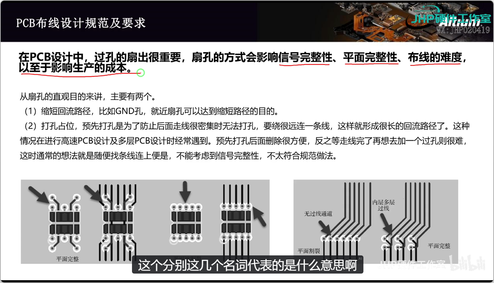
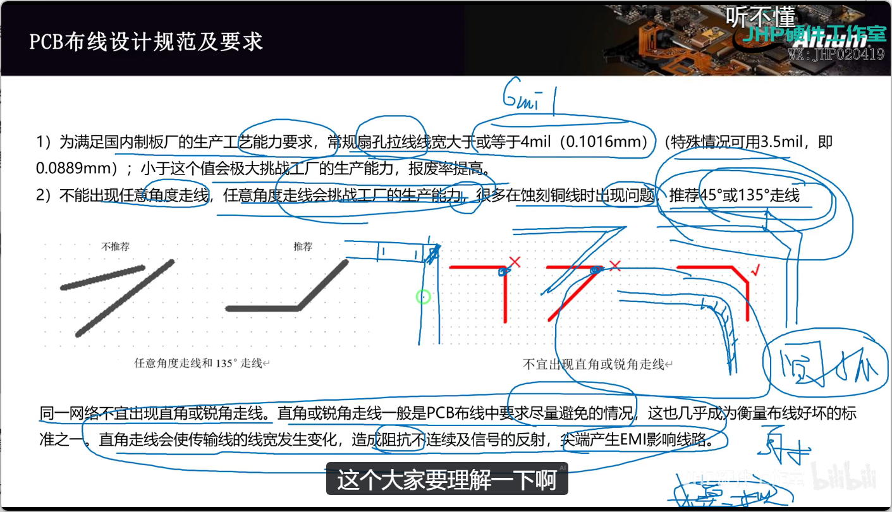
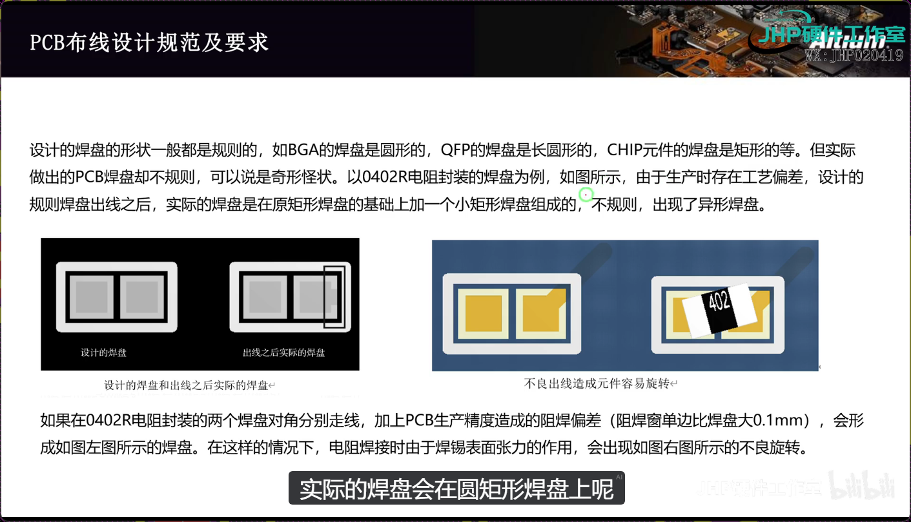
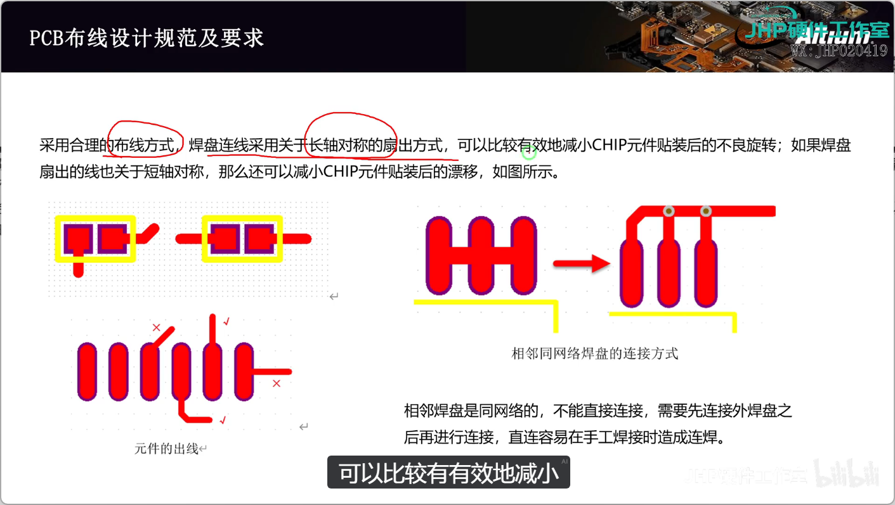
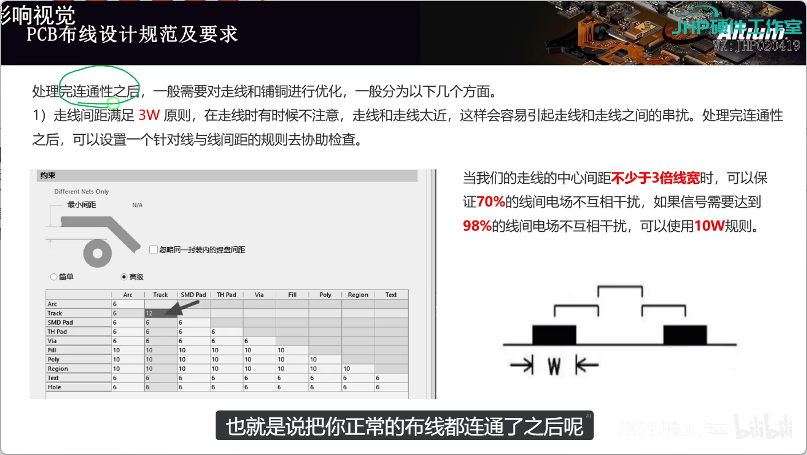
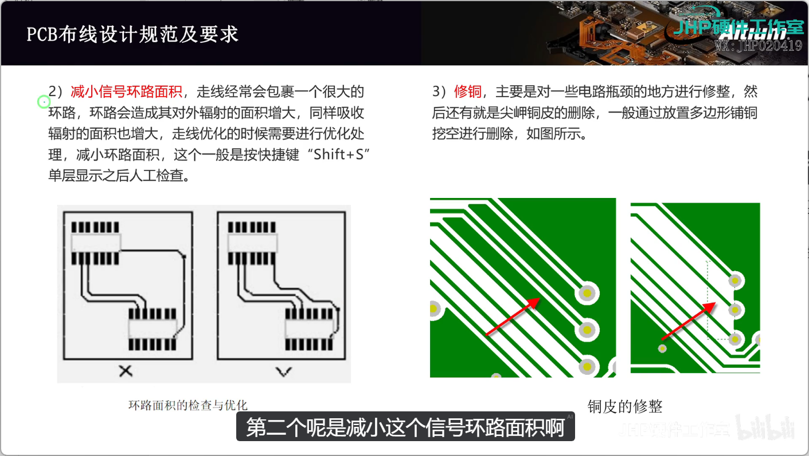

# 布线注意事项
1. DRC不是万能 ，有些问题需要进行注意 
## 扇孔
1. 目的：缩短回流路径，就近扇空可以达到缩短路径的目的（**回流路径的长短直接决定了信号环路的面积与寄生电感，路径越长，信号失真越严重、对外辐射（EMI）越大、抗干扰能力越差。**）
2. 打孔占位，预先打孔是为了防止后面走线很密集时无法打孔。要绕很远连一条线
## 走线

 1. 线宽：信号线建议：6mil
 2. 走线角度：推荐45度和135度（生产不好生产，阻抗不连续）
 3. 当走线对阻抗要求特别高的时候：圆弧走线（模拟信号）
## 焊盘形状

1. **阻焊层本身就是绿油，走线盖绿油起保护作用，焊盘位置需“开窗”裸铜以便焊接；而所谓的“异形焊盘”是你在画封装时人为设计的形状，绝不是被绿油“咬”出来的。**  尽量不要斜角走线，顺着焊盘走线
2. 合理的布线方式：焊盘连接采用关于长轴对称的扇出方式，可以比较有效减小CHIP元件贴装后的不良旋转；如果焊盘扇出的线也关于短对称，还可以减少CHIP元件贴装后的漂移
## 走线和铺铜的优化
处理完连通性之后，一般需要对走线和铺铜进行优化，一般分为以下几个方面。
1. 走线间距满足3W原则，在走线时有时候不注意，走线和走线太近，这样会容易引起走线和走线之间的串扰。处理完连通性之后，可以**设置一个针对线与线间距的规则去协助检查**。
	- 3W原则：当我们的走线的中心间距不少于3倍线宽时，可以保证70%的线间电场不互相干扰，如果信号需要达到98%的线间电场不互相干扰，可以使用10W规则。比如当线宽是6mil时候，间距为12mil即可，当然一般走线不需要要求这么高，但是一些重要信号线，就需要遵循3W原则
	- 对于要求3W原则的线，可以建一个class，然后针对对应导线将间距改成12mil（线宽为6mil时候）
2. 减小信号环路面积：走线经常会包裹一个很大的环路，环路会造成其对外辐射的面积增大，同样吸收辐射的面积也增大，走线优化的时候需要进行优化处理，减小环路面积，这个一般是按快捷键“Shift+S”单层显示之后人工检查。
3. 修铜：主要是对一些电路瓶颈的地方进行修整，然后还有就是尖岬铜皮的删除，一般通过**放置多边形铺铜挖空进行删除**
## PCB布线的顺序
1. 完成可模块内部的走线，确定与外部连接的是那些线，是什么性质
2. 处理模块之间的重要信号线（例如：模拟线，高速数据线等）
3. 处理模块之间常规的信号线（例如：控制线，低速线等）
4. 处理模块之间的电源线（例如：VCC,GND等）
# 模块内部走线（电源1）
# 模块内部走线（电源2）
# 模块内部走线（MIC）
# 模块内部走线（H桥电机驱动）
# 模块内部走线（红外避障电路）
# 模块内部走线（MCU）
# 模块内部走线（重要信号线）
# 模块内部走线（常规信号线）

