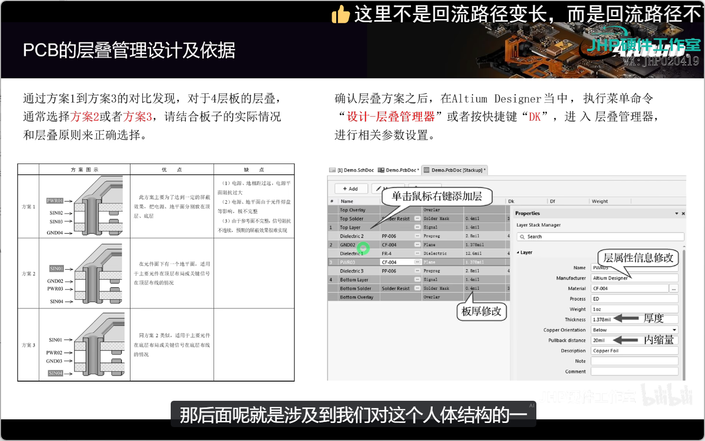

封装尺寸元器件尺寸 

贴片电阻  实际设计时候封装要比电阻大一点 

封装库 
原理图库 
安装封装库
# AD各层的含义
top layer - 顶层
bottom layer -底层
mechanical,机械层：板框层
keepoutlayer禁止布线层：约束铜皮

top overlay顶层丝印层
bottom overlay底层丝印层

top paste顶层助焊层：开钢网的时候使用
bottom paste底层助焊层

top solder顶层阻焊层：绿油
bottom solder底层阻焊层

drill guide 过孔引导层：
drill drawing 过孔钻孔层
multilayer多层：整个电路板
# PCB层叠管理设置及其依据
1. 一阶HDI板的流程: 开料—内层—AOI—棕化—子板压合—钻埋孔—埋孔沉铜—埋孔电
镀—树脂塞孔—磨树脂—次外层线路—次外层AOI—次外层棕化—外
层压合—X-RAY钻靶—言孔开窗—锰射—外层钻孔—外层沉铜—外层
电镀—外层线路—同其他板流程.
2. 普通多层板流程：
开料—内层—AOI—棕化—压合—钻孔—沉铜—电镀—外层线路—
同其他板流程
3. 判断因素：成本，PCB板的，布局走线密度，BGA深度，信号考虑（回路，串扰（信号线之间互相干扰））
4. 板的层数不是越多越好，也不是越少越好，确定多层PCB的层叠结构需要考虑较多的因素。从布线方面来说，层数越多越利于布线，但是制板成本和难度也会随之增加。生产厂家来说，层叠结构对称与否是PCB制造时需要关注的焦点。所以，层数的选择需要考虑各方面的需求，以达到最佳的平衡。
5. 对有经验的设计人员来说，在完成元件的预布局后，会对PCB的布线瓶颈处进行重点分析，再综合有特殊布线要求的信号线（如差分线、敏感信号线等）的数量和种类来定信号层的层数，然后根据电源的种类、隔离和抗干扰的要求来确定内电层的层数。这样，整个电路板的层数就基本确定了。
6. 层叠设计方案选择依据：
	- ①元件面、焊接面为完整的地平面(屏蔽)
	- ② 尽可能无相邻平行布线层。
	- ③ 所有信号层尽可能与地平面相邻。
	- ④ 关键信号与地层相邻，不跨分割区。
7. 层叠设计优缺点

