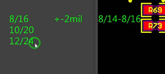
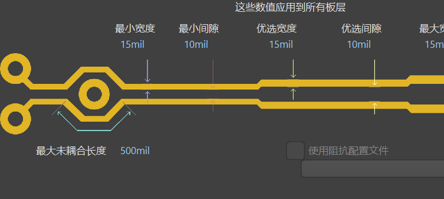

# 间距规则的设置
1. 铺铜 
2. 填充
3. 实心区域

|      | 铺铜                                                 | 填充                                   | 实心区域                                 |
| ---- | -------------------------------------------------- | ------------------------------------ | ------------------------------------ |
| 形状   | 任意多边形                                              | 仅限矩形                                 | 任意多边形                                |
| 智能避让 | **自动避让**。严格遵循设计规则，自动与不同网络的焊盘、走线保持安全间距              | **完全无视**。直接覆盖，极易造成短路                 | **基本无视**。早期版本直接覆盖，新版本可关联网络但避让能力依然很弱。 |
| 动态更新 | **是 (动态)**。移动走线/器件后，重新铺铜（`Shift+B`）即可自动适应新布局       | 否，形状固定，需手动修改                         | 否，形状固定，手动修改                          |
| 网络连接 | **智能连接**。自动连接到相同网络的焊盘/过孔，并可通过规则精细控制连接方式（如十字连接、全连接） | **需手动赋予网络**。放置在信号层后可连接到一个网络，但不会智能识别。 | 可关联网络，但智能性弱，主要用于造型而非规范连接             |
# 线宽规则的设置
![[image-1793333594147.png]]
1. 宽度：
	- 首选宽度：
	- 最小宽度
	- 最大宽度
2. 线
	- 电源线：过流 /载流  要求粗        
	- 信号线：
		- 低速信号：6mil
		- 高速信号: 由阻抗来确定
# 过孔规则的设置
1. 直径
	- 盘直径
	- 孔直径
	- 推荐：8/16，10/20，12/24
# 差分规则的设置

1. 线宽 
	- 最小线宽
	- 优选线宽
	- 最大线宽
2. 线距
	- 最小线距
	- 优先线距
	- 最大线距
3. 这个线宽是由具体阻抗来计算的（[嘉立创阻抗计算神器](https://tools.jlc.com/jlcTools/index.html#/impedanceCalculateNew)）
4. 为啥要走差分线：
	- 一根线：当外界有干扰的时候，信号传输会出现错误
	- 两根线：差分线传输的是一对振幅相同、相位相反的信号，接收端只看两根线之间的电压差，而不看单根线对地的绝对电压；外界电磁干扰、串扰和地噪声作用在靠得很近的两根平行线上时，会以几乎等值、同相的方式叠加，变成共模信号，而差分接收端做减法时有用信号因反相被保留甚至翻倍，共模干扰因同相被抵消，所以抗干扰的本质是“共模抑制+差模提取”；但这一切成立的前提是两根线必须**紧耦合**，让它们经历几乎相同的电磁环境，干扰才能高度对称地变成共模，同时两根线必须**等长**，本质是保证反相信号在时间上严格对齐、不因相位偏差把共模噪声泄漏成差模噪声，因此经典表述不是“控制两根线的距离差”，而是“**等长+紧耦合，让干扰变成共模，再在接收端用减法把它扔掉**”，紧耦合还附带让两根线反向电流产生的电磁场相互抵消，从而抑制对外辐射EMI。
 