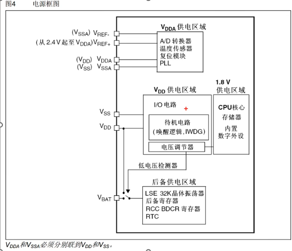
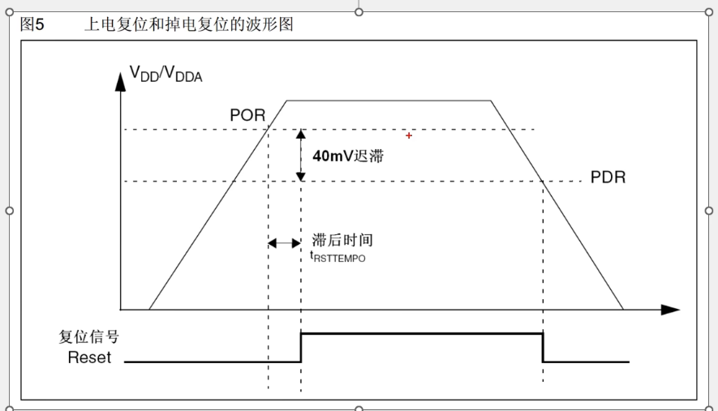
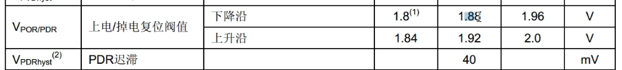
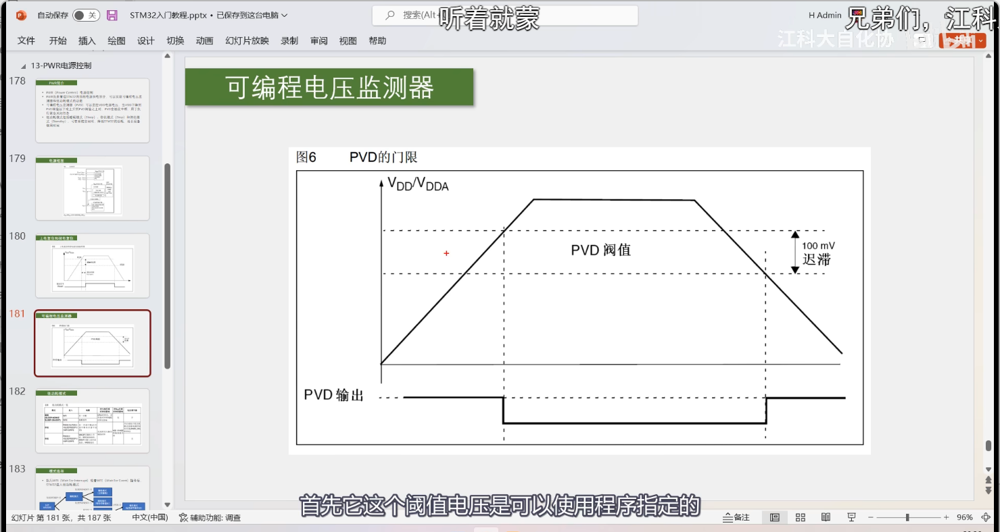
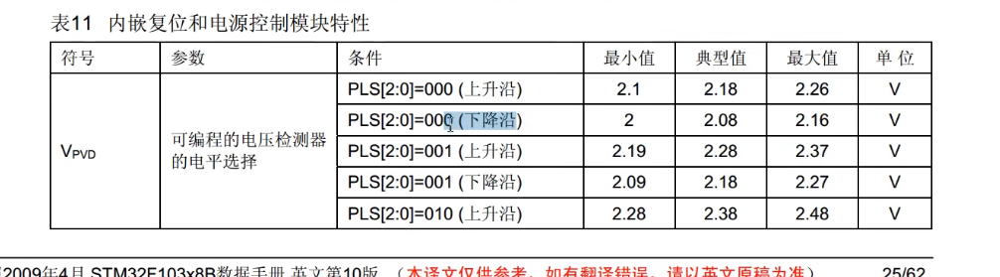
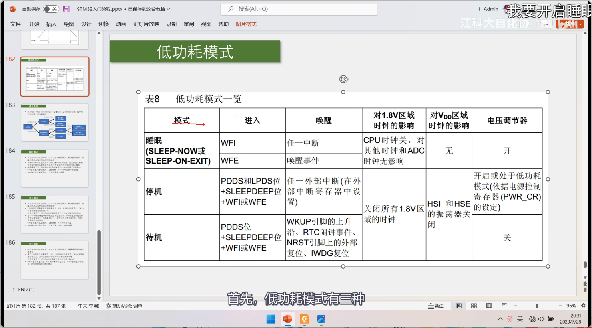

# 1.1 STM32供电方案

1. 模拟部分供电
2. 数字部分供电（VDD供电区域，1.8V供电区域（CPU核心，存储器，内置数字外设））
3. Vbat后备供电
# 1.2 上电复位和掉电复位
1. 当VDD或者VDDA电压过低时，内部电路直接产生复位，使stm32复位，不乱操作
2. 40mV迟滞：
	- **下降沿（掉电）：** 当电源电压下降至 PDR（Power-Down Reset）触发阈值时（1.88V），芯片触发复位。此时对应的电压是一个**上限**（电压低于此值即复位）。
	- **上升沿（上电）：** 当电源电压上升至 POR（Power-On Reset）释放阈值时（1.92V），芯片解除复位。此时对应的电压是一个**下限**（电压高于此值即正常工作）。
    - **迟滞（Hysteresis）：** 上升沿释放阈值与下降沿触发阈值之间存在差值，典型值为 40mV。该迟滞窗口可有效防止电源在临界点波动时导致芯片发生反复复位（系统震荡）。
    - **滞后时间**：电源电压达到门槛后，芯片偷偷给自己留出的“热身时间”。在这个时间内，`Reset` 信号保持低电平，死死压住 CPU 不让它动，等内部时钟、电压、存储器全部就位，才松开手，让程序正式开始跑。
    - 上电延迟是为了“求稳”等内部电路就绪再开机，掉电瞬间复位是为了“保命”防止低压下逻辑错乱或损坏数据。所以掉电是没有滞后时间的
	- （上升沿-下降沿）正好就是40mV的迟滞
	- 
# 1.2 可编程电压检测器
1. 阈值电压可以使用程序指定的，自定义调节
2. 3.3V正常供电，电压在2.2V~2.9V的时候是PVD监测范围，可以通过PVD设置一个警戒线，电压降低1.9V就是复位电路的检测范围，如果再低，就直接复位了
# 1.3 低功耗模式
1. 从上到下越省电，同时也越难唤醒
2. 关闭电压调节器相较于关闭时钟更加省电
3. PDDS等于0进入停机模式，等于1进入待机模式
4. 睡眠模式（CPU时钟关闭）
	- 调用WFI，任意**中断**都可唤醒，要进入被唤醒的中断执行任务    
	- 调用WFE，要由**唤醒事件**才能进行唤醒，唤醒后继续执行，不需要执行中断函数
	- 两种调用对电路的影响都是将**CPU时钟关闭**，使得CPU内部数字逻辑信号停止翻转，导致CPU关闭
	- 特性：
		- 执行完WFI/WFE指令后，STM32进入睡眠模式，程序暂停运行，唤醒后程序从暂停的地方继续执行
		- SLEEPDEER位决定STM32执行完WFI或者WFE后，是立刻进入睡眠，还是等到STM3从最低优先级的中断处理程序中退出时进入睡眠
		- 在睡眠模式下，所有I/O引脚都保持他们在运行模式时的状态
		- WFI指令进入睡眠模式，可以被任意一个NVIC响应的中断唤醒
		- WFE指令进入睡眠模式，可被唤醒事件唤醒
5. 停止模式
	- PDDS为0进入停机模式
	- LPDS用于设置电压调节器，等于0用于开启，等于1进入低功耗
	- 唤醒：任意外部中断（在外部中断寄存器中设置）
	- 停止模式对电路的操作：关闭1.8V区域时钟，HSL和HSE的振荡器关闭，电压调节器这个部分可以开启或者处于低功耗模式，低功耗省电，但是唤醒时间长
	- 特性：
		- 执行完WFI/WFE指令后，STM32进入停止模式，程序暂停运行，唤醒后程序从暂停的地方继续执行
		- 1.8V供电区域的所有时钟都被停止，PLL，HSI和HSE被禁止，SRAM和寄存器内容被保留下来
		- 在停止模式下，所有I/O引脚都保持他们在运行模式时的状态
		- 当一个中断唤醒事件导致退出停止模式时，HSI会被选为系统时钟
6. 待机模式
	- PDDS为1进入待机模式，SLEEPDEER为1即将深度睡眠
	- 唤醒：普通外设中断和外部中断，都无法唤醒待机模式，只有指定的信号能唤醒
	- 对电路的操作：关闭1.8V区域时钟，HSL和HSE的振荡器关闭, 同时电压调节器关闭，这个就意味着1.8V电源关闭，这个就导致内部存储器和寄存器数据全部丢失
7. 库函数已经封装好，不用自己配置![[image-1792413957699.png]]

34.58

