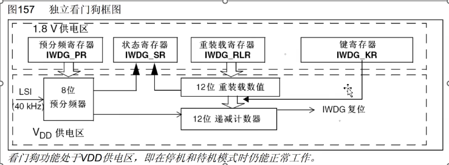
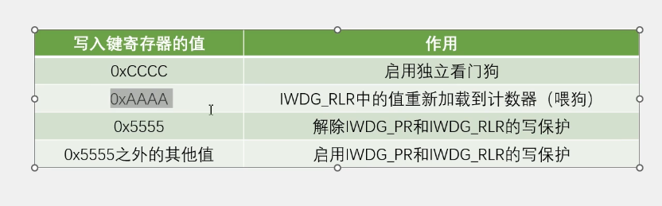
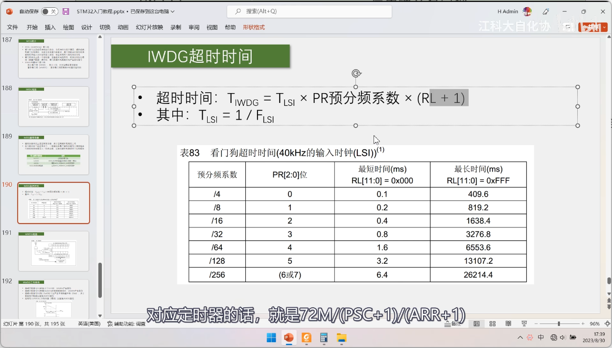
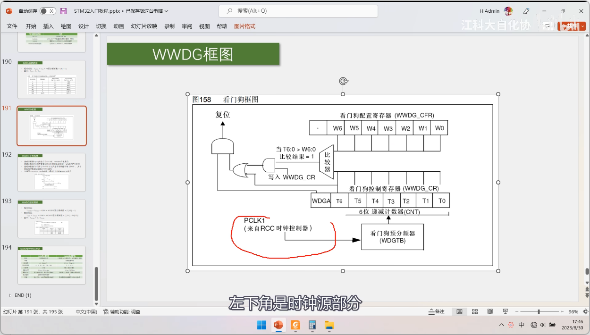

# 看门狗简介
1. WDG（Watchdog）看门狗
2. 看门狗可以监控程序的运行状态，当程序因为设计漏洞，硬件故障，电磁干扰等原因，出现卡死或跑飞现象时，看门狗能及时复位程序，避免程序陷入长时间的罢工状态，保证系统的可靠性和安全性
3. 看门狗本质上是一个定时器，当指定时间范围内，程序没有执行喂狗（重置计数器）操作时，看门狗硬件电路自动产生复位信号
4. STM32内置两个看门狗
	- 独立看门狗（IWDG）：独立工作，对时间精度要求较低
	- 窗口看门狗(WWDG)：要求看门狗在**精确计时窗口**（喂狗有时间界限，必须在时间界限中喂狗）起作用
# 独立看门狗（IWDG）框图
1. 类比定时器时基单元，输入时钟内部低速时钟，预分频器进行分频，时钟驱动递减计数器
	1. 输入时钟（内部低速时钟，时钟进入预分频器进行分频，时钟驱动递减计数器，自减到0就会产生IWDG复位，）
	2. 看门狗也能在停机和待机中工作
# IWDG键寄存器
- 键寄存器本质上是控制寄存器，用于控制硬件电路的工作
- 在可能存在干扰的情况下，一般通过在整个寄存器写入特定值来代替控制寄存器写入一位的功能（独立看门狗工作的环境，如何设置一个位，这个环境可能会干扰这个值，这个时候，通过在整个寄存器中写入一个特定值，键寄存器十六位，但是变成这个特定值的可能性非常小，同时这个特定值也是1，0交替），以降低硬件受到干扰的概率
	- PR,SR,RLR也是寄存器，也要有放置误操作的功能，可以设置一个写保护的功能，只有键寄存器写入特定的键值才会解除写保护，这样其他寄存器就可以和键寄存器一起保护起来
# IWDG超时时间

1. 超声时间：LSI输入时钟（40KHz）,通过计算得到得到两个输入时钟的时间间隔，预分频器假如为16，那么就意味着，只有进行十六次两个输入时钟的时间间隔，才会使寄存器加1，同时乘于这个(RL+1)计数周期数，这样就可以得出这个超时时间
2. 最短时间和最长时间就是由这个预分频系数和这个RL（计数周期）所决定的
# WWDG（窗口看门狗）框图

1. 工作流程：时钟来源（PCLK1默认使36KMz,然后经过预分频器调整分频系数，然后经过6位递减计数器，最高位T6是溢出标志位，通过自减，直到这个溢出标志位为0，这个时候就会产生复位信号
2. 复位信号输入部分（WDGA）
3. 最早界限 看门狗配置寄存器，喂狗的时候把当前计数值与预设的计数值进行比较
4. 喂狗太晚，看门狗计数寄存器（六位计数器）为0，进行复位，喂狗太早，计数器的值超过窗口值，进行复位
# WWDG（窗口看门狗）的工作特性

