# 1.1 GPIO的4种输出模式
1. 结构框图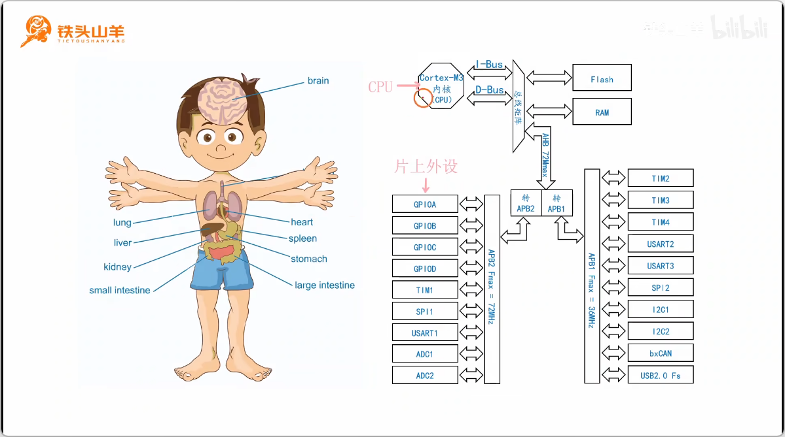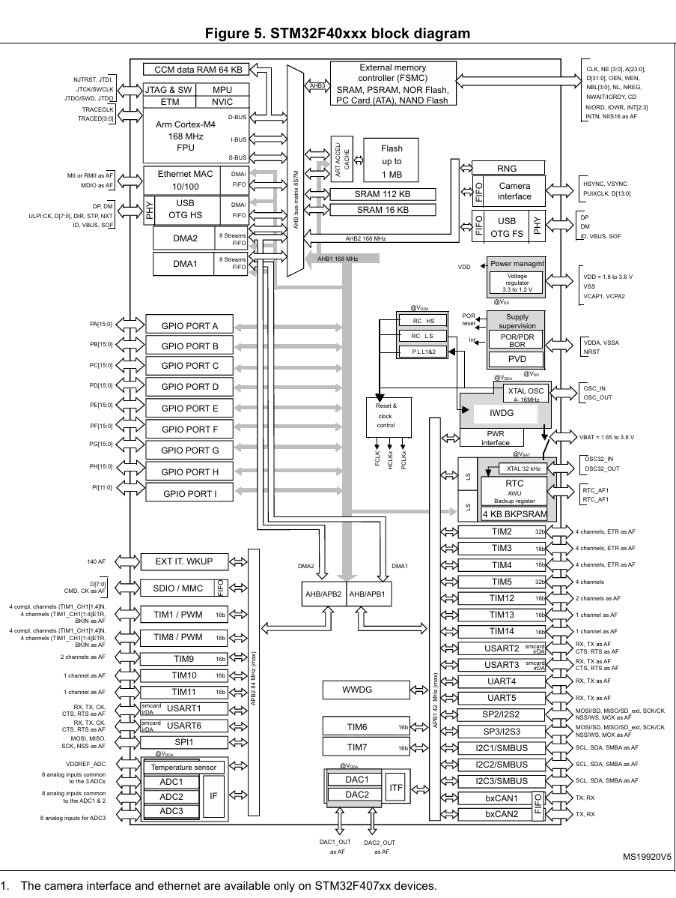
	- 八边形Cortex-M3: GPU,负责计算
	- 片上外设：每一个片上外设能完成一个独立的任务 
2. 封装类型是LQFP48，48个引脚，普通IO引脚就是分成四组A.B,C,D，GPIO相当于四个手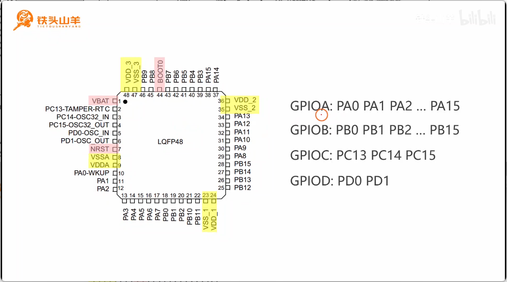
3. GPIO八种模式：
	 - 输入：通用输出推挽，通用输出开漏，复用输出推挽，复用输出开漏
	 - 输出：输入上拉，输入下拉，输入浮空，模拟模式
	 - 示例图：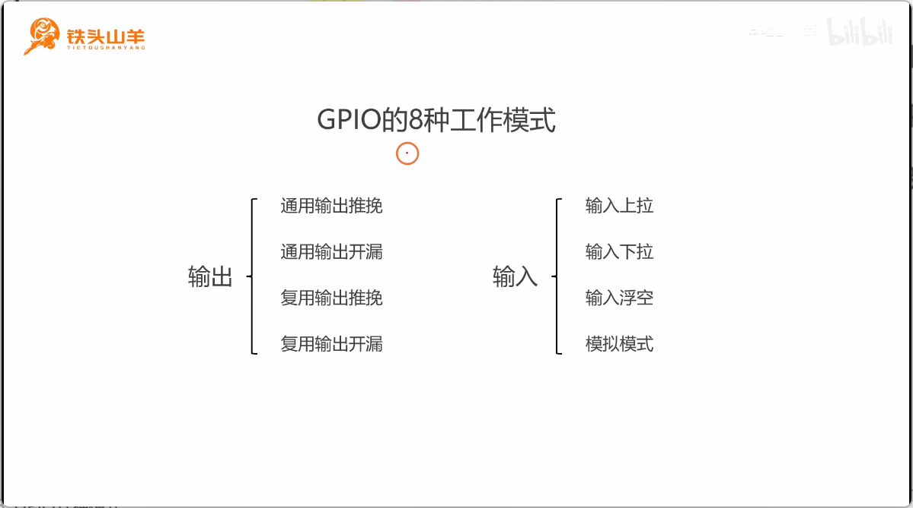
4. 输出和输入：小方框表示IO引脚，芯片内部有两个寄存器（输出数据寄存器，输入数据寄存器），输出和输入的区别就是信号的方向不同和寄存器类型不同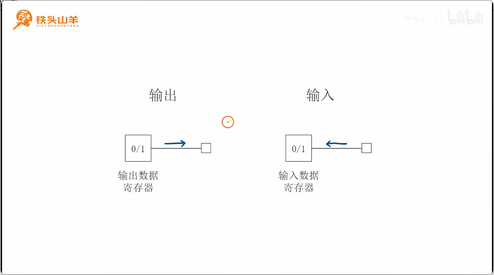
## 1.1.1 输出模式
1. 四种模式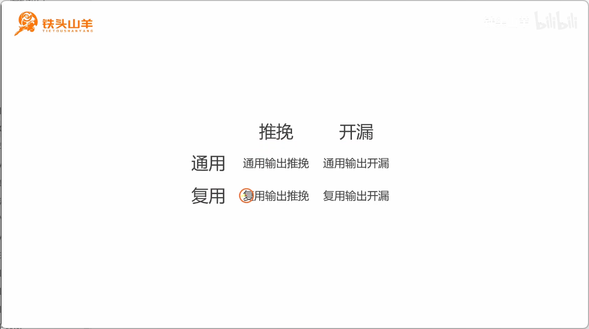
2. I/O端口位的基本结构，分成两部分 两个部分  单片机有48个引脚，其中37个是普通的引脚，都是下面的基本结构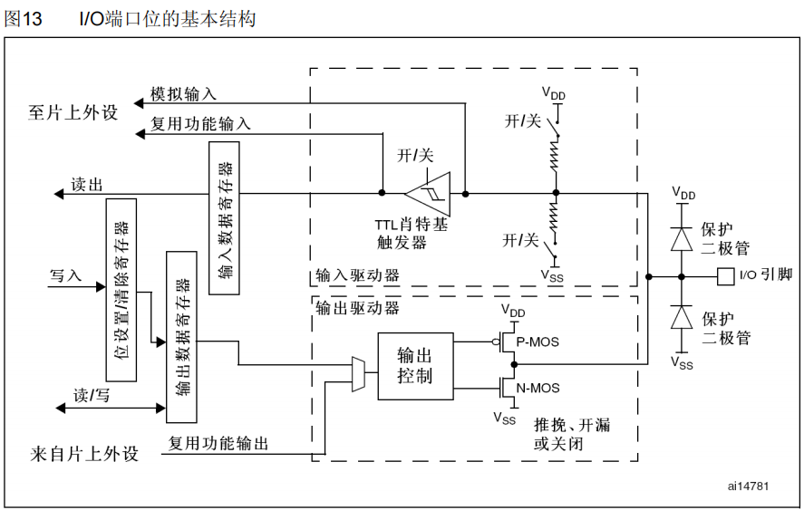
3. 输出简化图：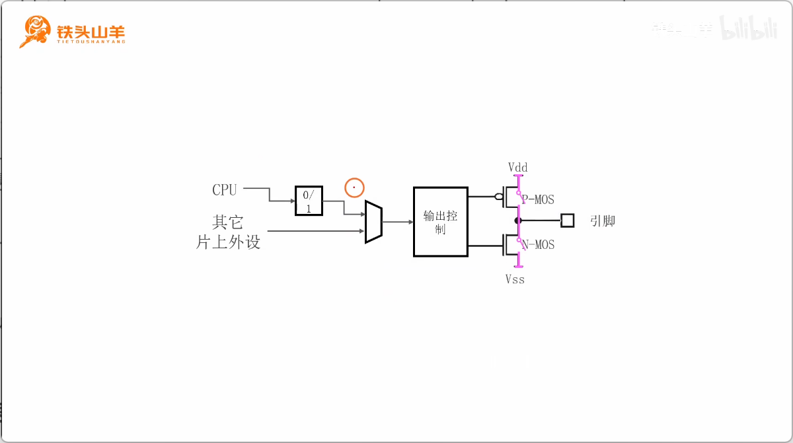
4. 通用/复用：说的是这个引脚由谁控制
5. 推挽/开漏：说的是这个引脚怎么输出高低电平
## 1.1.2 推挽（Push-Pull）&& 开漏（Open-Drain）
### 1.1.2.1 推挽（Push-Pull）
1. 推挽基础概念：推挽主要是和和下图的MOS管有关
	 - 推 - push - 向外推电流 - 和示意图上面的P-MOS有关 ：当P-MOS开关闭合，N-MOS开关断开时，IO引脚通过上面的开关和Vdd相连，`Vdd`是高电压，所以电压从高电压向低电压流，电流方向就是Vdd流向IO引脚，也就是所谓的**向外推电流**
	 - 挽 - Pull - 从外面向里面拉电流 - 和示意图上面的 N - MOS 有关，当P-MOS开关断开，N-MOS开关闭合时，IO引脚通过下面的开关和Vss相连,`Vss`是低电压，所以电压从高电压流向低电压，电流方向就是IO引脚流向Vss，也就是所谓的**从外面向里拉电流**
	 - `P-MOS`和`N-MOS`**交替导通**，不能同时闭合（同时闭合，高电压和低电压通过一根导线连接，直接短路）
	 - 例子：单片机中IO引脚设置为推挽：向输出控制寄存器写0/1，
		- 写0时，N-MOS导通，P-MOS关断，IO引脚连接Vss，低电压
		- 写1时，N-MOS断开，P-MOS导通，IO引脚连接Vdd，高电压
	- 推挽像你自己能控制门
		- 你想关门：主动关上
		- 你想开门：主动打开
		- 想高就主动拉高
		- 想低就主动拉低
	 - 示意图：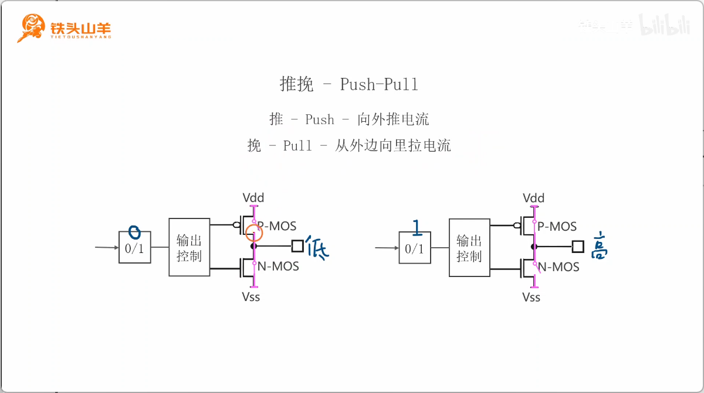
### 1.1.2.2 开漏（Open-Drain）（P-MOS被干掉）
1. MOS结构分析：三个部分组成（漏极，栅极，源极）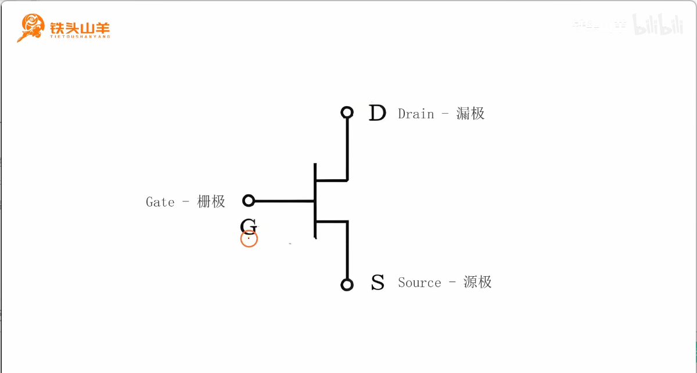
2. 开漏模式：所谓开漏就是漏极断开的一种模式（**上面的P-MOS一直保持断开**，只剩下下面一个N-MOS管，这个时候就相当于上面的漏极（D）断开了，如下图）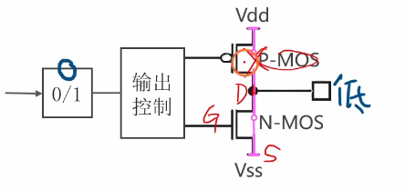
3. 例子：当把单片机的IO引脚设置为开漏模式的时候，向输出控制寄存器写0/1，
	- 向寄存器写0时，下面的N-MOS闭合，输出低电平，同推挽模式类似
	- 向寄存器写1时，下面的N-MOS断开，两个MOS都断开，IO引脚悬空，无论给IO引脚多大的电压，IO引脚的电流恒等于0，由欧姆定律得电阻无穷大，即高阻抗，所以，开漏模式下写1时，既不会出现高电压，也不会出现低电压，而是会出现高阻抗
## 1.1.3 通用&&复用
1. 通用和复用区别就是控制输出的时CPU还是其他片上外设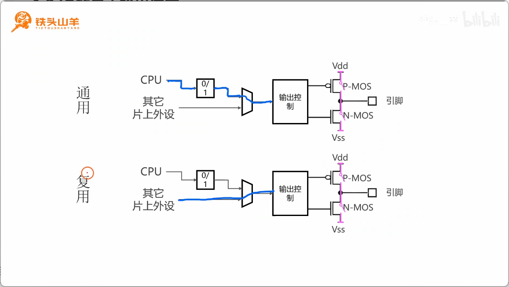
2. 例子
	- 通用：引脚由**你写代码（CPU）**直接控制高低电平
	- 复用：引脚交给**芯片内部的外设硬件（如串口、SPI）**去自动控制
	- 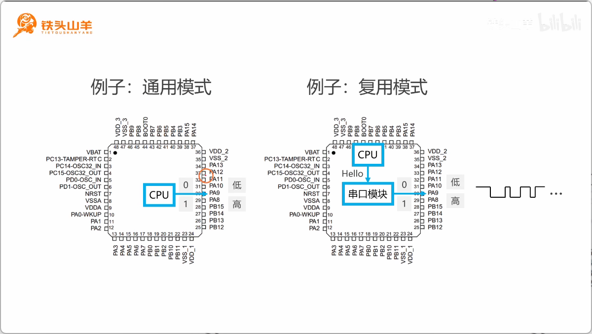
## 1.1.4 总结
1. **推挽能强上强下，开漏只能下不能上；通用听CPU，复用听外设**
# 1.2 IO的最大输出速度

## 1.2.1 什么是IO的最大输出速度
1. IO最大输出速度：向IO交替写0和1输出**不失真**的最快速度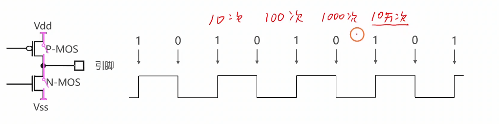
## 1.2.2 上升时间，下降时间和保持时间的概念
1. 高低电平的转换并不是一蹴而就的；这其中包括上升时间，保持时间，下降时间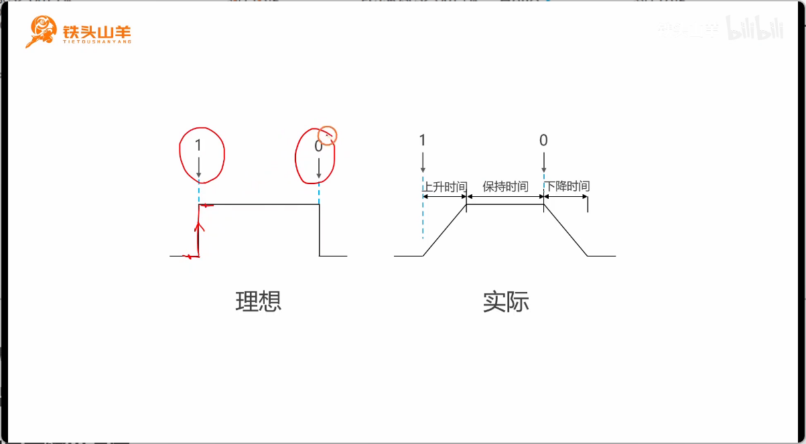
## 1.2.3 什么限制了IO的最大输出速度
1. 限制IO引脚最大输出速度因素：上升时间和下降时间的长短
2. 如下图：
	- 当这个输出速度比较慢的时候，上升时间和下降时间两个斜坡的距离比较长，有效电压时间（中间的保持时间）比较长
	- 加快写0和写1的速度，上升时间和下降时间两个斜坡的距离变小，有效电压时间（中间的保持时间）变短
	- 保持写0和写1的速度，同时保证输出的波形是正常的，这个时候就需要缩短上升时间和下降时间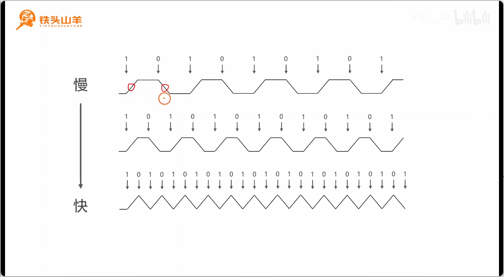

## 1.2.4 最大输出速度应该如何选择
1. 三种最大输出速度：低速（最大输出速度2MHz），中速(10MHz)，高速(50MHz)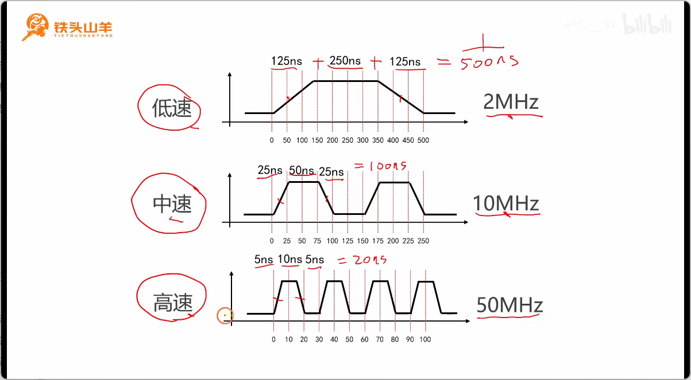
2. 选取原则：**选取满足要求的最小值**，过于陡峭的边会增加耗电，并引入EMI问题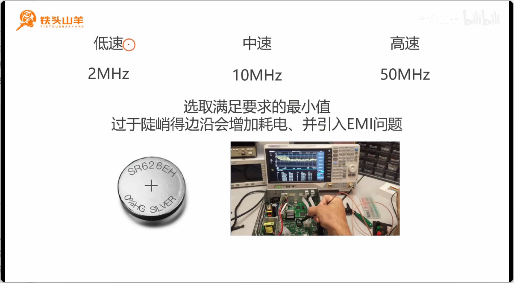
3. 应用场景
	- 低速（2MHz）:LED灯
	- 中速（10MHz）:SPI总线通信的波特率是8Mbit/s,即**8 MHz**
	- 高速（50MHz）: USB 2.0Fs 12Mbps, 即12MHz
# 1.3 LED闪灯实验
## 1.3.1 LED原理
1.  亮灭原理：
	- 点亮LED，向LED通入2~10mA的电流，电流=（3.3-压降）/510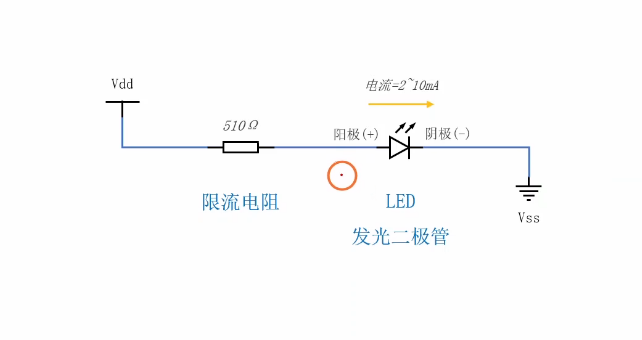      
	- 熄灭LED，拨动开关来熄灭LED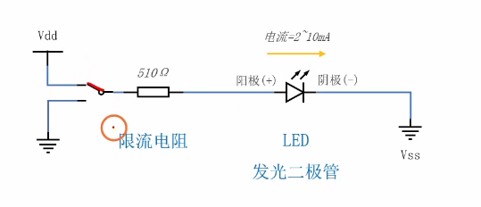
	- 推挽接法：拨动开关就是改变输出的高低电平，类似于推挽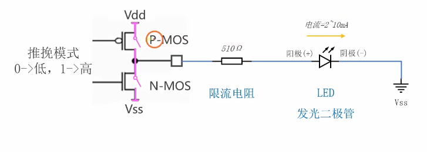
	- 开漏接法：第一个图右面有一个开关类似于第二张图的开漏模式，0为低电平，1为高阻抗
		- 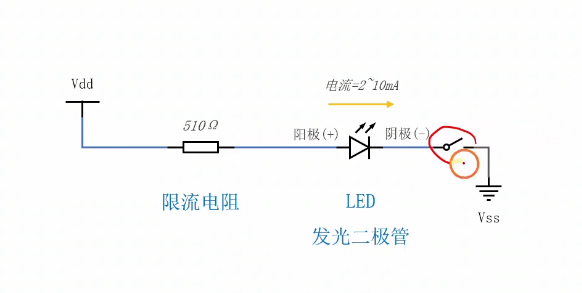
		- 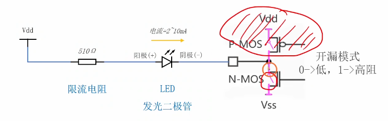
2. 两种接线方式（推挽&&开漏）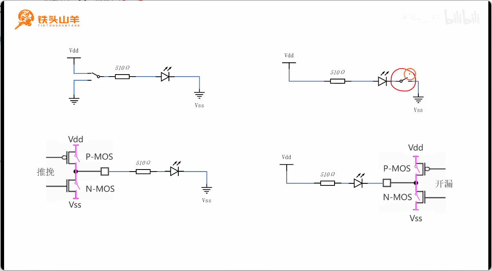
3. 最小系统板符合开漏模式
	- 当内部寄存器输出 `0`（低电平）时，单片机N-MOS导通，IO引脚被拉低到地，构成回路，LED点亮
	- 当内部寄存器输出 `1`  (高电平)  时， 单片机N-MOS闭合，引脚变成**高阻态（悬空/断开）**，无法构成回路，LED熄灭
	- 原理图：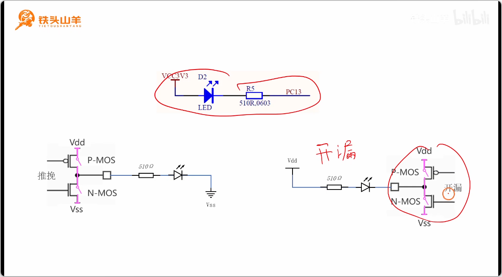
## 1.3.2 代码编写
1. 开启时钟
	- 为啥要开启时钟：不开时钟外设就没有节拍（相当于没通电），你配置PC13的代码就不会生效，引脚无法工作。
	- 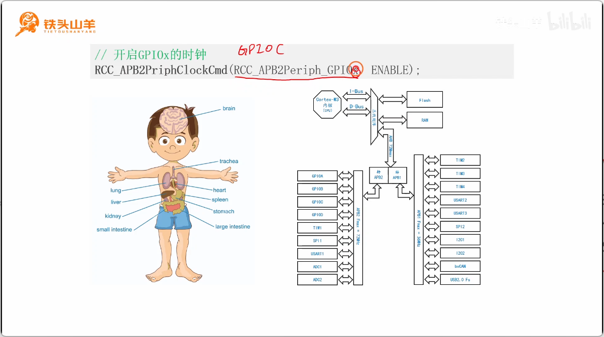
2. 编程接口   
	- `GPIO_Init`: 进行初始化IO引脚（配置IO引脚的参数: 工作模式，最大输出速度，引脚号）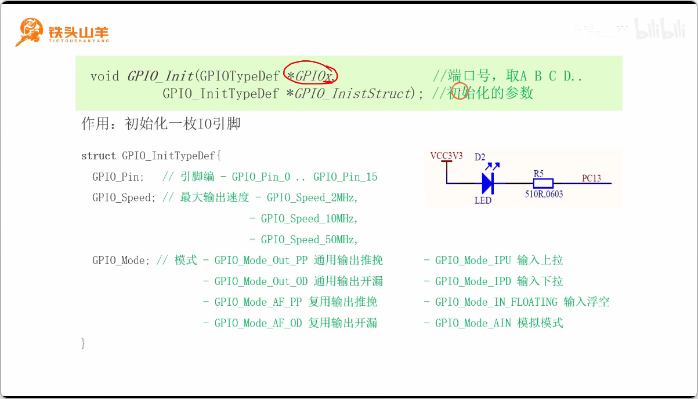
	- `GPIO_WriteBit`: 向输出数据寄存器写入1个比特位（0/1）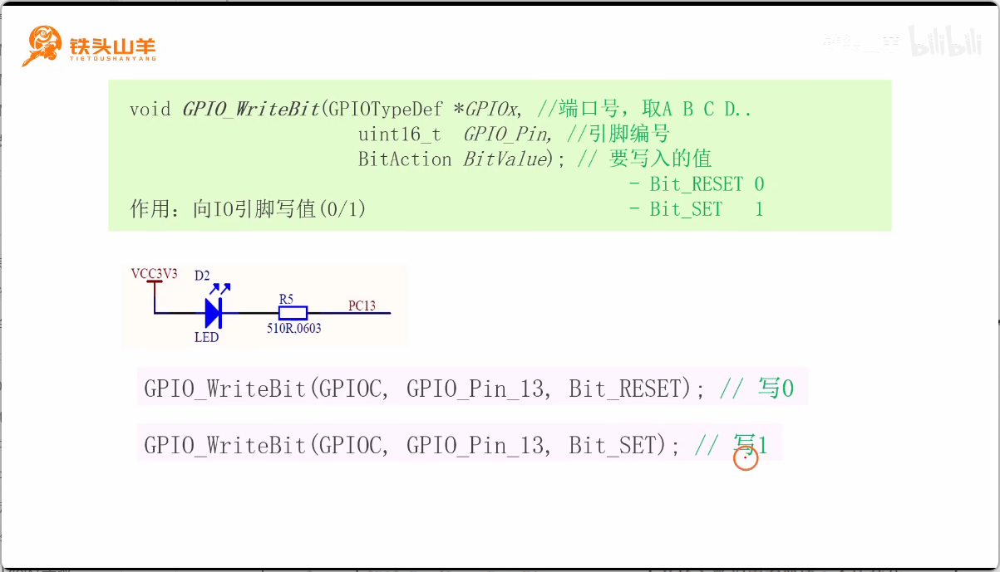
	- `GPIO_ReadOutputDataBit`: 从输出书记寄存器读1个比特位
	- 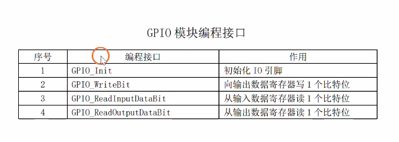
3. 输出模式的选择：开漏已经确定，同时向输出数据寄存器写值的时候，是通过CPU写值的，所以这个输出模式是**通用输出开漏**
4. 实现闪烁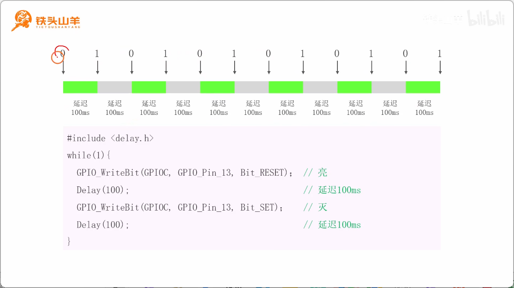
# 1.4 GPIO的4种输入模式
1. 输入电路结构框图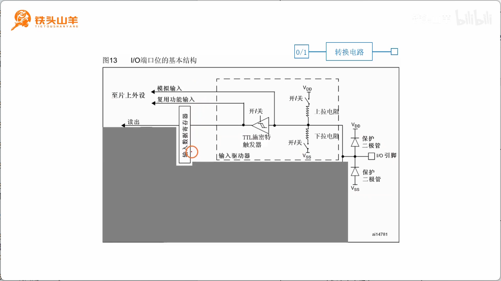
2. 简化输入电路框图）
	- **IO 引脚**（最右边这个小方块）: 0V      单片机认为是 0     3.3V    单片机认为是 1
	- **保护二极管**: 如果外部电压太高或者太低，它可以起到一定保护作用
	- **上拉电阻**
		- 概念：**内部接了一个电阻到 3.3V**
			 3.3V→电阻→IO引脚
		- 如果外面没有信号，IO 默认就是高电平
		- 应用：输入上拉常用于按键（没按为 1，按下为 0）
	- **下拉电阻**
		 - 概念：内部接了一个电阻到 GND
			 IO引脚→电阻→GND
		- 如果外面没有信号，IO 默认就是低电平
		- 应用输入下拉常用于按键（没按为 0，按下为 1）
	- **施密特触发器**:把外面的电压转换成稳定的数字信号(**模拟电压 → 数字 0/1**) ，施密特触发器不能流过电流，通过欧姆定律，等效为一个无穷大的电阻
	- **输入数据寄存器**:STM32 内部用来保存当前输入状态的寄存器，
	- 简化输入电路框图：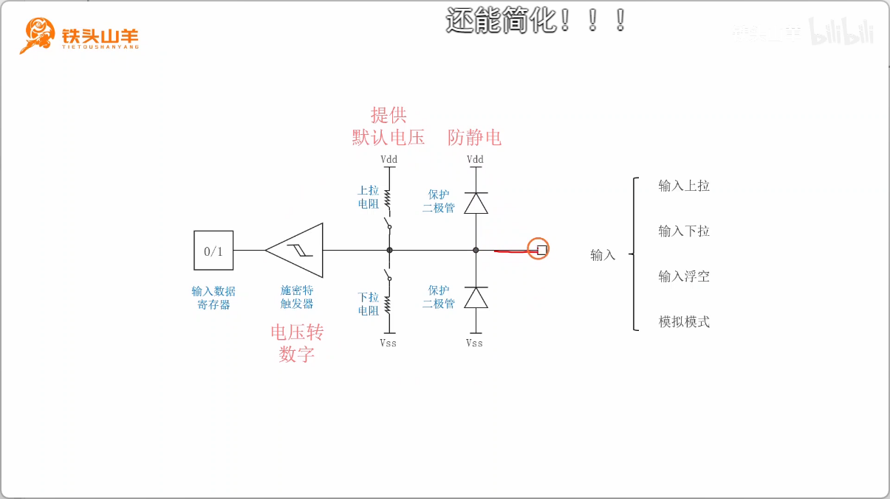
## 1.4.1 输入上拉
1. 内部接了一个电阻到 3.3V
2. 作用：当输入IO引脚悬空的时候，上拉电阻可以给这个IO引脚一个默认的高电压
3. IO引脚不悬空的时候，上拉电阻不会影响转换的结果
	- 外部输入低电平：给IO引脚输入一个0V的时候，施密德触发器右面也是0V,上拉电阻不会影响转换的结果
		- 上拉电阻闭合，引脚内部通过电阻接3.3V，引脚外部直接通过导线接地（外部电阻$R_外$ ≈ 0Ω）
		- 电流从Vdd出发，流过内部上拉电阻，再经过外部0Ω导线回到地
		- 分压计算：引脚处电压为0V
	- 外部输入是高电平：
		- 电路状态：内部通过上拉电阻接3.3V，外部直接接3.3V电源
		- 引脚两端都是3.3V，没有电压差，没有电流流过内部上拉电阻
		- 引脚电压保持再3.3V，施密特触发器读到的是1
	- 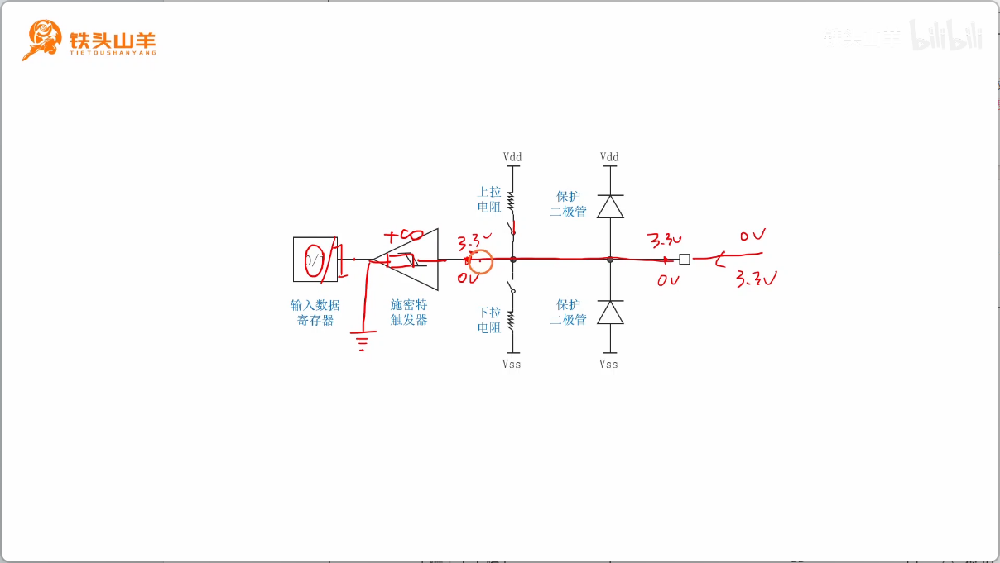
4. 引脚悬空（简化成下图所示）
	 - 悬空的时候可以简化电路为![[Pasted image 20260704220728.png]]
		- 形成Vdd→上拉电阻→施密特触发器输入端 = 高阻抗输入→GND 
		- 施密特触发器可看作一个高阻抗输入 ，
		- 因为施密特触发器输入端高阻抗，几乎没有电流，  
		- 所以上拉电阻没有明显压降，IO 引脚被拉到接近 3.3V。
		- 如果不悬空形成：IO引脚→施密特触发器→输入数据寄存器
5. 引脚电平：此时的引脚电平为高电平
6.  默认读到的是1
7. 上拉悬空无信号输入![[Pasted image 20260704225130.png]]
## 1.4.2 输入下拉
1. 内部接了一个电阻到 GND
2. 作用：当输入IO引脚悬空的时候，下拉电阻可以给这个IO引脚一个默认的低电平
3. IO引脚不悬空的时候，下拉电阻不会影响转换的结果
	 - 外部输入高电平：
		 - IO引脚内部通过下拉电阻接地，引脚外部接3.3V（外部电阻$R_外$≈ 0Ω）
		 - 外部强电源把引脚拉高，内部弱下拉把引脚拉低，外部力量大
		 - 分压计算：夹在中间点的电压是由夹在中间点和地（GND）之间的那个电阻决定的，所以引脚电压强行被拉高到3.3V
		 - 结果：施密特触发器识别为高电平，数据寄存器存入1，下拉电阻没有影响结果
	 - 外部输入低电平：
		 -  内部通过下拉电阻接0V，外部通过导线接0V
		 - 引脚两端都是0V，没有电压差
		 - 结果：没有电流流过内部下拉电阻，引脚电压稳稳保持在0V,施密特触发器读到的是0V，下拉电阻没有影响结果
4. 引脚电平：此时的引脚电平为低电平
5. 默认读到的0
6. 下拉悬空无信号输入![[Pasted image 20260704225342.png]]
## 1.4.3 输入浮空
1. 内部既不接上拉电阻，也不接下拉电阻。
2. 作用：让外部信号直接决定 IO 引脚的电平。
3. 悬空时可以简化为：IO 引脚→施密特触发器输入端→输入数据寄存器
4. 浮空输入悬空无信号输入（读取的端口信号不确定）![[Pasted image 20260704225536.png]]

## 1.4.4 输入模拟
## 1.4.5 四种输入模式的选择
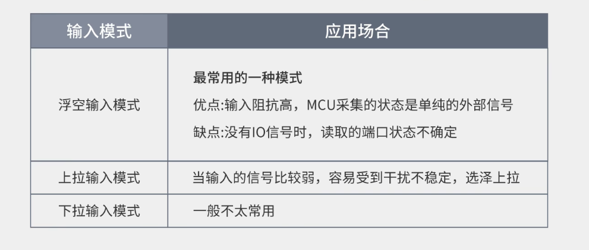
# 1.5 按钮实验
## 1.5.1 LED的接线方法
1. 接线方法
	- 推挽接法：两个MOS管交替导通，写0熄灭，写1点亮
	- 开漏接法：写1熄灭，写0点亮
	- 本次实验使用推挽接法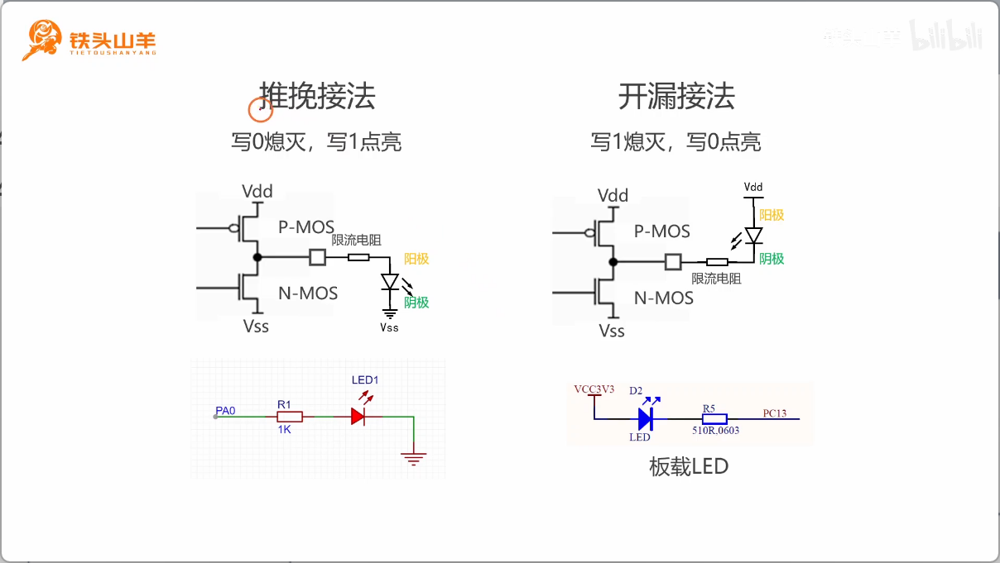
	- 接线图：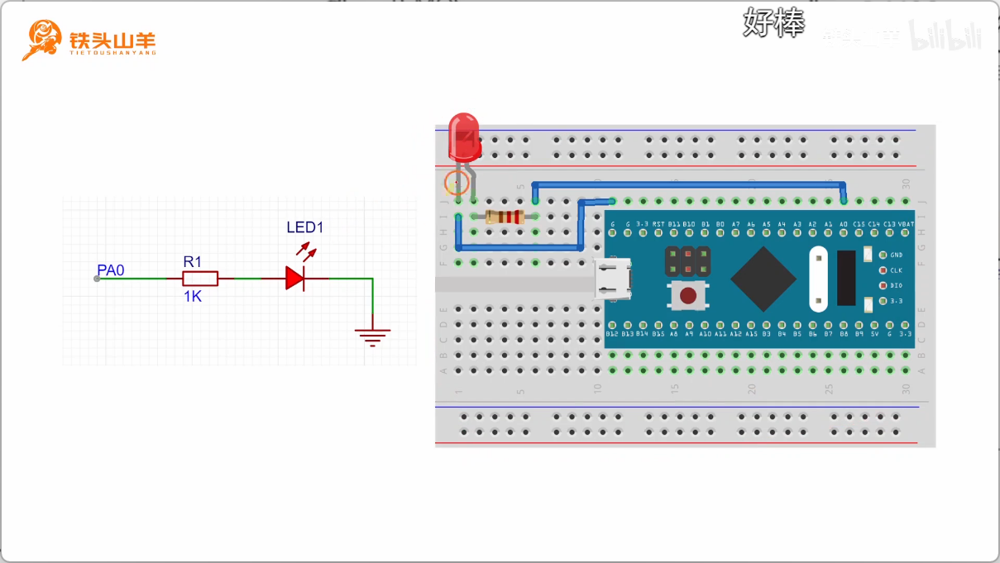
	- 代码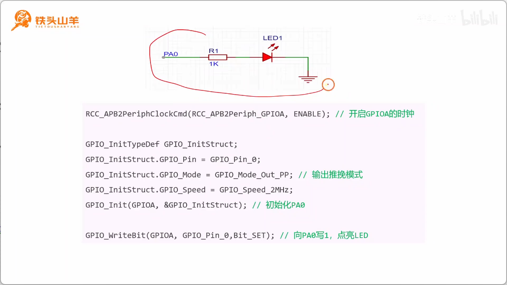
## 1.5.2 按钮的接线方法
1. 按钮接线原理图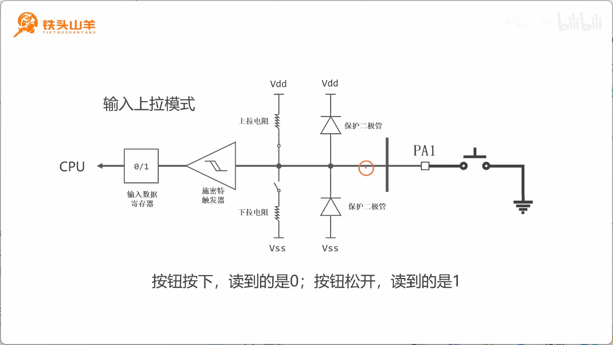
	- 设置为输入上拉模式，闭合上拉电阻开关
	- 原理
		- 按钮松开：PA1引脚悬空，但是由于上拉电阻的存在，引脚被拉高到3.3V，输入数据寄存器读取到的值是1
		- 按钮按下：上拉电阻不影响转换结果，所以施密特触发器右面直接接地，输入数据寄存器读取到的值是0
		- 按钮是带方向的，有引脚的一段朝上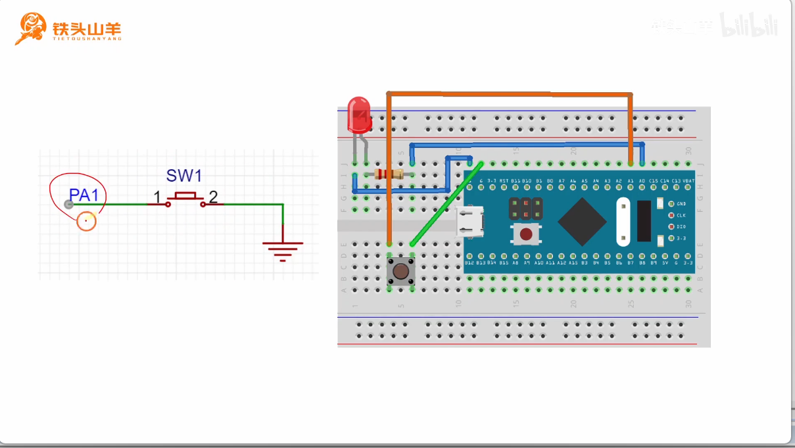
## 1.5.3 编程接口和代码
1. 八种工作模式的编程接口：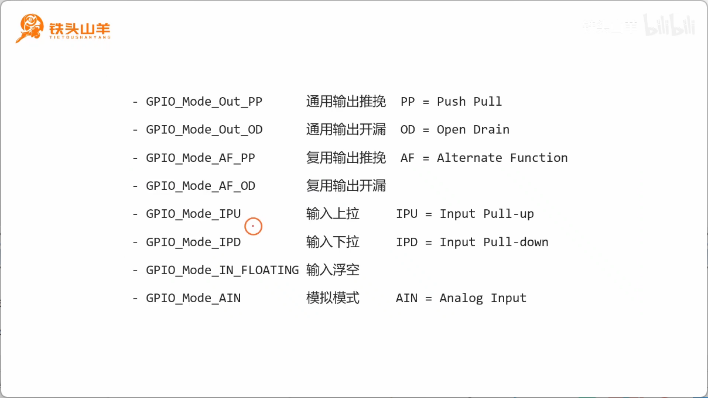

 

