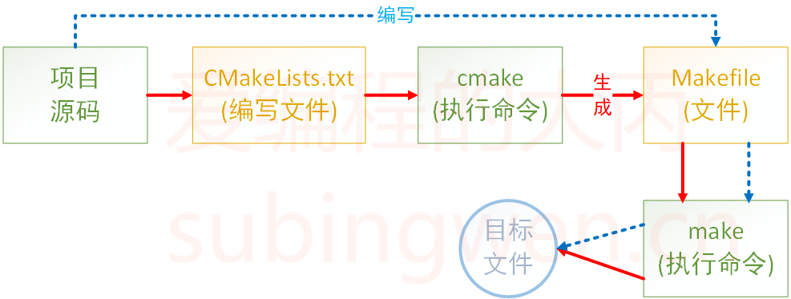

[CMake 保姆级教程（上） | 爱编程的大丙](https://subingwen.cn/cmake/CMake-primer/)
# 1. Cmark简述

源代码→可执行程序（预处理器(头文件展开，注释&宏消失，)，源文件，.c，.cpp） 
预处理→编译→汇编→链接→可执行程序
markfile  一系列指令 脚本文件 
Cmark(不依赖平台)   脚本文件Cmarklist.txt  执行Cmark 

# 2. CMake的使用
