# 1. 数制与码制
## 1.1 知识点
*   **数制转换**：十进制、二进制、八进制、十六进制相互转换（熟练掌握除2取余、乘2取整）。
*   **常用编码**：8421 BCD码（有权码）、余3码（无权码）、格雷码（循环码，相邻只有一位不同）。
*   **带符号数**：机器数与真值，原码、反码、补码的求法。
*   **运算**：补码的加减运算及溢出判断（双符号位法/单符号位法）。
## 1.2 题型
### 1.2.1 数制转换
1. 二进制转十进制：
2. 十进制转8421BCD码：
3. 十六进制转二进制：
	- 方法：每一位十六进制数字直接转换成 4 位二进制
	- 转换图：                                                             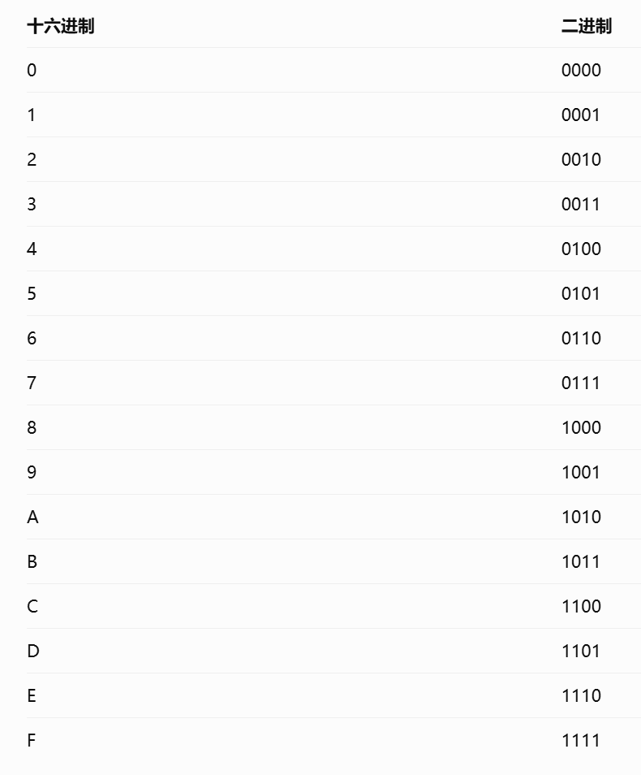
### 1.2.2 原码，反码，补码
1. 解题方法：
	- 正数：原码、反码、补码相同。
	- 负数反码：符号位不变，数值位取反。
	- 负数补码：反码末位加 1。
	- 开头1为负，0为正
	- 负数二进制补码：先计算正数的二进制，然后把标志位换成负数，取反加一   （记住0 正数  1 负数） 
## 1.2.3 二进制算术运算
1. 小数点转换：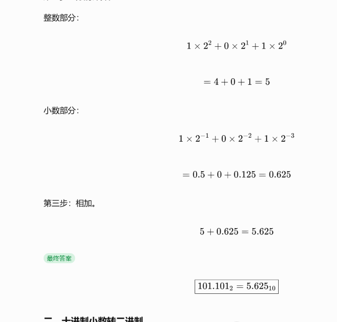

## 1.2.3 常用 BCD 编码

---

# 2. 逻辑代数基础
## 2.1 知识点
*   **基本定理**：逻辑代数的基本公式、常用公式（吸收律、摩根定律最重要）。
*   **表示方法**：真值表、逻辑函数式、逻辑图、卡诺图、波形图之间的相互转换。
*   **化简方法**：代数法化简、**卡诺图法化简**（重点掌握最小项的合并规律、带无关项/约束项的化简）。
*   **形式变换**：最大项与最小项的关系，标准与或式。
1. 同或（⊙）：**相同为 1，相异为 0**    $Y=A′B′+AB=A⊙B$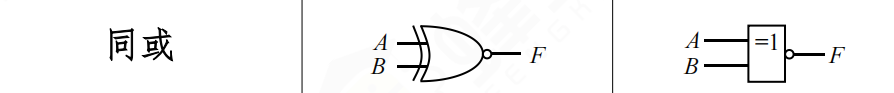
2. 异或（⊕）：**相异为 1，相同为 0**    $Y=A′B+AB′=A⊕B$  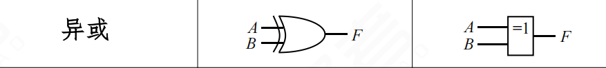
## 2.2 题型
### 2.2.1 公式法化简
1. 基本运算：                                                           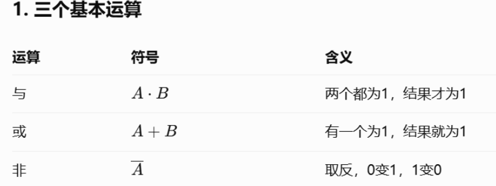
2. 基本公式：                                                                                 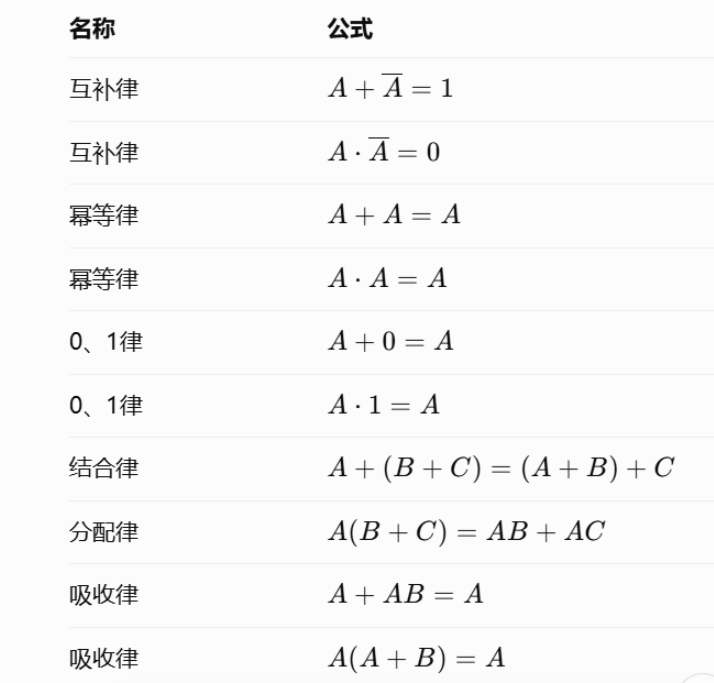
3. 常用化简公式：
	- 吸收律：$A+A'B=A+B$
	- 反变量吸收律：$A+A'B=A+B$
	- 冗余项定理：$AB+A'C+BC=AB+A'C$
4. 
### 2.2.1 [卡诺图化简](https://www.bilibili.com/video/BV14T4y1d7us?t=11.2)
1. 二进制转换→包围圈（尽可能大）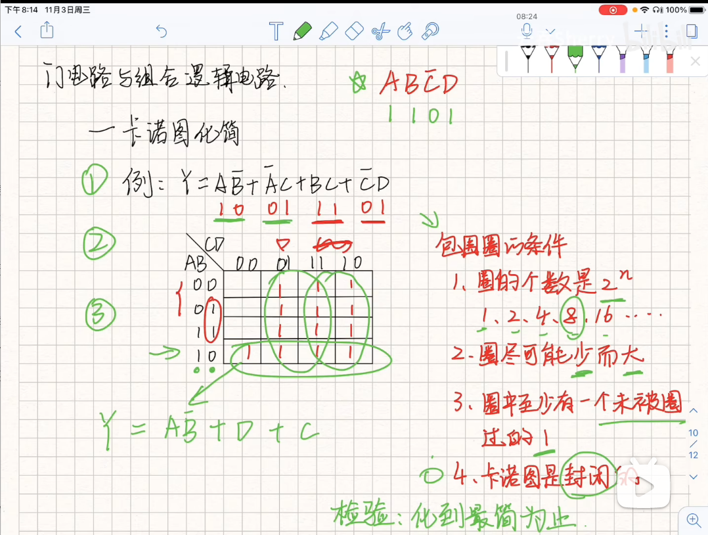
2. [方法](https://www.bilibili.com/video/BV1EY4y1x7iL?t=5.1)
	 - 步骤：画出逻辑函数的卡诺图→ 合并相邻最小项，画出包围圈→写出最简表达式
	 - 8421方法填卡诺图：A代表8 B代表4  C代表2 D代表1  这样进行对比，最后得出二进制的值，当然也可以提前写好每一个位置的编号直接填进去
	 - 画圈原则：
---

# 3. 门电路
## 3.1 知识点
*   **二极管/三极管开关特性**：导通与截止条件。
*   **TTL门电路**：TTL反相器结构、电压传输特性（开门/关门电平、阈值电压、噪声容限）、多余输入端的处理（悬空相当于高电平，不能悬空处理）。
*   **CMOS门电路**：CMOS反相器、传输门、多余输入端的处理（绝不能悬空）。
*   **特殊门**：**OC门**（集电极开路门，可实现线与）、**三态门**（高阻态、总线应用）。
## 3.2 题型
*   **选择/判断题**：判断门电路多余输入端的接法（如TTL与门多余端能否悬空）；判断OC门、三态门的逻辑功能。
*   **画图题**：利用OC门实现“线与”逻辑连接。

---

# 4. 组合逻辑电路
## 4.1 知识点
*   **分析步骤**：逻辑图  表达式  化简 真值表   分析功能。
*   **设计步骤**：逻辑要求   真值表  表达式  化简/变换   逻辑图。
### 4.1.3 常用中规模集成芯片（MSI）：
1. 编码器：优先编码器（如74LS148）
2. 译码器：3-8线译码器（如**74LS138**，常考用译码器+与非门实现逻辑函数）
	- 作用：实现译码功能，将一个二进制代码“翻译“成一个特定的输出信号
	- **地址输入**：A2,A1,A0（接收3位二进制代码）。
	- **数据输出**：Y0∼Y7（带小圆圈或上划线，**低电平有效**）。
	- **使能端（总开关）**，必须同时满足以下条件芯片才工作：
	    - G1（或 STA​）：接 **高电平（1）**。
	    - G2A （或 STB​）：接 **低电平（0）**。
	    - G2B （或 STC ​）：接 **低电平（0）**。
	    - 只要有一个接反，芯片直接罢工，输出全变 1
	    - 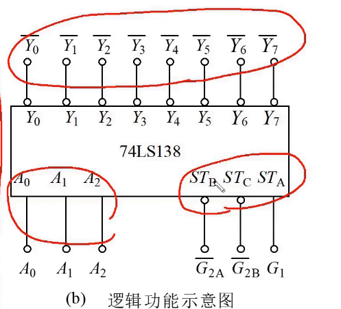
3. [数据选择器](https://www.bilibili.com/video/BV1dw411G7M3?t=8.0)：8选1数据选择器（如**74LS151**，常考用MUX实现逻辑函数）
	- 
4. 加法器：半加器、全加器（如74LS283）。
5. 全加器&半加器
	- 全加器：即考虑了低位的进位，又考虑了高位的进位，半加器只考虑了高位的进位，不考虑低位的进位                                        
	- 半加器：两个输入，两个输出，半加器不考虑高位的进位 ，和数只看最低位的值        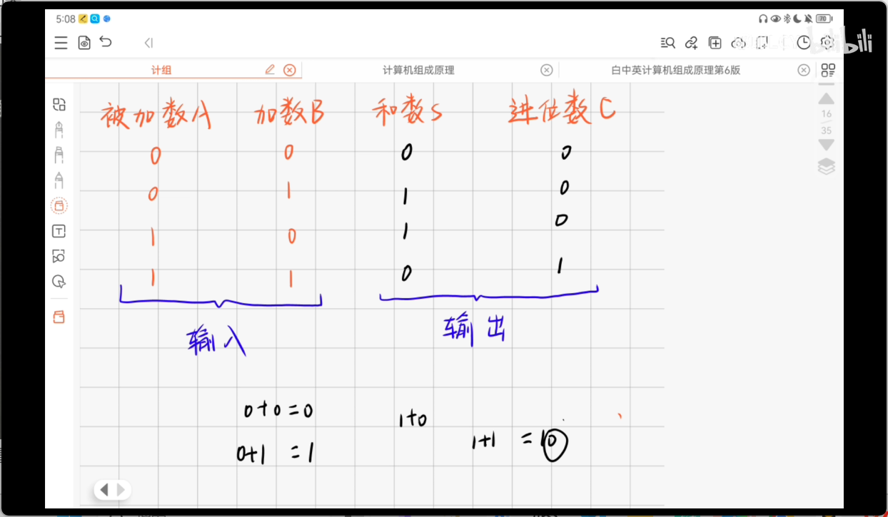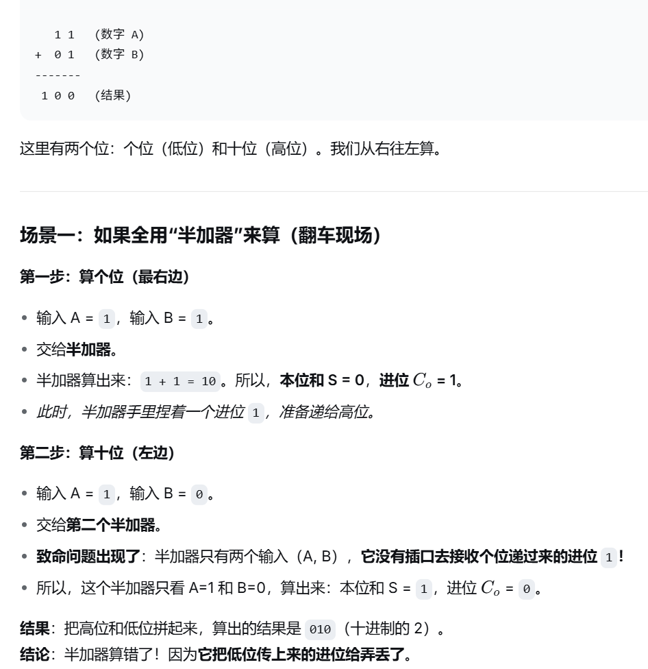
	- 区别：它没有进位输入
	- 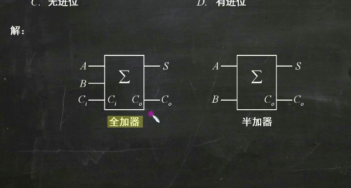
6. 竞争与冒险：产生原因及消除方法（加选通脉冲、加冗余项、加滤波电容）。
	- 当卡诺图有重复的时候就存在竞争与冒险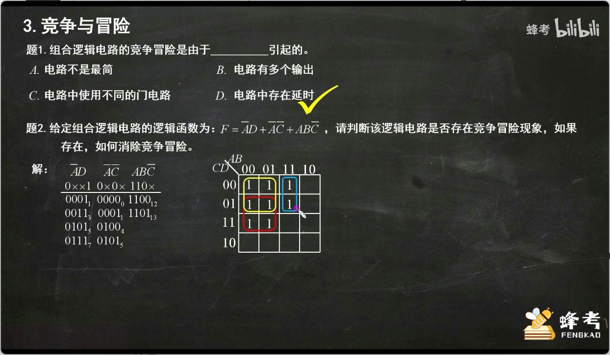
## 4.2 题型
### 4.2.1 组合逻辑电路分析
1. 逻辑抽象
2. 逻辑表达式及其化简
3. 公式化简
4. 列真值表
5. 分析逻辑功能
6. 分析电路功能要写出真值表
### 4.2.2 组合逻辑电路设计题
1. 真值表
2. 卡诺图
3. 逻辑表达式
4. 电路图
	- 最简电路图：化成最简与或式，**寻找公共项并提取**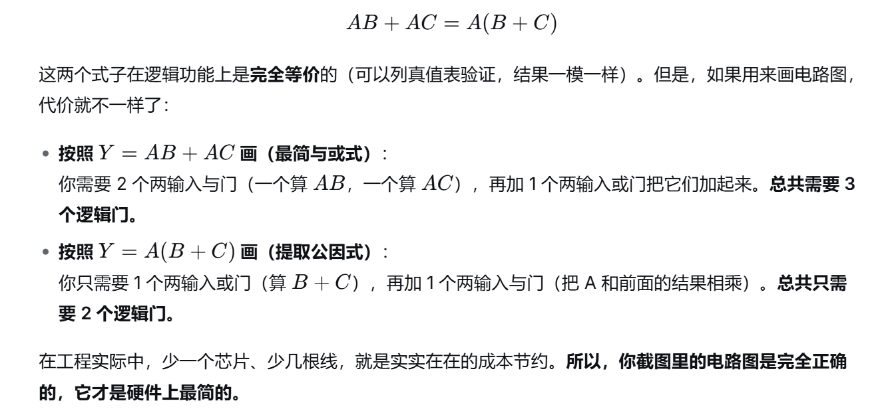
### 4.2.3 看图写表达式
1. 符号简介：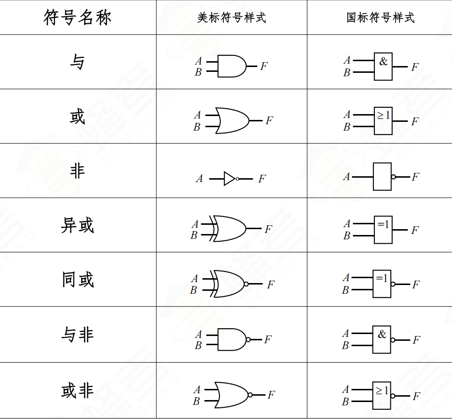

* **设计题（重头戏）**：
    *   用基本门电路设计满足文字描述的逻辑电路（如三人表决器）。
    *   用74LS138或74LS151设计实现特定逻辑函数。
    *   用74LS283设计代码转换器（如8421BCD码转余3码）。

--- 

# 5. 触发器
## 5.1 知识点
*   **触发器**：下一个状态 Q 不只取决于当前输入，还取决于它原来存的是啥 Q
*   **触发方式**：电平触发、脉冲触发、边沿触发（重点掌握边沿触发抗干扰能力强）。
*   **电平有效**：
	* **没有小圆圈（光秃秃的三角形）** → **上升沿有效**（高电平触发）。
	* **带小圆圈（气泡）** → **下降沿有效**（低电平触发）
-   **有效边沿**：**看芯片方框内部，CP 引脚上的那个“小三角形（>>）”，以及它后面有没有小圆圈**，有就是下降沿触发，无就是上升沿触发
*   **触发器引脚**：
	* 数据输入端（D）：同步数据输入端。它决定了触发器在有效时钟边沿到来时的**次态**，属于**同步信号**，必须与时钟信号配合使用，单独改变 D 不会引起触发器状态的改变
	* 时钟脉冲端（CP）：在非有效边沿期间，触发器处于“保持”状态，输出 QQ 维持原值；仅当有效边沿到来时，才允许 DD 端的数据被写入。
	* 异步复位端（$R_D$  最高优先级）:
		- 高电平有效：$R_D$​ 变成 `1`，不管 CP 是什么状态，也不管 D 输入什么，Q 波形会**瞬间“啪”的一下变成 `0`**，并且死死按住，直到 $R_D$ 变回 `0`
		- 低电平有效：$R_D$​ 是**低电平有效**（带小圆圈或横线）：只要 $R_D$​ 变成 `0`，Q 同样瞬间清零
- 响应优先级：**异步复位端（RDRD​） > 时钟脉冲端（CPCP） > 数据输入端（DD）**
	- 当 $R_D$​ 有效时，无视 CP 和 D，直接清零。
	- 当 $R_D$​​ 无效时，触发器等待 CP 的有效边沿；边沿未到时，无视 D，保持原态。
	- 当 $R_D$​​ 无效且 CP 有效边沿到来时，触发器读取 D 的值并更新状态。
*   **四大触发器**：
    *   **SR触发器**：                                                                                     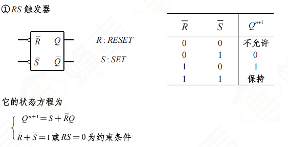
    *   **JK触发器**：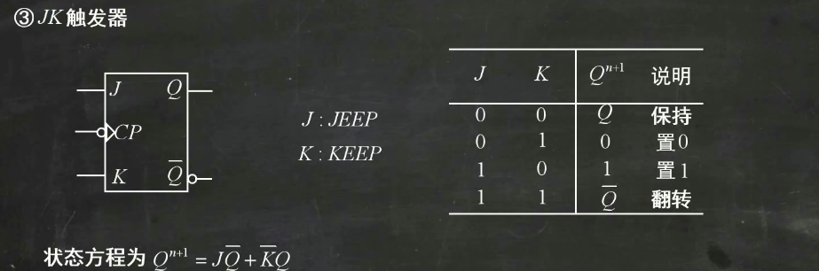                                                                          
    *   **D触发器**：                                                                            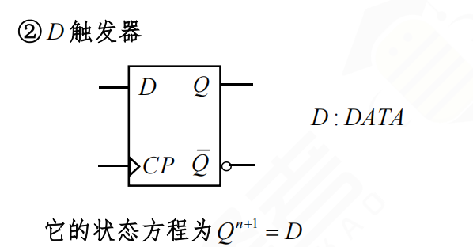
    *   **T触发器**： 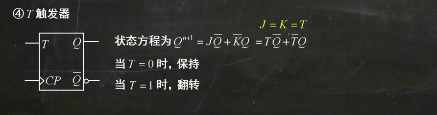
*   **逻辑功能描述**：特征方程、状态转换真值表、状态转换图、激励表。
## 5.2 题型
1.  **选择/填空题**：考查各触发器的特征方程、约束条件；判断上升沿/下降沿触发。
2.  **画图题（波形题）**：给定CP时钟信号和输入信号（如J、K或D），画出触发器输出端Q的波形（注意异步置位/复位端的影响）。
	- 解题步骤：
		- 列出状态方程
		- 根据$R_D$ 处理初始值
		- 在有效边沿处用虚线标识
		- 写出虚线处输入变量的值
		- 写出输出的值，并画出波形
---

# 6. 时序逻辑电路
## 6.1 知识点
*   **分类**：同步时序电路 vs 异步时序电路；Mealy型 vs Moore型。
*   **分析步骤**：写出驱动方程 \(\rightarrow\) 状态方程 \(\rightarrow\) 状态转换表/图 \(\rightarrow\) 画时序图 \(\rightarrow\) 归纳功能。
*   **设计步骤**：状态图 \(\rightarrow\) 状态表 \(\rightarrow\) 状态化简/分配 \(\rightarrow\) 选触发器 \(\rightarrow\) 写驱动/输出方程 \(\rightarrow\) 画电路图。
*   **常用芯片**：
    *   **计数器**：同步计数器（如**74LS161**、74LS160），异步计数器。
    *   **寄存器**：移位寄存器（串入并出、并入串出、环形/扭环形计数器）。
*   **任意进制计数器设计**：利用“反馈清零法”或“反馈置数法”（**必考大题**）。
## 6.2 题型
*   **分析题**：给定时序逻辑电路图，分析其模数（几进制计数器）及功能，画出完整状态图
### 6.2.1 **异步时序逻辑电路分析题**
1. 电路结构
	1. **触发器类型**： JK 触发器 。
	2. **触发边沿**：看 C1C1 端有个小圆圈，说明是**下降沿触发**（时钟从高电平变低电平时，触发器才动作）。
	3. **时钟连接（最关键）**:这是一个**异步时序电路**（也叫行波计数器），因为它们的时钟不同步，是“老大带小弟”的关系。
2. 驱动方程和状态方程
	 - 时钟方程
	 - 驱动方程
	 - 触发器特征方程
	 - 状态方程
3. 波形图绘制（明确上升沿下降沿）
4. 归纳逻辑功能：
	 - 模板：`该电路为 [N](触发器)位 [同步 / 异步]（时钟端） [加法 / 减法]（状态表数字是上升还是下降） **[二进制 / 十进制]** 计数器（或：实现了 **[M]** 分频功能）。共包含 **[K]** 个有效状态，属于 **[K]** 进制计数器（或模 **[K]** 计数器）。**[具备 / 不具备]** 自启动能力`
	 - 
 
*   **设计题**：
    *   用74LS161/160设计指定进制的计数器（如六进制、十二进制）。
    *   根据文字要求设计同步时序电路（如序列检测器）。
*   **画图题**：根据时钟和输入，画出移位寄存器的输出波形。

--- 

# 电路设计
## 74LS194
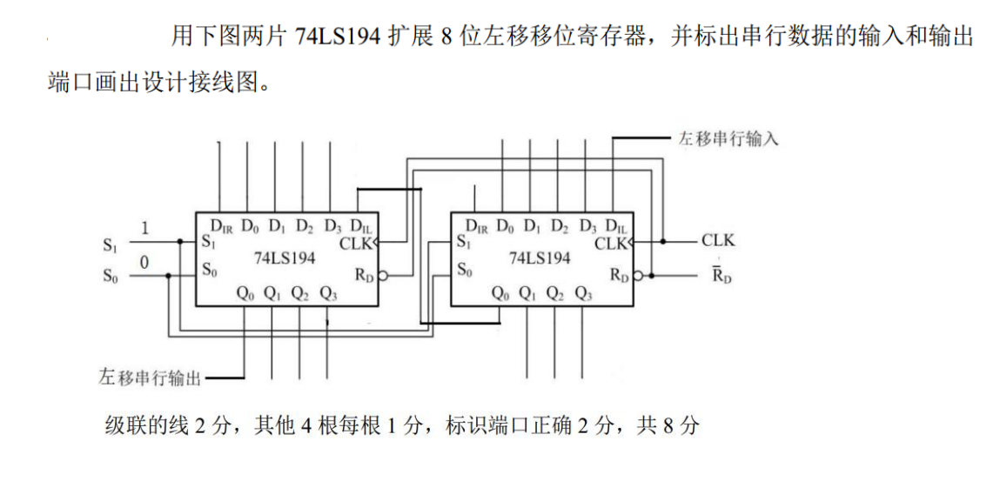
## 74HC153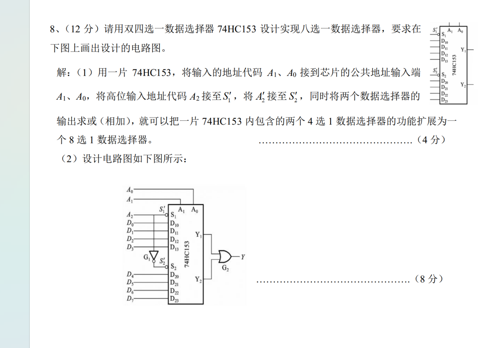
# 电路分析

# 判断几进制
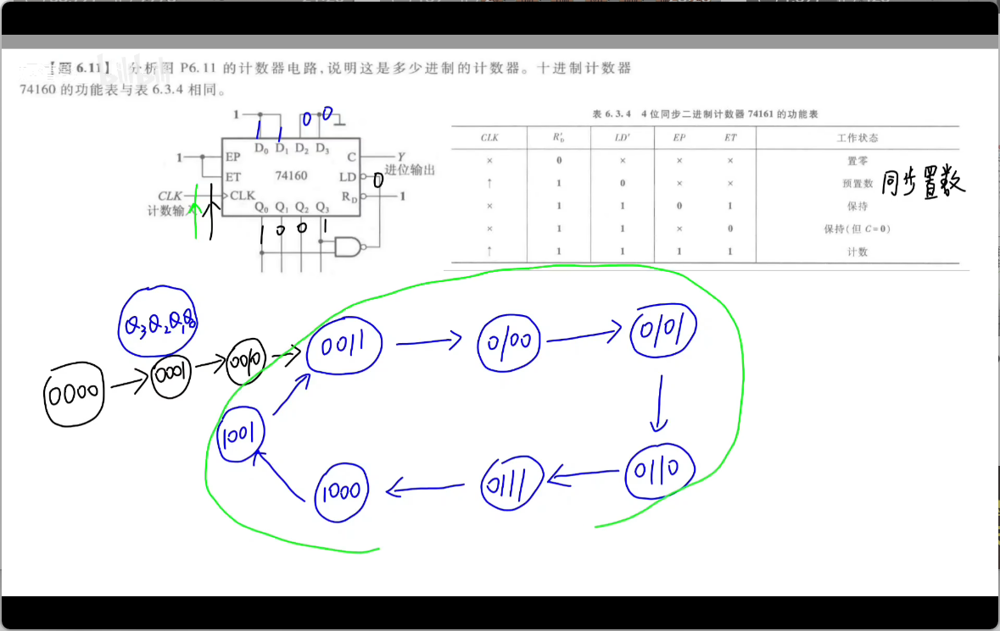

1. 输入端：是有一个固定的值的，置数的时候会传递给输出端
2. 输出端，只有这个引出的线满足这个LD低电平触发的时候，他就会置数，回到输入端固定的值，这个时候就会形成一个循环，循环有几个数就是几进制

# 计数器实现x进制计数器
1. 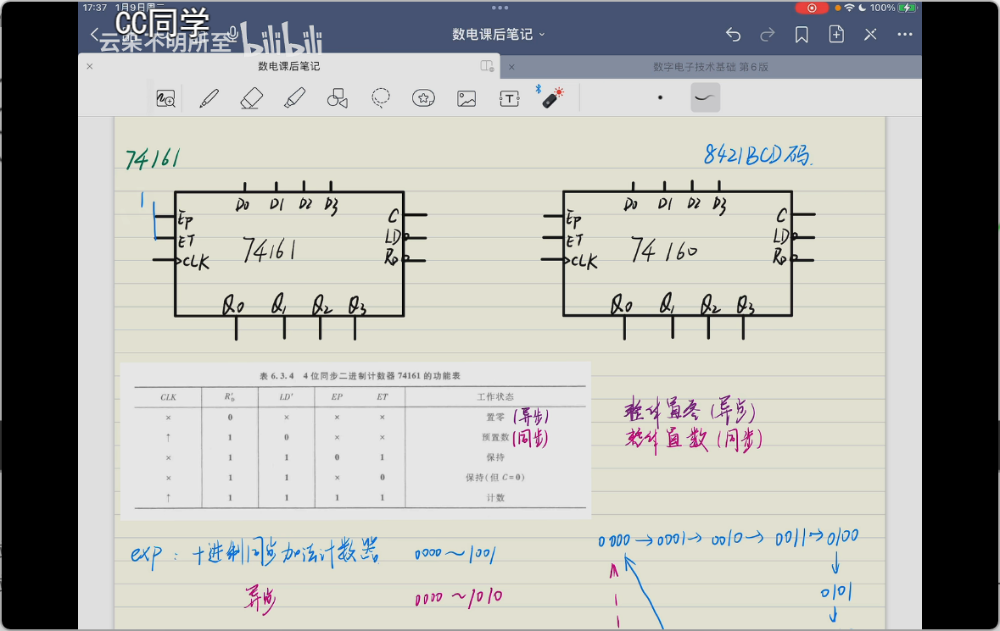
2. 74161&74160
	- 74161  十六进制计数器
	- 74160  8421BCD码
3. EP和ET同时为1的时候开始计数
4. 置零，置数
	- 置0：RD有效电平触发  异步置0  不需要CLK有效沿触发，只要RD触发就会进行输入到输出直接置0
	- 置数：LD有效沿触发，同步置数，这个时候不仅要触发LD，同时CLK也要有一个有效边沿，这个时候预先设定好的输入的数就会进入输入端，这个时候就会产生一个循环，循环有几个就是几进制计数器
5. 同步&**异步**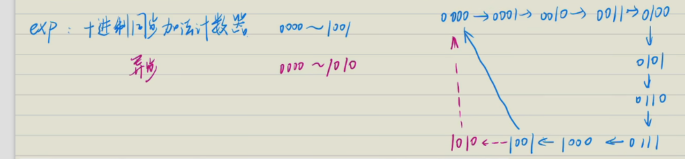
	- 同步：同步清零等待下一个有效沿
	- 异步：异步清零，立即触发