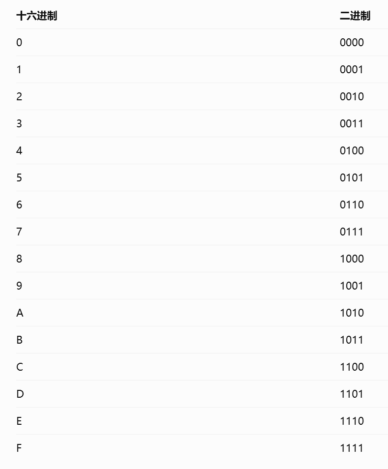
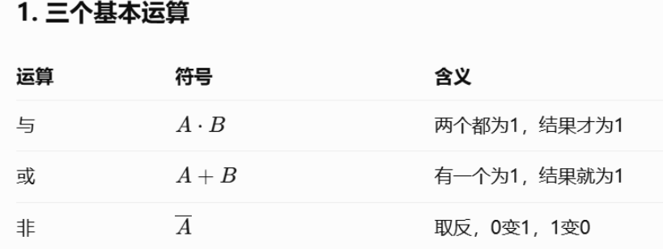
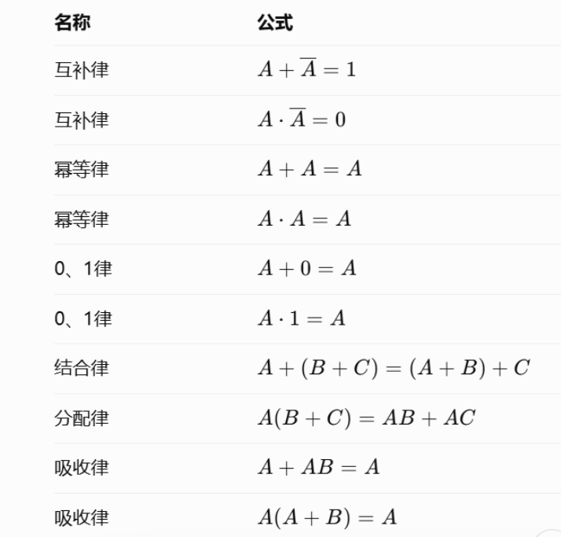

# 1. 数制与码制
## 1.1 知识点
*   **数制转换**：十进制、二进制、八进制、十六进制相互转换（熟练掌握除2取余、乘2取整）。
*   **常用编码**：8421 BCD码（有权码）、余3码（无权码）、格雷码（循环码，相邻只有一位不同）。
*   **带符号数**：机器数与真值，原码、反码、补码的求法。
*   **运算**：补码的加减运算及溢出判断（双符号位法/单符号位法）。
## 1.2 题型
### 1.2.1 数制转换
1. 二进制转十进制：
2. 十进制转8421BCD码：
3. 十六进制转二进制：
	- 方法：每一位十六进制数字直接转换成 4 位二进制
	- 转换图：                                                             
### 1.2.2 原码，反码，补码
1. 解题方法：
	- 正数：原码、反码、补码相同。
	- 负数反码：符号位不变，数值位取反。
	- 负数补码：反码末位加 1。
	- 开头1为负，0为正
## 1.2.3 二进制算术运算

## 1.2.3 常用 BCD 编码

---

# 2. 逻辑代数基础（必考工具，强烈建议单独列出）
## 2.1 知识点
*   **基本定理**：逻辑代数的基本公式、常用公式（吸收律、摩根定律最重要）。
*   **表示方法**：真值表、逻辑函数式、逻辑图、卡诺图、波形图之间的相互转换。
*   **化简方法**：代数法化简、**卡诺图法化简**（重点掌握最小项的合并规律、带无关项/约束项的化简）。
*   **形式变换**：最大项与最小项的关系，标准与或式。
## 2.2 题型
### 2.2.1 公式法化简
1. 基本运算：                                                           
2. 基本公式：                                                                                 
3. 常用化简公式：
	- 吸收律：$A+A'B=A+B$
	- 
### 2.2.1 卡诺图化简

---

# 3. 门电路
## 3.1 知识点
*   **二极管/三极管开关特性**：导通与截止条件。
*   **TTL门电路**：TTL反相器结构、电压传输特性（开门/关门电平、阈值电压、噪声容限）、多余输入端的处理（悬空相当于高电平，不能悬空处理）。
*   **CMOS门电路**：CMOS反相器、传输门、多余输入端的处理（绝不能悬空）。
*   **特殊门**：**OC门**（集电极开路门，可实现线与）、**三态门**（高阻态、总线应用）。
## 3.2 题型
*   **选择/判断题**：判断门电路多余输入端的接法（如TTL与门多余端能否悬空）；判断OC门、三态门的逻辑功能。
*   **画图题**：利用OC门实现“线与”逻辑连接。

---

# 4. 组合逻辑电路
## 4.1 知识点
*   **分析步骤**：逻辑图 \(\rightarrow\) 表达式 \(\rightarrow\) 化简 \(\rightarrow\) 真值表 \(\rightarrow\) 分析功能。
*   **设计步骤**：逻辑要求 \(\rightarrow\) 真值表 \(\rightarrow\) 表达式 \(\rightarrow\) 化简/变换 \(\rightarrow\) 逻辑图。
*   **常用中规模集成芯片（MSI）**：
    *   **编码器**：优先编码器（如74LS148）。
    *   **译码器**：3-8线译码器（如**74LS138**，常考用译码器+与非门实现逻辑函数）。
    *   **数据选择器**：8选1数据选择器（如**74LS151**，常考用MUX实现逻辑函数）。
    *   **加法器**：半加器、全加器（如74LS283）。
*   **竞争与冒险**：产生原因及消除方法（加选通脉冲、加冗余项、加滤波电容）。
## 4.2 题型
*   **分析题**：给组合电路图，写出输出逻辑表达式并说明功能。
*   **设计题（重头戏）**：
    *   用基本门电路设计满足文字描述的逻辑电路（如三人表决器）。
    *   用74LS138或74LS151设计实现特定逻辑函数。
    *   用74LS283设计代码转换器（如8421BCD码转余3码）。

---

# 5. 触发器
## 5.1 知识点
*   **触发方式**：电平触发、脉冲触发、边沿触发（重点掌握边沿触发抗干扰能力强）。
*   **四大触发器**：
    *   **SR触发器**：特征方程 \(Q^{n+1} = S + \overline{R}Q^n\) (约束条件 \(SR=0\))。
    *   **JK触发器**：特征方程 \(Q^{n+1} = J\overline{Q^n} + \overline{K}Q^n\) （有翻转功能）。
    *   **D触发器**：特征方程 \(Q^{n+1} = D\) （跟随功能）。
    *   **T触发器**：特征方程 \(Q^{n+1} = T\overline{Q^n} + \overline{T}Q^n\)。
*   **逻辑功能描述**：特征方程、状态转换真值表、状态转换图、激励表。
## 5.2 题型
*   **选择/填空题**：考查各触发器的特征方程、约束条件；判断上升沿/下降沿触发。
*   **画图题（波形题）**：给定CP时钟信号和输入信号（如J、K或D），画出触发器输出端Q的波形（注意异步置位/复位端的影响）。

---

# 6. 时序逻辑电路
## 6.1 知识点
*   **分类**：同步时序电路 vs 异步时序电路；Mealy型 vs Moore型。
*   **分析步骤**：写出驱动方程 \(\rightarrow\) 状态方程 \(\rightarrow\) 状态转换表/图 \(\rightarrow\) 画时序图 \(\rightarrow\) 归纳功能。
*   **设计步骤**：状态图 \(\rightarrow\) 状态表 \(\rightarrow\) 状态化简/分配 \(\rightarrow\) 选触发器 \(\rightarrow\) 写驱动/输出方程 \(\rightarrow\) 画电路图。
*   **常用芯片**：
    *   **计数器**：同步计数器（如**74LS161**、74LS160），异步计数器。
    *   **寄存器**：移位寄存器（串入并出、并入串出、环形/扭环形计数器）。
*   **任意进制计数器设计**：利用“反馈清零法”或“反馈置数法”（**必考大题**）。
## 6.2 题型
*   **分析题**：给定时序逻辑电路图，分析其模数（几进制计数器）及功能，画出完整状态图。
*   **设计题**：
    *   用74LS161/160设计指定进制的计数器（如六进制、十二进制）。
    *   根据文字要求设计同步时序电路（如序列检测器）。
*   **画图题**：根据时钟和输入，画出移位寄存器的输出波形。

---
 