# 1.1 电路结构和通信协议
## 1.1.1 SPI总线的电路结构
1. 电路结构
	- MOSI：主发从收
	- MISO：主收从发
	- SCK：串行时钟（时钟信号）
	- NSS：从机选择（**低电平有效**）
## 1.1.2 通信流程及波形
1. 通信流程：SPI 通信时，主机首先将目标从机的 NSS 引脚拉低，选中该从机，同时其他从机的 NSS 保持高电平，处于未选中状态。随后主机产生 SCK 时钟信号，在时钟的控制下，主机通过 MOSI 线向从机发送数据，从机通过 MISO 线向主机返回数据，实现同步全双工通信。数据传输完成后，主机将 NSS 拉高，结束本次通信，从机取消选中。
## 1.1.3 参数1：时钟信号的极性和相位
1. 极性：
	 - 低极性：SCK 空闲时保持低电平
	 - 高极性：SCK 空闲时保持高电平
	 - 
2. 相位：
	 - 两种边沿：
		 - 上升沿：低电平变成高电平。
		 - 下降沿：高电平变成低电平。
	- 第一边沿和第二边沿是指 SCK 时钟信号在一个时钟周期内的第一次和第二次电平跳变。
		- 第一边沿是时钟信号离开空闲电平后的第一次跳变，第二边沿是随后的第二次跳变。
		- 当 CPOL=0（空闲低电平）时，第一边沿是上升沿，第二边沿是下降沿；
		- 当 CPOL=1（空闲高电平）时，第一边沿是下降沿，第二边沿是上升沿。CPHA 决定在哪个边沿采样数据：CPHA=0 在第一边沿采样，CPHA=1 在第二边沿采样。
	- 第一边沿采集：在 SCK 时钟信号出现第一个边沿时采样数据（CPHA=0），即 CPOL=0 时在上升沿采样，CPOL=1 时在下降沿采样。
	- 第二边沿采集：在 SCK 时钟信号出现第二个边沿时采样数据（CPHA=1），即 CPOL=0 时在下降沿采样，CPOL=1 时在上升沿采样
	- 
## 1.1.4 SPI的4种模式
1. 四种时钟模式：
## 1.1.5 参数2：传输顺序
1. 传输顺序：
	- 先传最低有效位（一个字节从右到左表号依次增加，先传最低有效位就是说先从表号小的开始传输）
	- 先传最高有效位（从表号大的开始传输）
## 1.1.6 参数3：数据宽度
1. 数据宽度：多少个Bit传输一次，两种情况  8Bit   16Bit
# 1.2 按钮驱动程序的编写
## 1.2.1 连接电路
1. PA0输入上拉模式，按钮按下（0）按钮松开（1），输出开漏模式（写1熄灭，写0点亮）
2. 接线图：
## 1.2.2 初始化板载LED和按钮
1. 
## 1.2.3 按钮程序的基本原理
1. 输入上拉模式，松开按钮i是高电压1，按下按钮的时候是低电平0  通过判断电位变化，实现LED的显示
2. 通过两个状态位，来判断电平是否发生变化，从而实现电灯的目的
3. 通过切换引脚的亮灭状态（通用输出推挽）
## 1.2.4 按键消抖的原理
1. 消抖：过载片（金属片）被按下需要时间（也就是导通时间，就会出现下面的抖动现象）
2. 
# 1.3 按钮代码的封装
## 1.3.1 搭建电路
1. 接线图
## 1.3.2 串口初始化
1. 串口初始化：引脚初始化，串口本身初始化  
## 1.3.3 按钮初始化

## 1.3.4 进程函数
1. 按键检测

## 1.3.5 回调函数
# 1.4 IO引脚初始化
## 1.4.1 SPI模块简介
1. 片上外设：两个SPI接口（SP1 SP2） 
## 1.4.2 W25Q64简介
1. Flash芯片
2. 模块简介：DI:接主机的MOSI   DO：接主机的MISO    CLK：接主机的SCK
## 1.4.3 定位SPI引脚位置
1. MOSI:主发从收  MISO:主收从发  SCK: 串行信号   NSS: 从机选择
2. 接线图
3. 引脚资源：                                                                                                                
## 1.4.4 选择IO引脚的模式
1. 引脚配置：        
## 1.4.5 选择IO的最大输出速度
1. 选择满足要求的最小值：（2 10 50）
2. 
# 1.5 SPI模块初始化
## 1.5.1 SPI模块的基本工作原理
1. 内部结构框图
	- 引脚：MOSI MISO SCK NSS(从机模式下使用)
	- 数据控制部分：
	- 时钟部分：时钟→开关→预分频→ 波特率 极性 相位→ 时钟控制
	- SPI通信方向部分：主/从选择→四种配置方式→通信方式选择
	- NSS部分：
	- 中断部分：标志位（TxE(发送数据寄存器) RxNE(接收数据寄存器) ORV）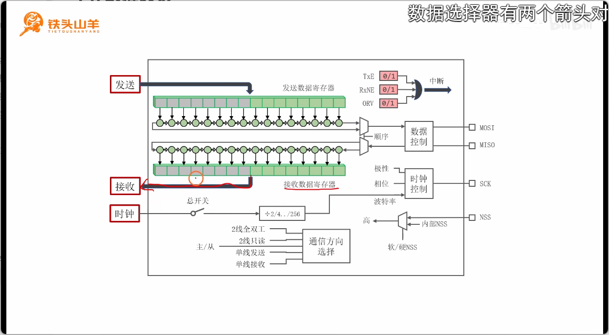
## 1.5.2 SPI_Init
1.  通信方向，SPI模式，数据宽度，时钟的极性 ，时钟的相位，比特位传输数据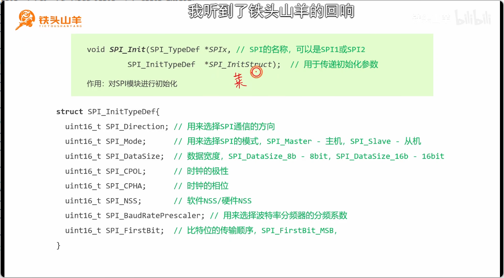
## 1.5.3 选择数据通信方向
1. 通信方向：2线全双工，2线只读（只读取数据，不返回数据 常用于主机→广播），1线发送，1线接收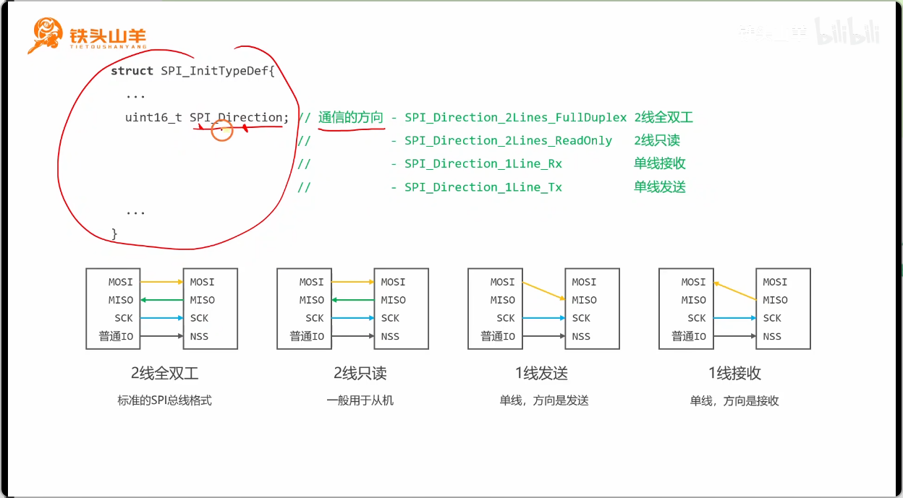
## 1.5.4 数据宽度、极性、相位和比特位传输顺序
1. 数据位的宽度：8bit  16bit
2. 时钟的极性和相位：接收方在那个边沿对信号进行采集
3. 设置比特位传输数据：先传最低有效位  先传最高有效位
4. 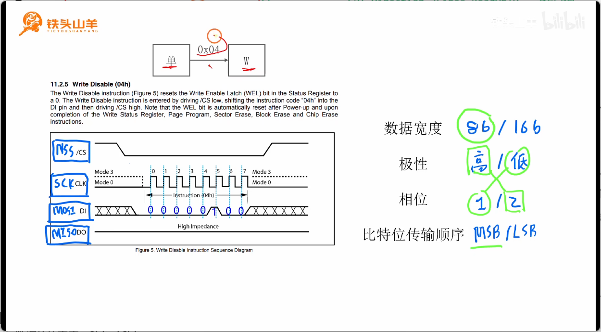
## 1.5.5 设置波特率
1. 假设时钟信号频率是72MHz,通过预分频，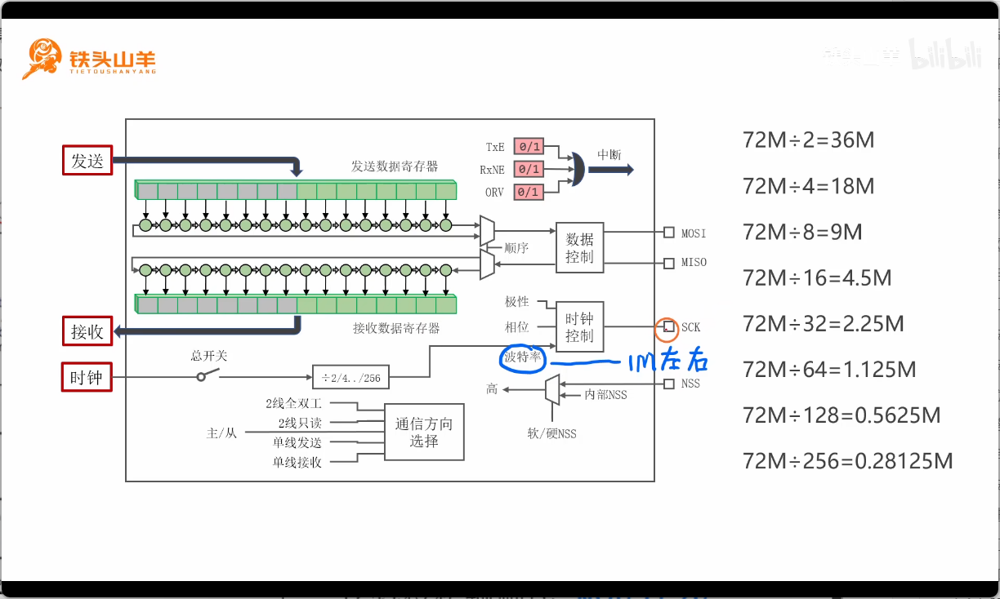

## 1.5.6 NSS的配置方式
1. 配置方式
	1. 多主机模式：NSS被拉低时主机的身份变为从机
	2. 主机（NSS引脚外接一个高电压，多主机模式） 
	3. 从机（NSS是一个片选信号，主机向从机输入一个低电压时，被选中，输入高电压时，未被选中）
	4. 通过软件NSS来实现硬件NSS：通过内部NSS（写0相当于输入低电压，写1相当于输入高电压）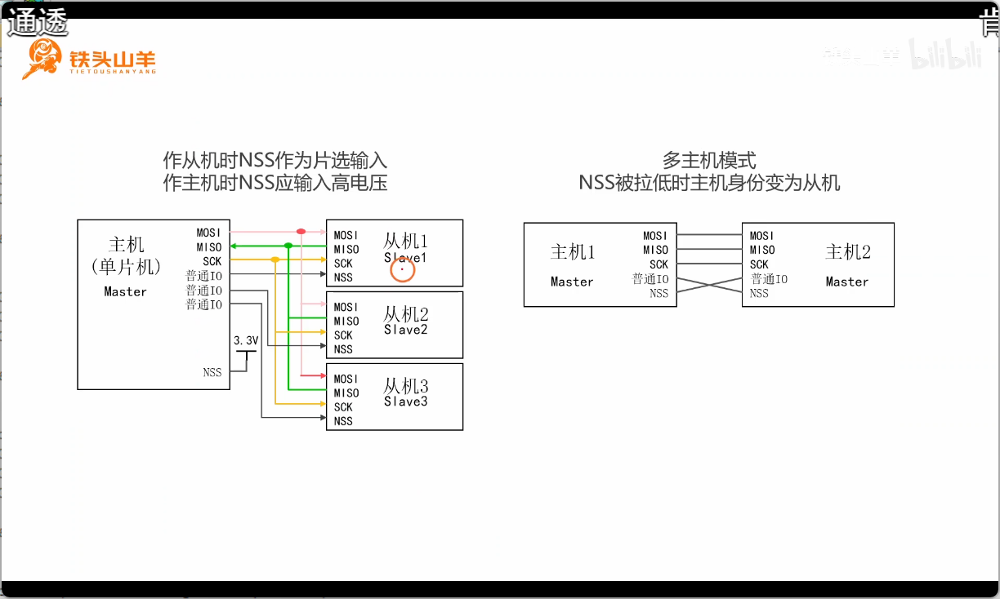

# 1.6 数据收发
## 1.6.1 SPI数据收发的特点
1. SPI数据收发是**双向的，同时的**，每发送一个比特位必然接收一个比特位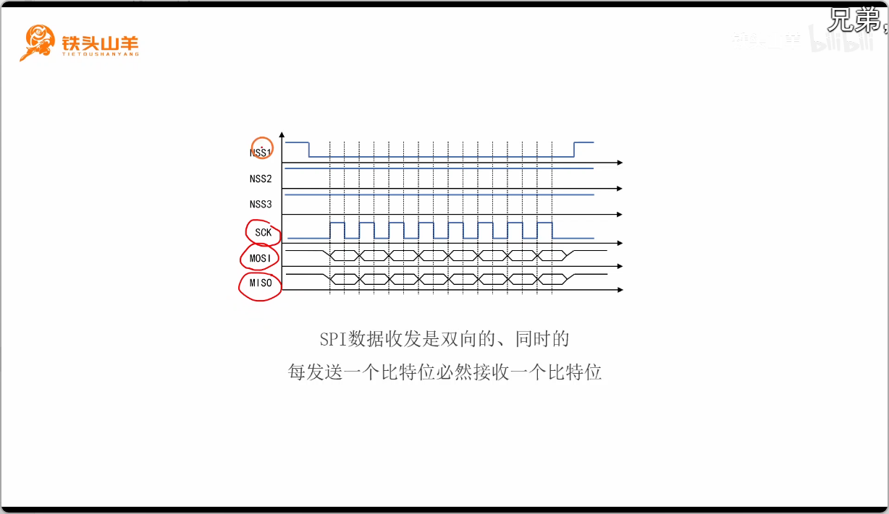
## 1.6.2 声明数据收发的编程接口
1. `App_SPI_MasterTransmitReceive`:使用SPI总线收发数据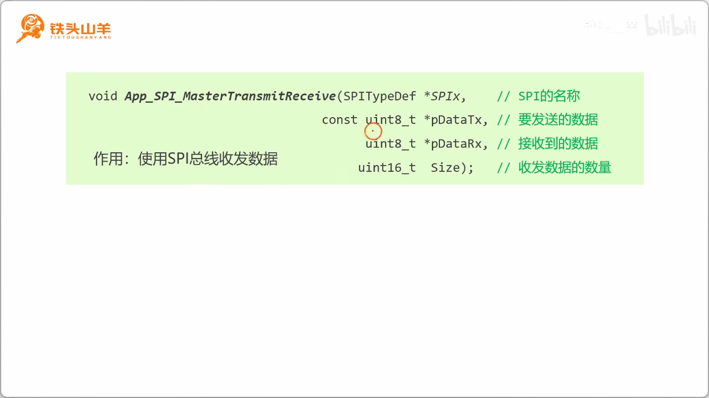
## 1.6.3 SPI数据收发过程简介
1. 流程：
	- 标志位 (TxE,RxNE) 
	- 收发过程：闭合总开关→向TDR写第一个字节→等待TXE(向TDR写第i+1个字节)→ 等待RxNE(从RDR读第i个字节)→ 等待RxNEz→读最后一个字节→ 断开总开关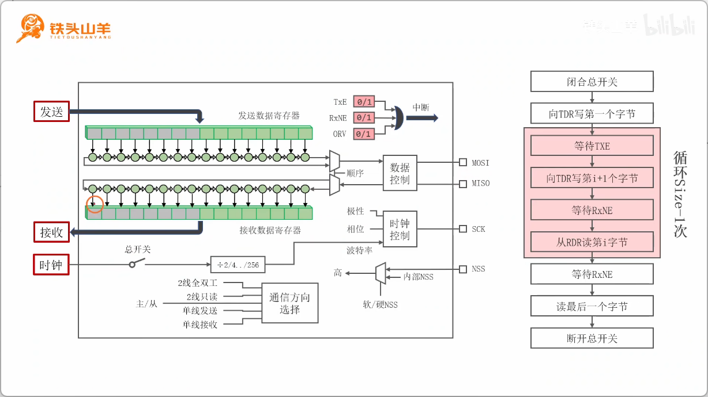
## 1.6.4 代码编写
1. 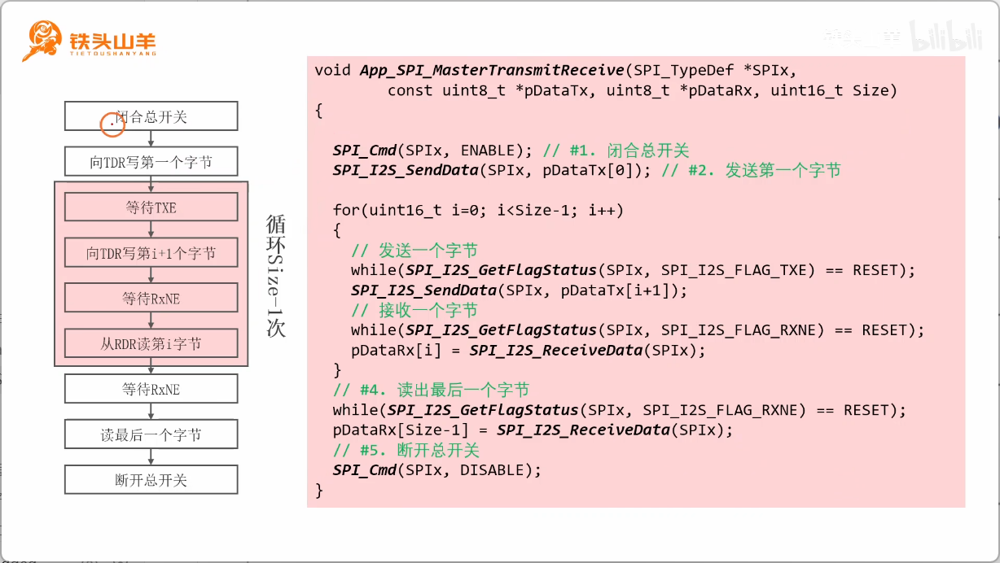
# 1.7 W25Q64 实验
## 1.7.1 W25Q64的存储结构
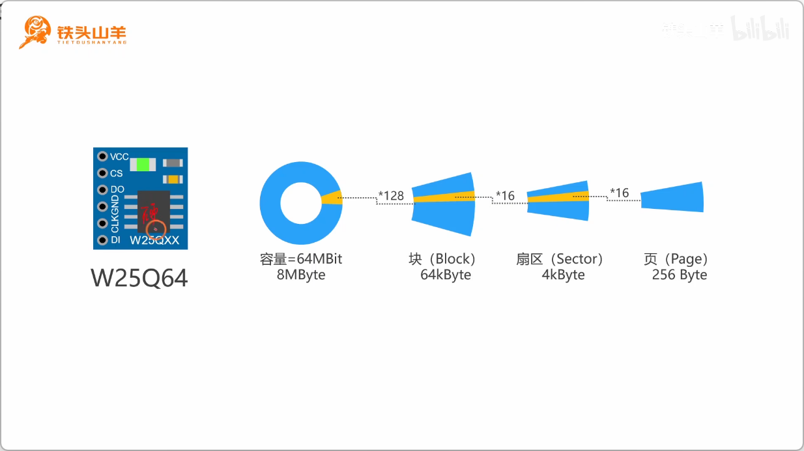
## 1.7.2 使用W25Q64存储数据
1. **存储数据的方式**：扇区擦除（擦除的最小单元扇区）  页编程（写数据是按页写）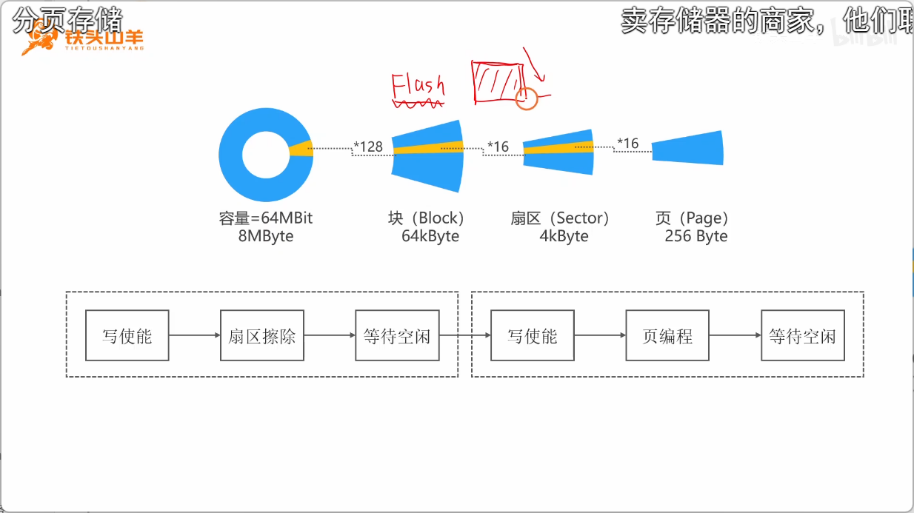
2. `App_W25Q64_SaveByte(uint8_t Byte)`
	1. 写使能：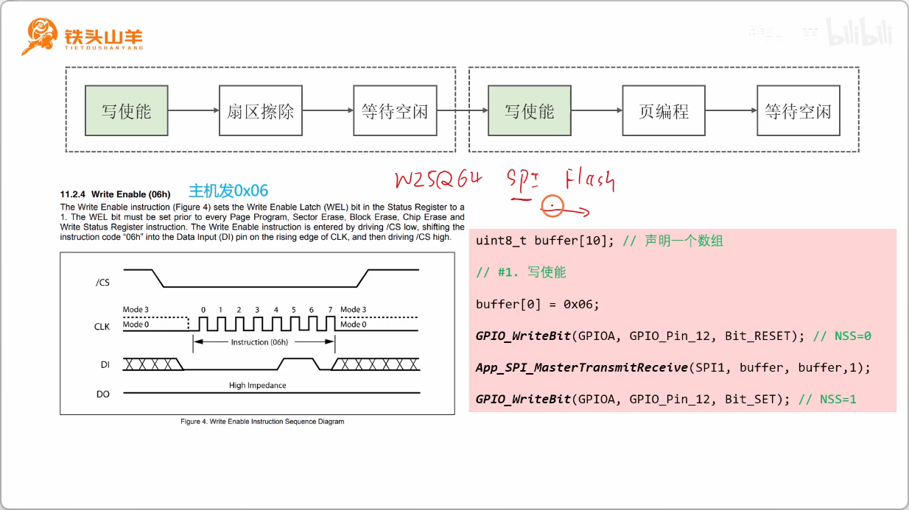
	2. 扇区擦除：主机发送指令码，24位地址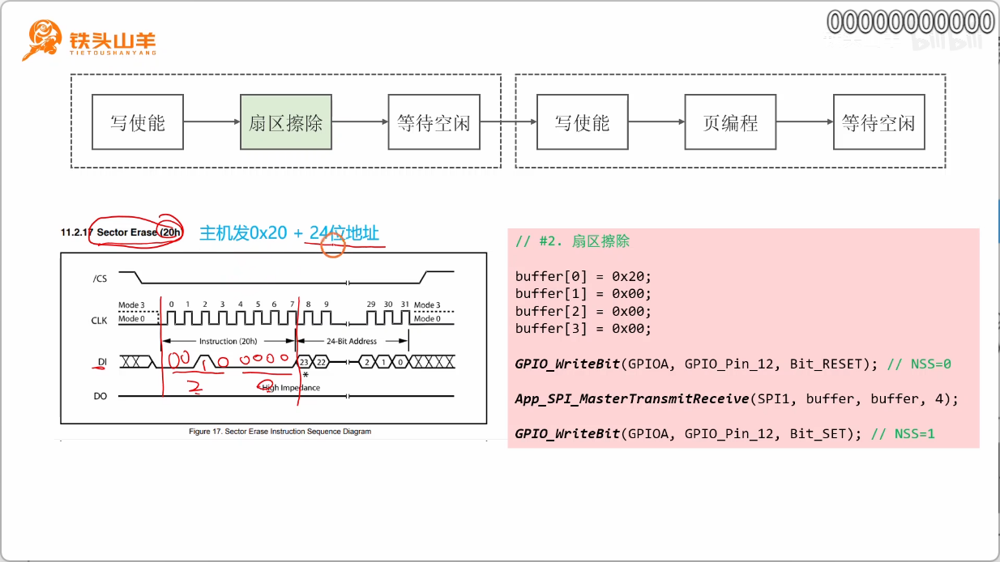
	3. 等待空闲：状态寄存器1（BUSY标志位，等于0表示空闲，等于1表示正在执行擦除），发送0x05,然后读取一个字节，读取的字节就是BUSY标志位的值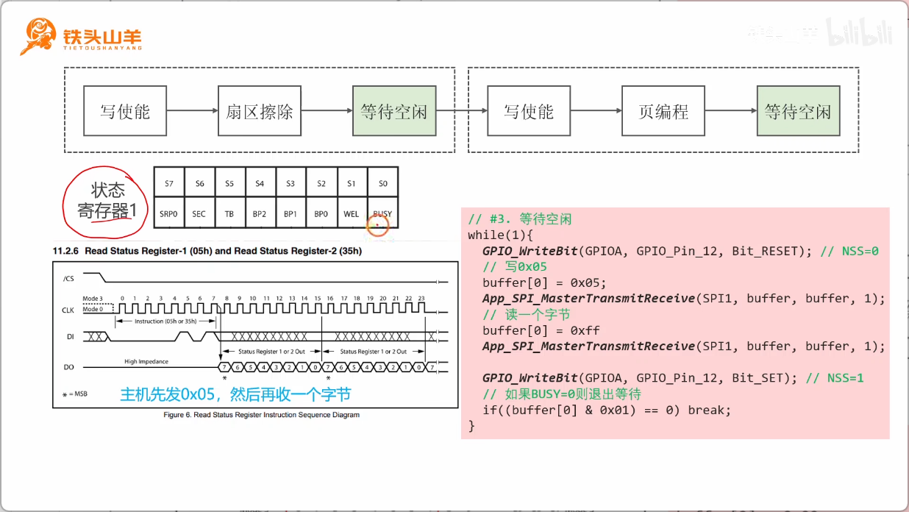
	4. 页编程  主机发送指令码0x02，24位地址，要写的数据（执行的是页变成，最多只能发送256个字节）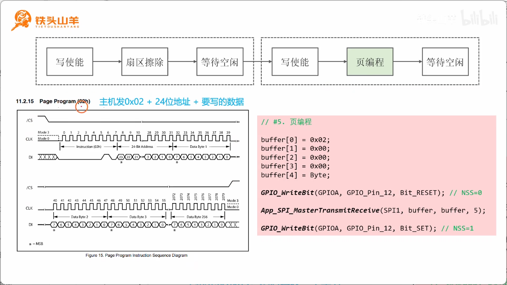
## 1.7.3 使用W25Q64读取数据
1. `App_W25Q64_LoadByte`:
	 - 读取数据：主机发送指令码0x03+24位地址，然后读数据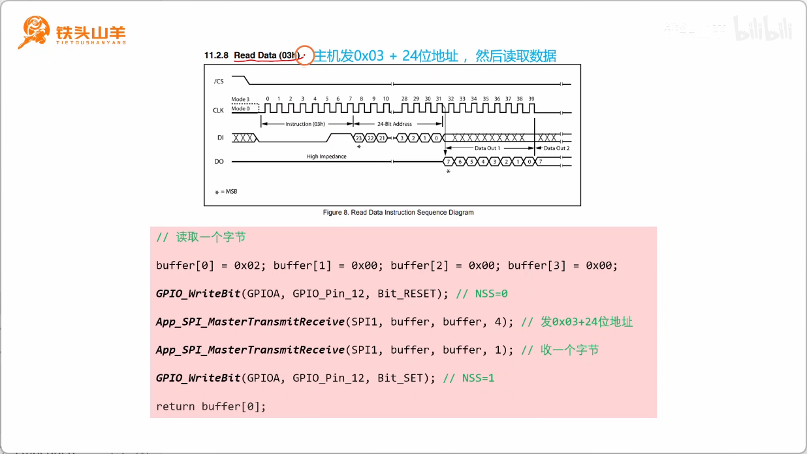
2. 测试代码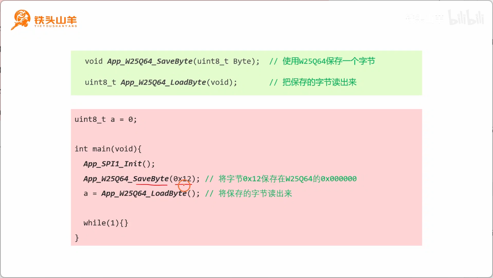
## 1.7.4 初始化板载LED
## 1.7.5 初始化按钮
## 1.7.6 使用按钮切换LED的亮灭
## 1.7.7 保存LED的当前状态
## 1.7.8 恢复LED的状态

