# 7.1 工作原理
## 7.1.1 EXTI（外部中断和事件控制器）模块简介
1. EXTI也是一个片上外设 ，**EXTI 是一根（或者20根）被配置好的线。外面的引脚电平一变，这根线就立刻通电（产生信号），顺着线跑去触发中断，让 CPU 干活。**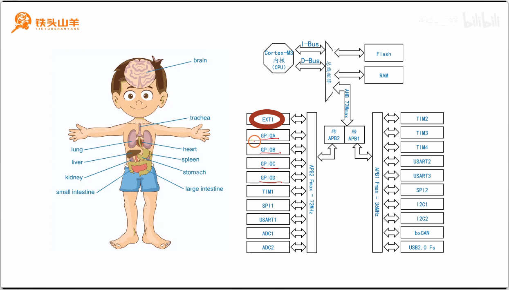
2. EXTI检测到的是电压的变化，就会向外产生中断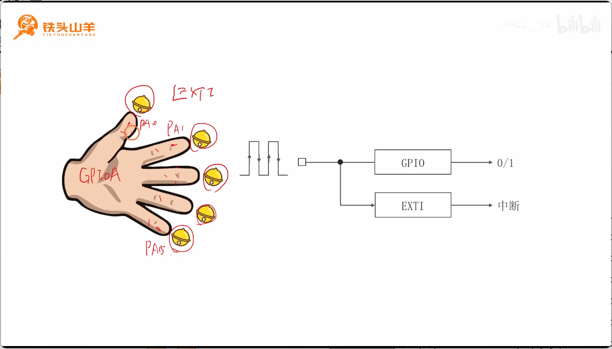
## 7.1.2 EXTI应用举例
1. 应用案例（捕捉按钮动作的瞬间）：
	1. 不加入EXTI，GPIO配置的是输入上拉模式，按钮松开上拉为高电平，按钮按下的时候为低电平
	2. 加入EXTI，EXTI就会捕捉电压的变化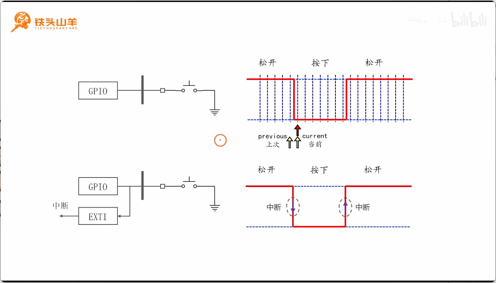
## 7.1.3 线的概念
1. EXTI线（20条）：EXTI信号输入，EXTI线会对输入信号的上升沿下降沿进行捕捉，捕捉到就会产生中断
	- EXTI线，其中十六条线给GPIO准备的，但是GPIO有37条，分配方案:  **不管你的芯片有多少个引脚，系统只看“尾号”。尾号是 0 的，全都去抢 EXTI0 这根线；但因为线只有一根，同一时刻它只能插在一个端口上（由你写代码决定插哪）。**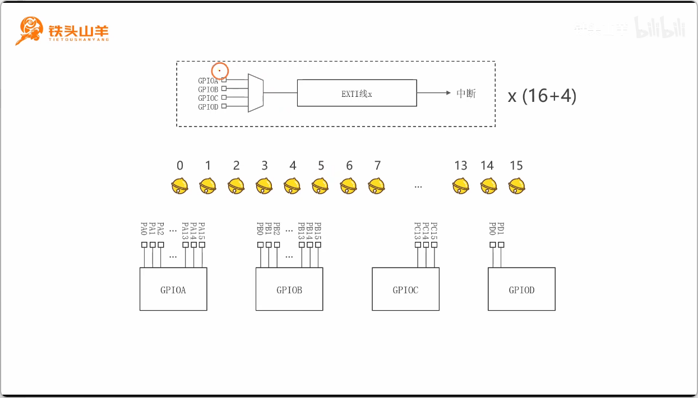
	- 剩下四条线：EXTI Line 16：PVD（可编程电压监测器）  EXTI Line 17：RTC（实时时钟）  EXTI Line 18：USB   EXTI Line 19：Ethernet（以太网）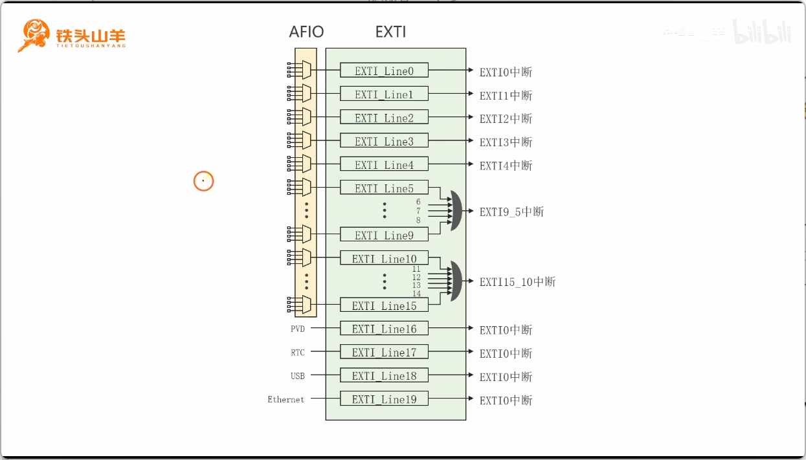
## 7.1.4 线的内部结构
1. 复用器（将线分配给GPIO的哪一个组）→ 边沿检测电路（上升沿，下降沿，上升沿和下降沿取或门得双边沿信号   三个信号）→输入信号是上升沿的时候，就会触发中断，输入信号是下降沿，就会触发中断，如果是双边沿，触发中断，也就是说，无论是上升沿，下降沿，双边信号，都会触发一个中断，处理硬件触发，还有软件触发（向其中写1，就可以触发中断）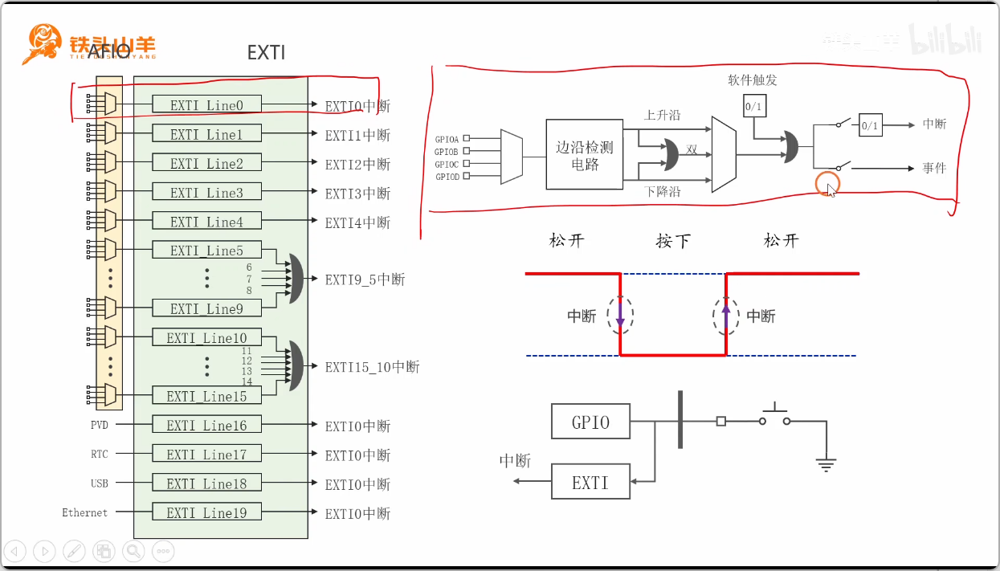
# 7.2 按钮实验
1. 实验现象：按下时候LED没有变化，松开后这个LED电位会发生变化，多以这个中断就是这个中断在上升沿触发
## 7.2.1 搭建电路
1. 复用输出开漏（LED），输入上拉（按键）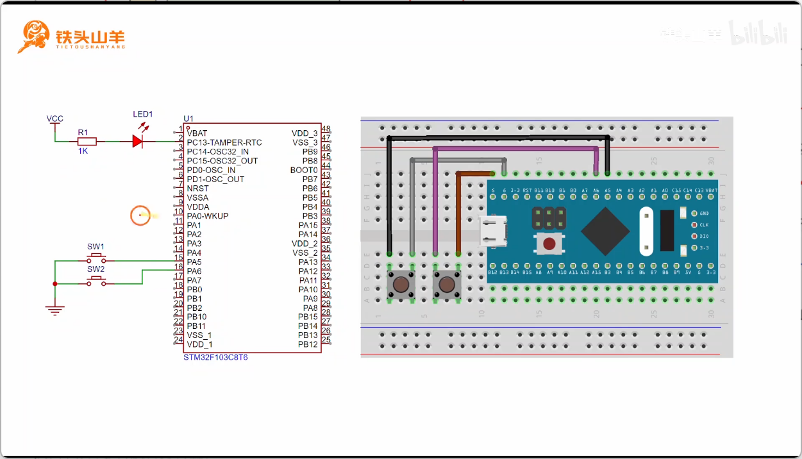
## 7.2.2 分配EXTI线
1. `GPIO_EXTILineConfig`
	- 作用使用AFIO模块为EXTI的线选择IO引脚
	- 参数：端口号，线编号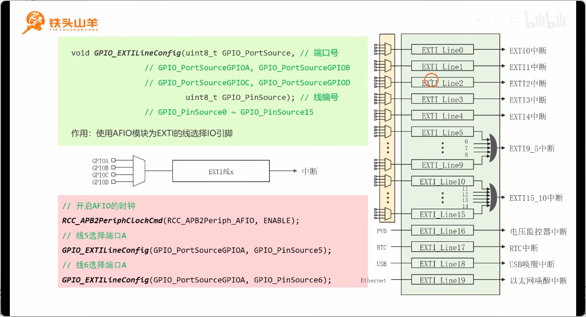
## 7.2.3 配置EXTI线的参数
1. 内部结构框图：线编号，模式（中断，事件），边沿（上升沿，下降沿，双边沿），开关（两个开关，如果模式选择中断，就是中断开关的开和关，否则就是事件开关）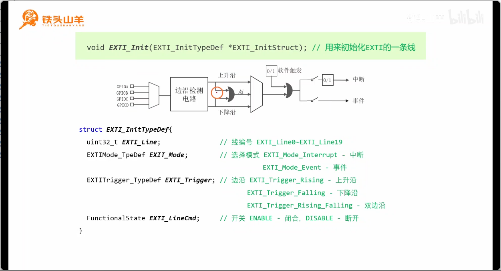
2. 初始化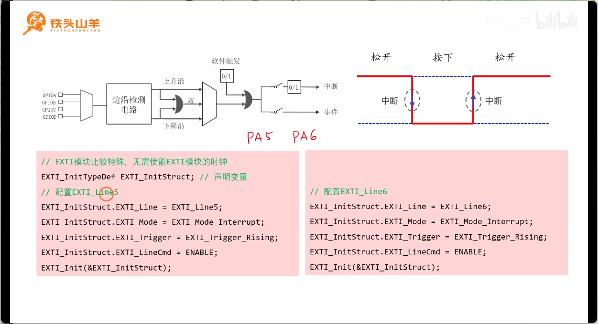
## 7.2.4 配置NVIC模块
1. 中断产生后要进入NVIC中进行中断管理  中断向量表产生的中断（EXTI0中断，EXTI1中断，EXTI2中断，EXTI3中断.......）,会进入中断内部结构框图片上外设的EXTI，所以需要进行对NVIC的配置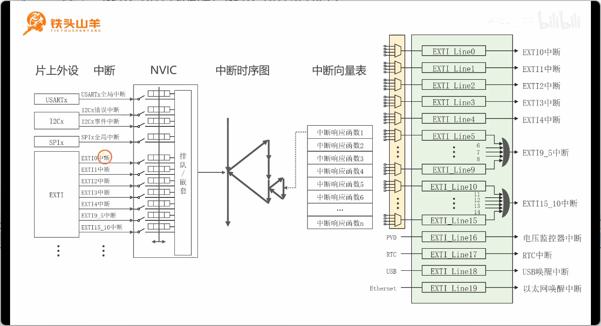
## 7.2.5 编写中断响应函数
### 7.2.5.1 确定中断响应函数的名称
1. startup→57行（中断向量表）→ 中断响应函数
### 7.2.5.2 判断那条线触发了中断
2. EXTI Line5~EXTI Lin9共用一个中断，需要在中断响应函数判断是那个线产生的中断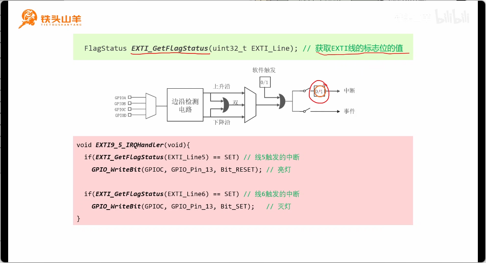
### 7.2.5.1 清除标志位
1. 执行亮灭灯的时候要清除标志位，中断5产生的是亮灯，中断6产生的是灭灯  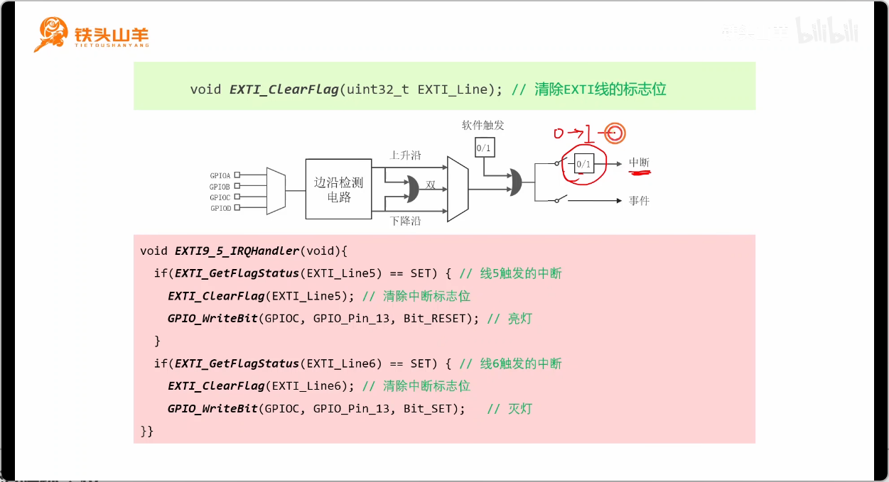

 

