# 1.1 中断的概念
### 1.1.2 中断的基本概念
1. 中断：单片机应对突发事件的一种方式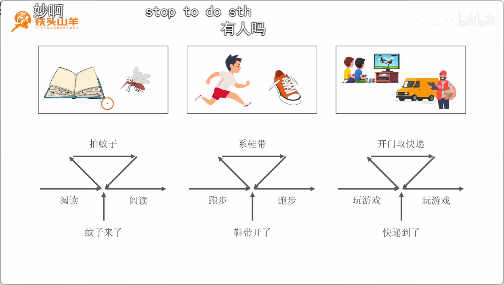
2. 中断响应函数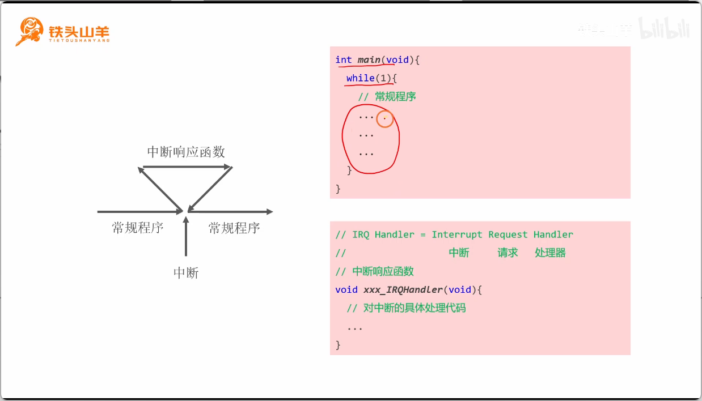
### 1.1.2 中断编程举例
1. 改变闪灯速度，通过标志位产生中断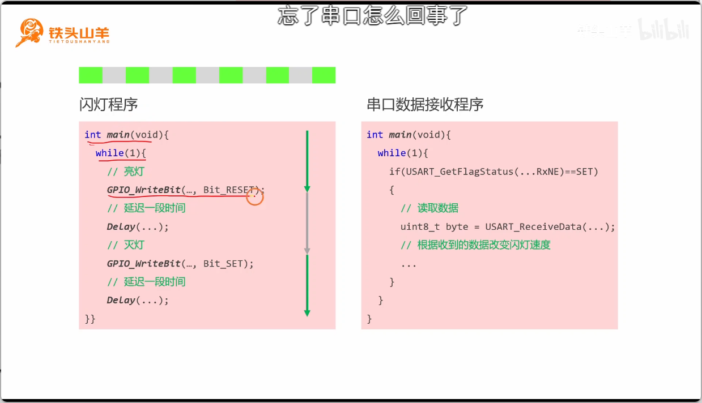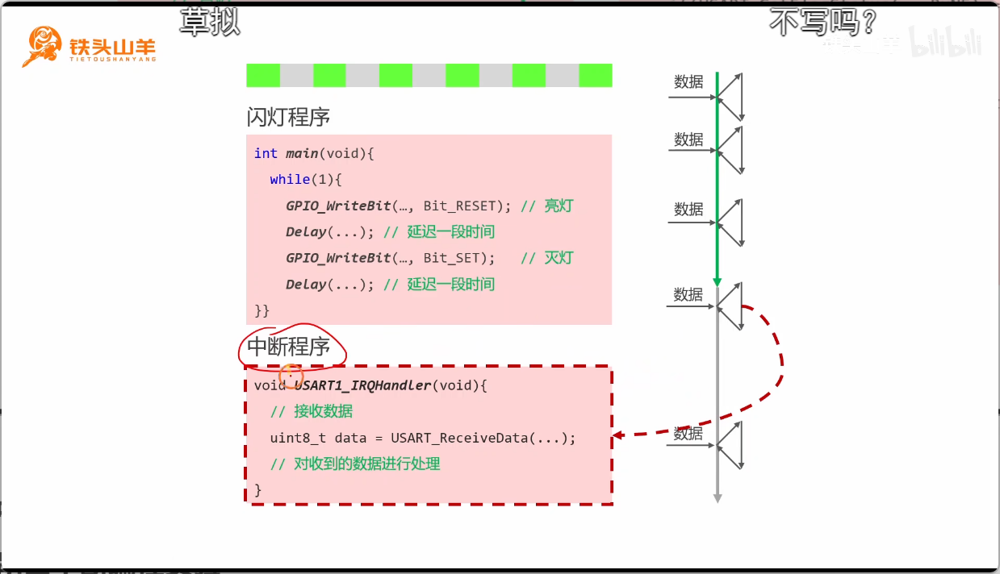
# 1.2 中断优先级
## 1.2.1 中断优先级的概念
1. 中断优先级：用数字表示中断的紧急程度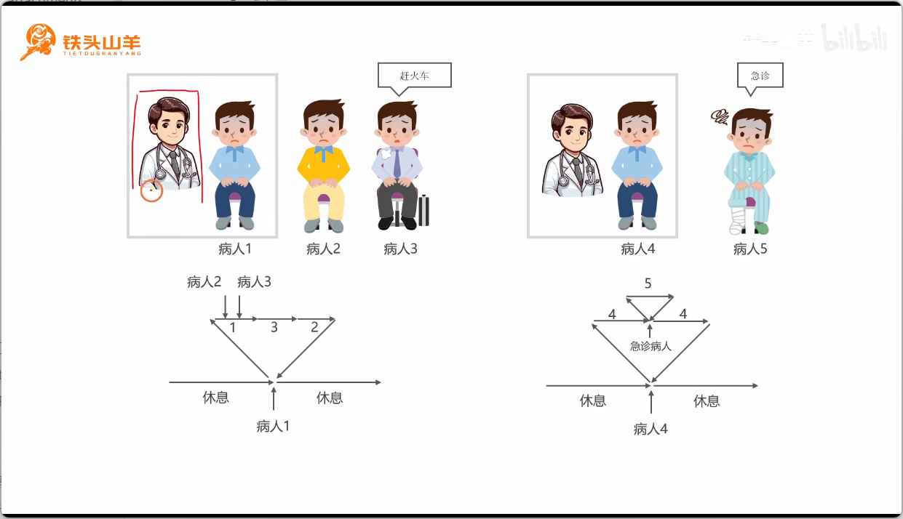
2. **抢占优先级和子优先级的核心区别在于：抢占决定“能不能插队打断”，子优先级决定“同时排队时谁先上”。** 抢占优先级具有绝对的打断权，只要新来的数值小于正在执行的数值，就能随时打断当前程序形成嵌套；而子优先级毫无打断能力，它只有在多个中断的抢占级别完全相同且同时发生时，才作为“裁判”决定谁先执行（**数值小的先上**）。两者都必须遵循“数值越小级别越高”的原则，且能填写的数字范围严格受“优先级分组”的格子数限制（如分组2中两者都只能是0~3）。
3. 数字越小，中断优先级越高
## 1.2.2 中断优先级的表示方法
1. 中断结构框图：外设（如串口、EXTI）的触发条件通过或门合并产生中断请求信号，进入NVIC（嵌套向量中断控制器），**由NVIC根据抢占与子优先级进行仲裁**，决定是排队等待还是打断当前程序进行嵌套；随后CPU响应中断并保护现场（如时序图折线所示），根据中断号去中断向量表中查找到对应的中断响应函数入口地址并跳转执行，执行完毕后恢复现场返回原程序。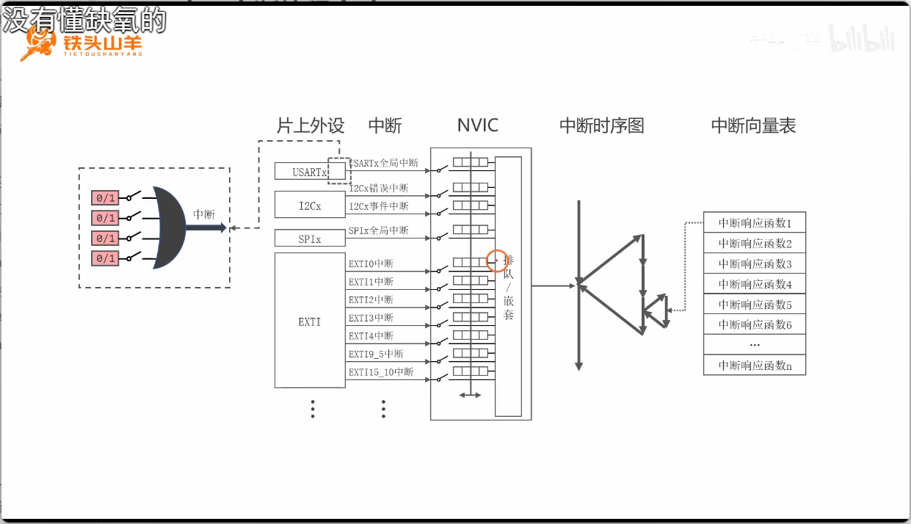
2. NVIC: 五种分组，每一个组都有十六种情况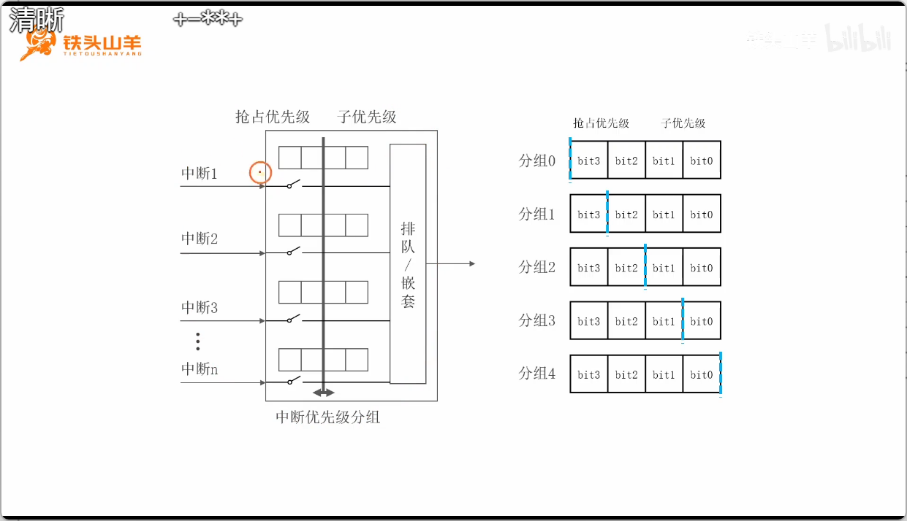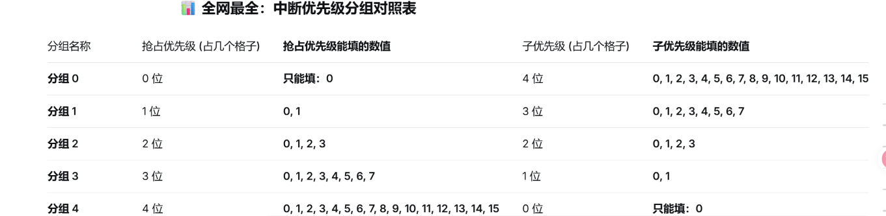
## 1.2.3 抢占优先级与中断嵌套
1. 中断嵌套：更高的优先级的中断打断正在指定的中断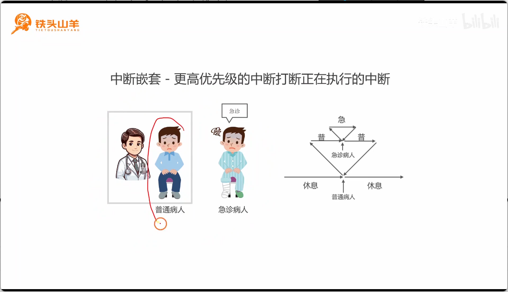
2. 分组二，抢占优先级是前两位，子优先级是后两位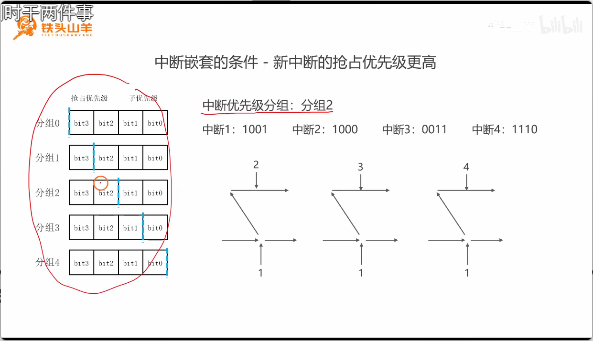
## 1.2.4 子占优先级与中断排队
1. 子优先级：抢占优先级相同，等待第一个中断执行完再处理新中断（不会打断当前中断的执行，优先级高的排前面，优先级相同分两种情况（不同时发生：先来后到，同时发生：通过中断号来判断，号码小谁就先上））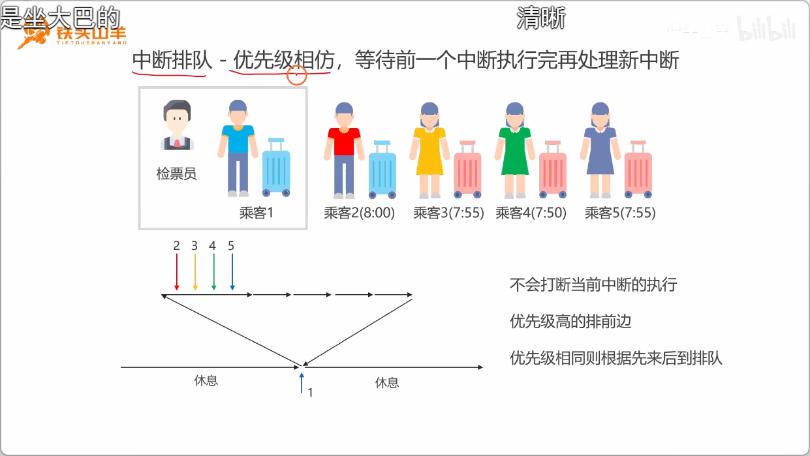
# 1.3 串口中断编程实验
## 1.3.1 编写闪灯代码
以不同的速度闪烁
## 1.3.2 初始化串口
1. 连线图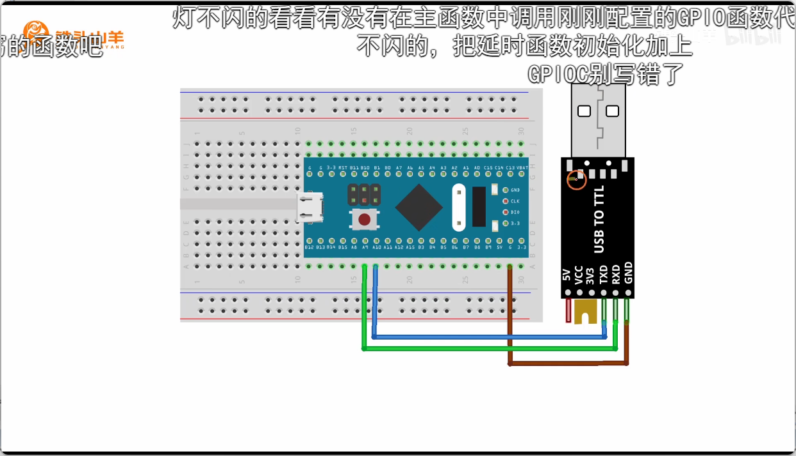
## 1.3.3 让RxNE标志位触发中断
1. 闭合中断开关：填写串口名称 标志位名称USART_RXNE  开关状态DISABLE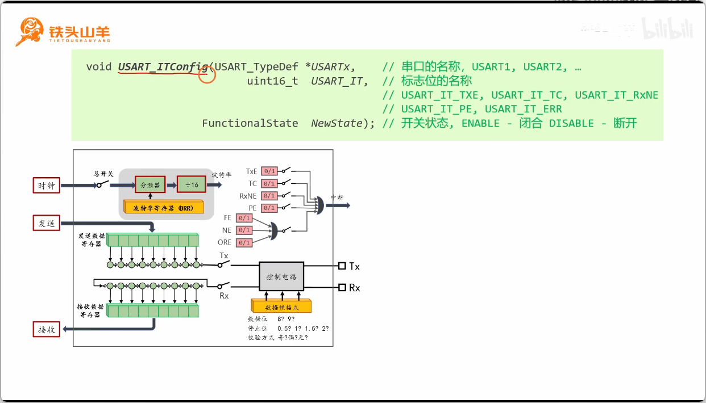
## 1.3.4 配置NVIC模块
1. NVIC模块：嵌套中断向量控制器(主要是对于中断的管理)  属于Cortex-M3内核一部分
2. 配置：中断优先级分组，中断优先级，中断使能（闭合开关）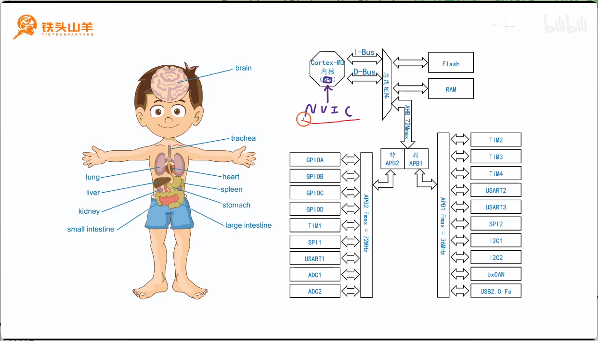
3. 配置中断优先级分组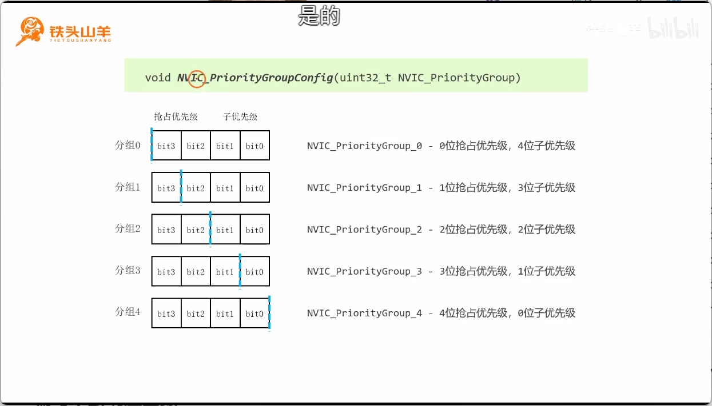
4. 对NVIC某一个中断进行初始化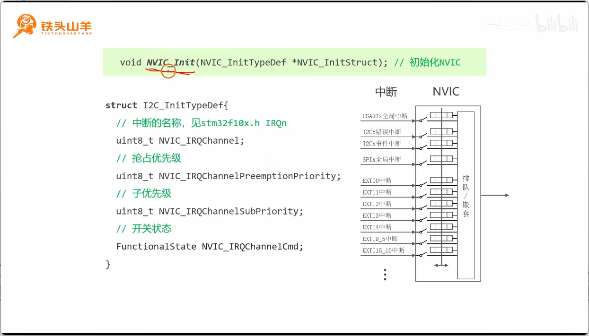
5. 中断响应函数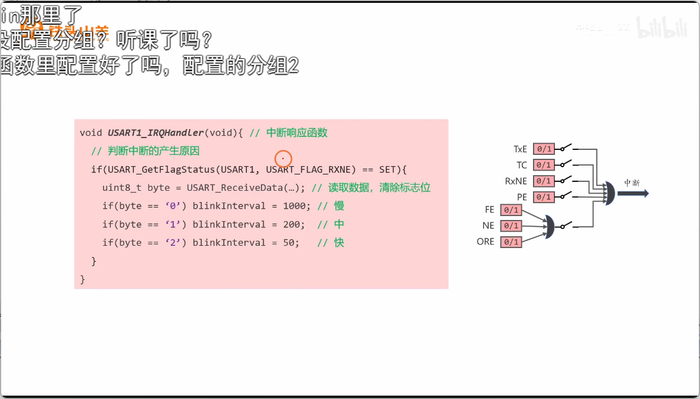
## 1.3.5 编写中断响应函数 

