# 1.1 时基单元
## 1.1.1 定时器简介
1. 定时器简介：TIM1(高级定时器) TIM2，TIM3，TIM4(通用定时器)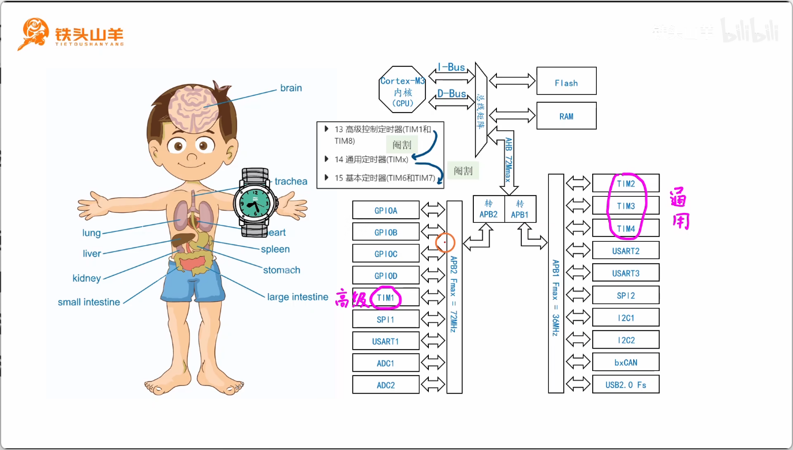
	- 高级定时器，通用定时器，基本定时器
2. 定时器内部结构框图：时基单元    输出比较  输入捕获  从模式控制器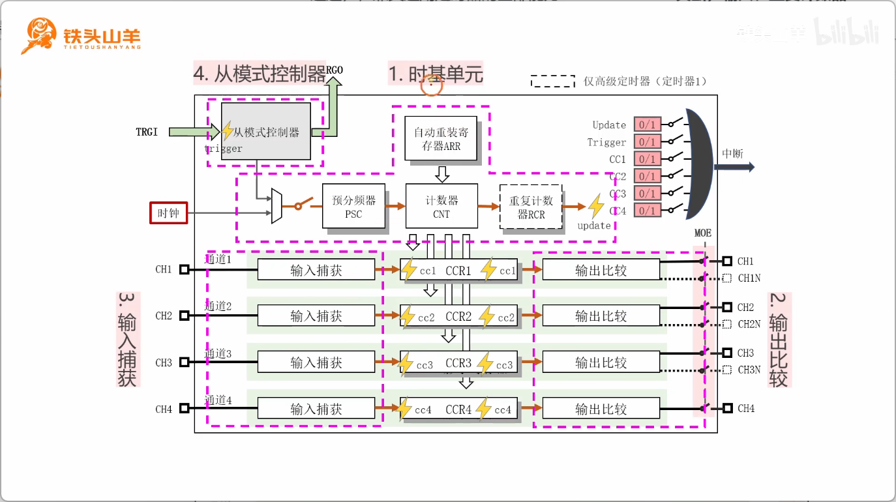
## 1.1.2 时基单元的基本结构![[image-1795406487396.png]]
1. 基本结构：时钟源，预分频器，计数器，自动重装寄存器ARR，重复计数器RCR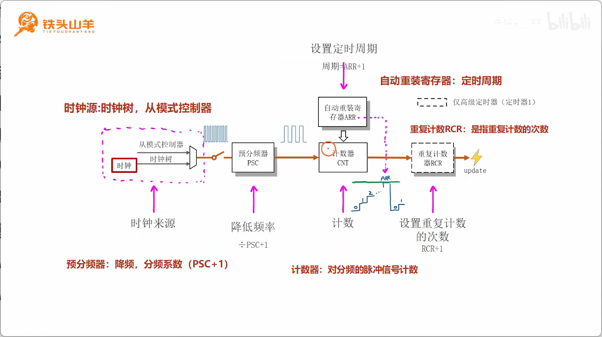
	- 时钟来源：时钟信号输入（时钟树，定时器本身的从模式控制器）
	- 预分频器：输入的时钟信号比较高，就需要预分频器进行**分频**，降低频率，分频系数是可以设置的（PSC+1）
		- 输入时10MHZ只需要把**预分频器对应的预分频系数**设置为9，从而降频到1MHZ
	- 计数器（CNT）：对左面分频的脉冲信号进行计数
	- 自动重装寄存器（ARR）：设置定时周期
		- 计数器通过对脉冲信号进行计数，然后对比ARR设置的定时周期，直至与ARR设置的定时周期相等的时候，就会溢出，从零开始重新计数
	- 重复计数器RCR：设置重复计数的次数
		- 没有重复计数器RCR时：计数器CNT每发生一次溢出，就会产生一次update事件
		- 加上重复计数器RCR时：计数器需要溢出RCR+1次，才会产生一次update事件
2. 举例：时钟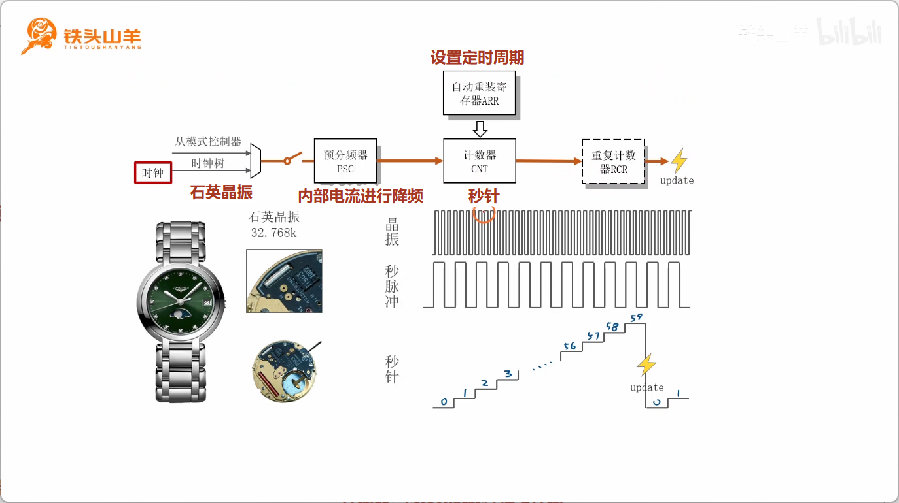
## 1.1.3 上计数，下计数和中心对齐
1. 计数方式：上计数，下计数，中心对齐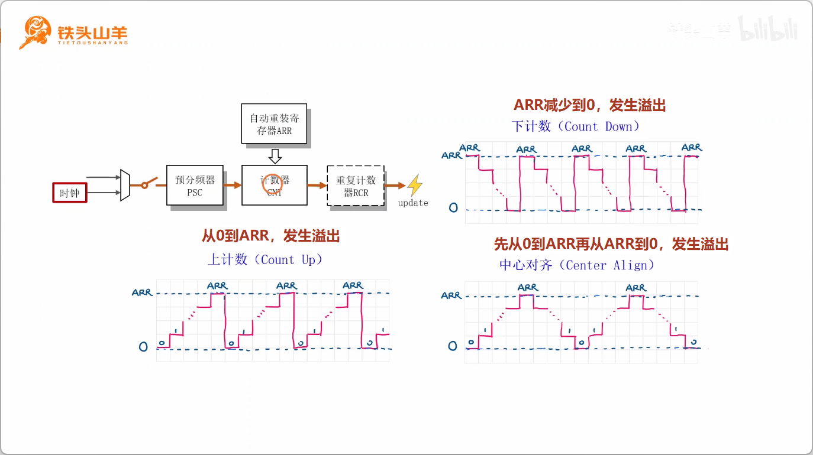
	- 下计数：每来一个脉冲ARR就会减少1，直至减少到0，就会发生一次溢出，然后从ARR开始重新计数
	- 中心对齐：首先从0开始上计数，计数到ARR，然后转变成下计数，然后从ARR开始计数到0 ，同样的ARR中心对齐的计数周期是上计数和下计数的两倍
## 1.1.4 时钟来源
1. 时间和频率的换算：
	- 1 秒=1,000 毫秒 (ms)=1,000,000 微秒 (μs)
	- **1 MHz** 的时钟 ➔ 一个周期就是 **1 μs** （**M**与**μ**刚好对应，最简单的1:1）
	- **1 kHz** 的时钟 ➔ 一个周期就是 **1 ms** （**k**与**m**对应）
	- **1 Hz** 的时钟 ➔ 一个周期就是 **1 s** （**Hz**与**s**对应）
## 1.1.5 寄存器预加载（防止寄存器跑飞）
1. 寄存器预加载：灰色阴影表示影子寄存器，白色的方块就是活动寄存器，向寄存器写值的时候，先写入影子寄存器，不会立即生效，直至计数器CNT溢出的时候同时产生了一个update事件的时候，影子寄存器的值才会进入活动寄存器，然后生效![[Pasted image 20261017123443.png]]
2. 作用：以自动重装寄存器为例
	- 在定时器运行的过程突然改变ARR:  改变ARR，没有预加载机制，波形会立即生效，也就是ARR会立即改变，由于计数过程中ARR改变，且没有预加载，这个值会立即生效，如果此时计数器cnt的值大于改变后的ARR，那么无论cnt再怎么增加，也不会和ARR相等，计数器就会无限的增长上去，从而增长到一个最大的极限值才会发生溢出，这个现象导致寄存器跑飞![[Pasted image 20261017124436.png]]
	- 使能ARR寄存器的预加载：改变ARR不会立即生效，会等到下一次update事件，改变的ARR才会从影子寄存器进入活动寄存器中生效，从而防止寄存器跑飞![[Pasted image 20261017124955.png]]
# 1.2 自制延迟函数
1. Delay函数的延迟实现机制：系统滴答定时器（位于内核内部）![[Pasted image 20261017125643.png]]
## 1.2.1 获取单片机的当前时间
1. volatile: 
	- 作用：告诉编译器，这个变量是易变的，随时可能被外部因素改变，每次用它的时候要从内存中读取，不允许用缓存
	- 编译器：编译器在编译代码时，会做优化（Optimization）来提高运行速度。它的一个常见优化手段就是：如果一个变量在循环里没有被当前代码修改过，它就默认这个变量不会变，把它缓存在 CPU 寄存器里，而不去访问慢吞吞的**内存（RAM）**。
	- 应用场景：
		- 被中断修改的全局变量
		- 硬件寄存器
		- 多线程（RTOS）共享变量
2.  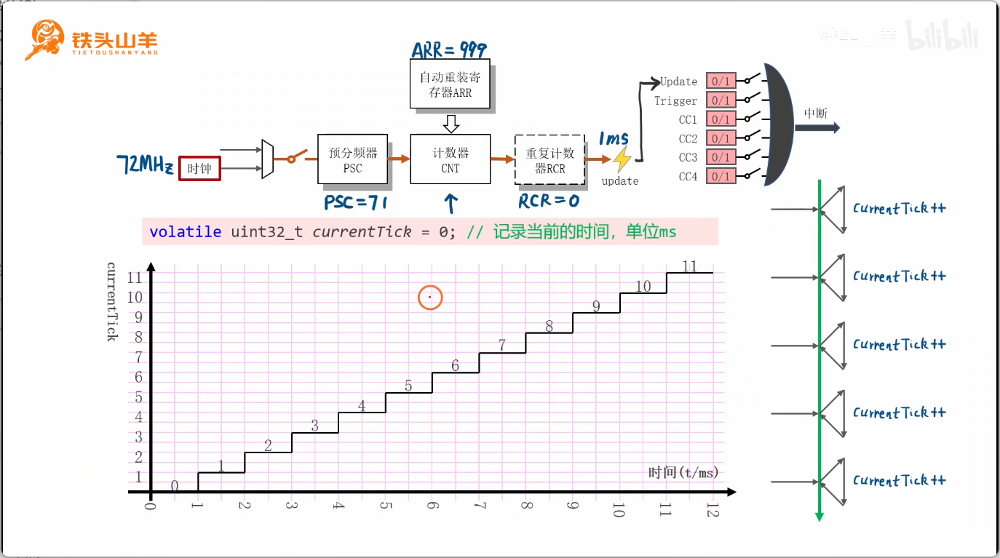
## 1.2.2 实现延迟函数
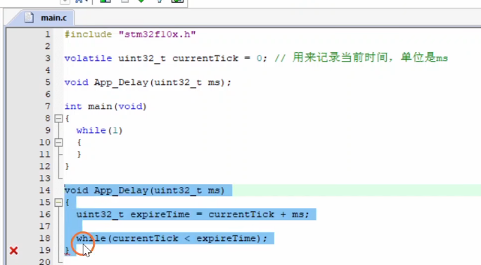
## 1.2.3 初始化时基单元
1. `App_TIM3_TimeBaseInit`:使能定时器时钟，配置时基单元参数，闭合时基单元的开关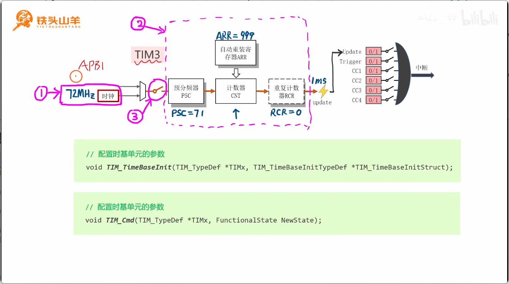
	- 时基单元参数：
		- Prescaler:   预分频器PSC的值
		- Period: 自动重装寄存器ARR的值
		- CountMode: 计数方式
		- TIM_RepetitionCounter ：重复计数器RCR的值
		- `TIM_ClockDivision`：时钟分频因子 CKD，暂时用不到
## 1.2.4 配置中断
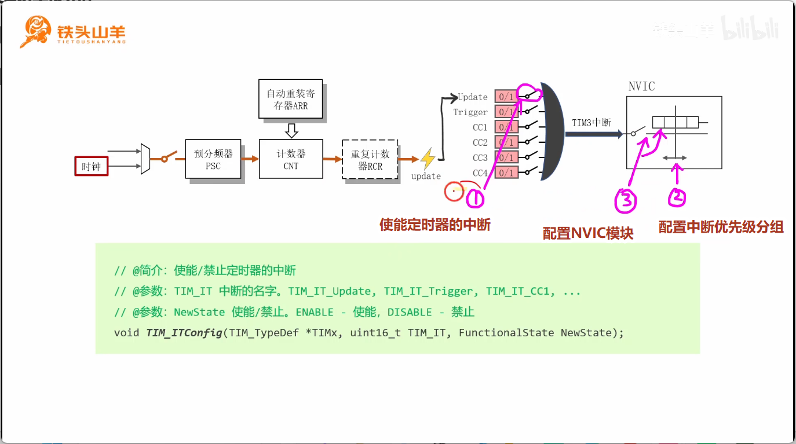
## 1.2.5 编写中断响应函数
1. 中断向量表→查询标志位→清楚标志位→计数++→板载LED（PC13）→ 测试延时函数（闪灯程序）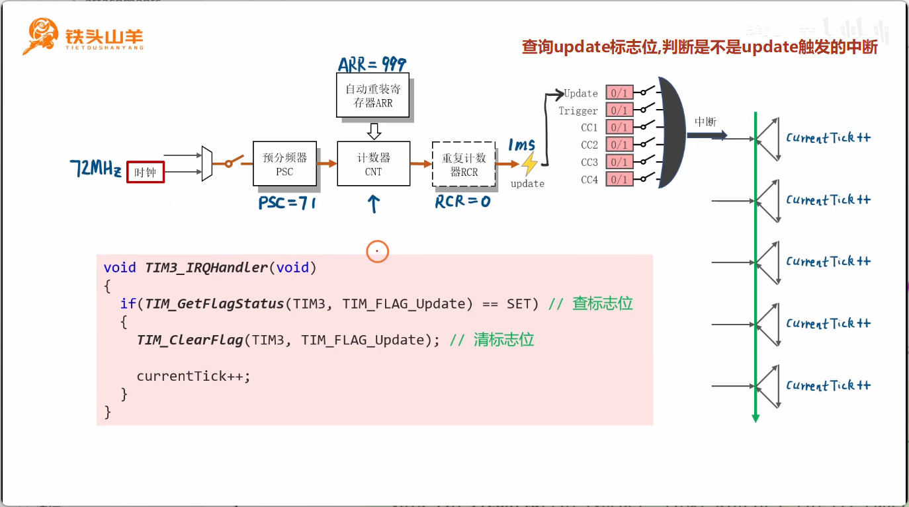
# 1.3 输出比较
## 1.3.1 输出比较简介
1. 定时器通道：
	- 四个通道CH1 CH2 CH3 CH4
	- 通道组成：输入捕获（测量外部输出信号的时间参数），CCRx寄存器，输出比较（定时器产生精确定时的方波信号）
## 1.3.2 基本工作原理(PWM)
1. PWM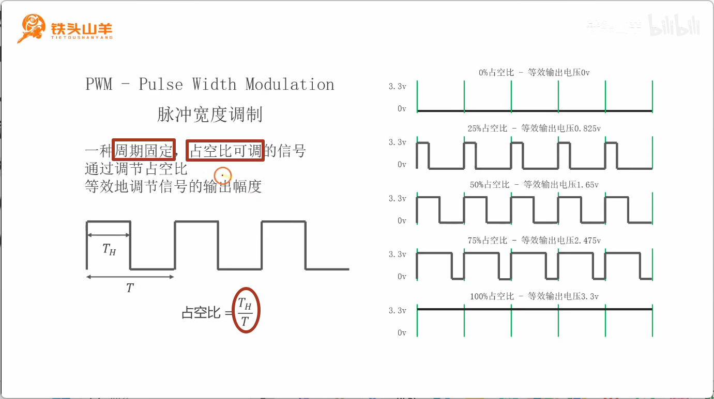
2. PWM基本的工作原理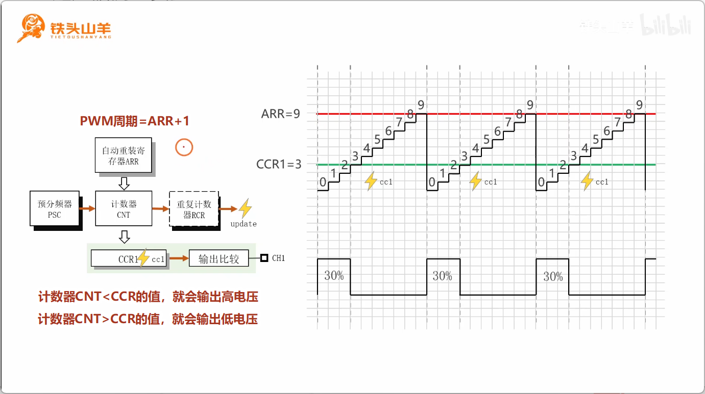
## 1.3.3 8种工作模式
1. 工作模式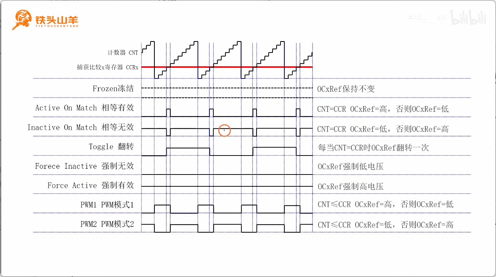
	- PWM1：CNT≤CCR OCxRef=高，否则OCxRef=低
	- PWM2：CNT≤CCR OCxRef=低，否则OCxRef=高
## 1.3.4 互补输出
1. CH1~CH3有两个引脚（正常输出，互补输出），CH4只有一个引脚（正常输出）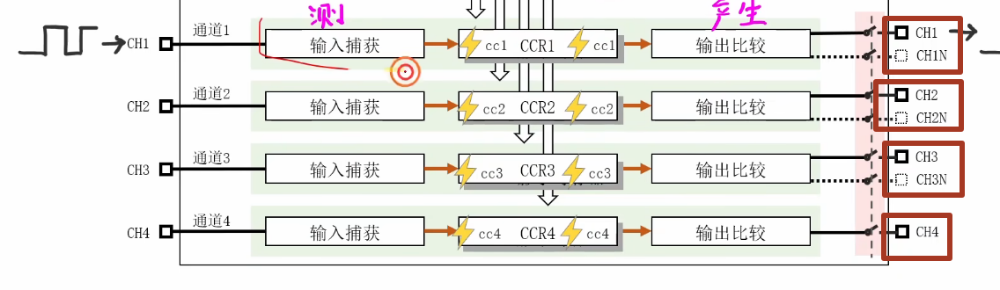
2. 正常输出&&互补输出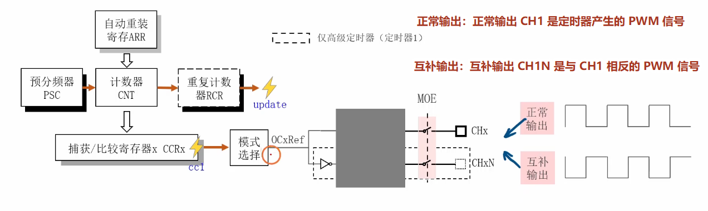
3. 互补输出的作用：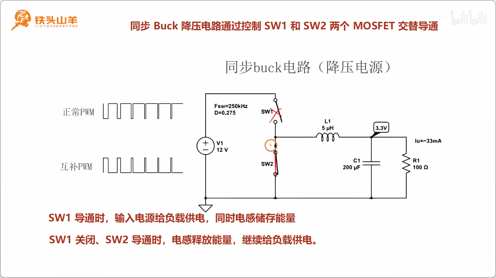
## 1.3.5 极性选择
1. 极性选择：是否对输出信号取反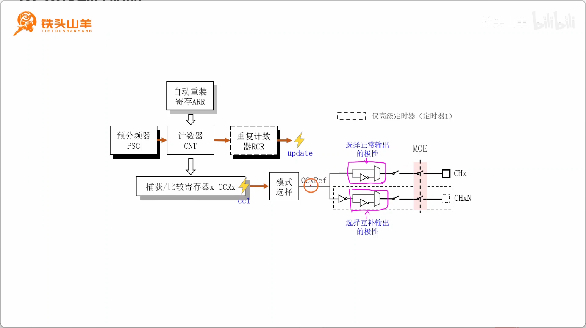
# 1.4 呼吸灯实验
## 1.4.1 呼吸灯原理
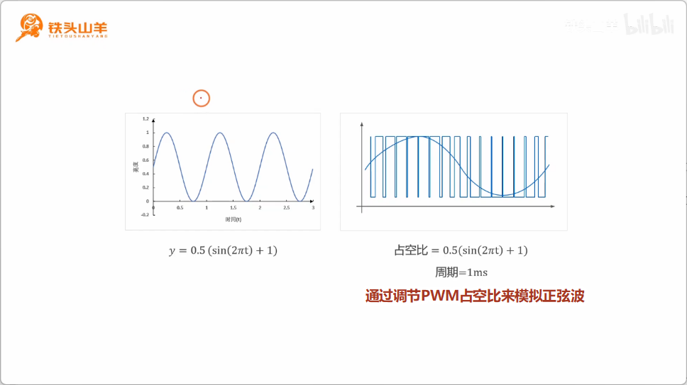
## 1.4.2 初始化I0引脚
1. 使用TIM1定时器引脚，103c8t6没有PE引脚，所以没有完全重映射                           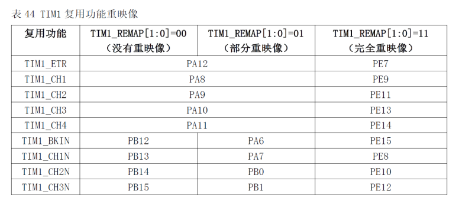
2. TIM1_CH1(PA8),TIM1_CH1N(PB13)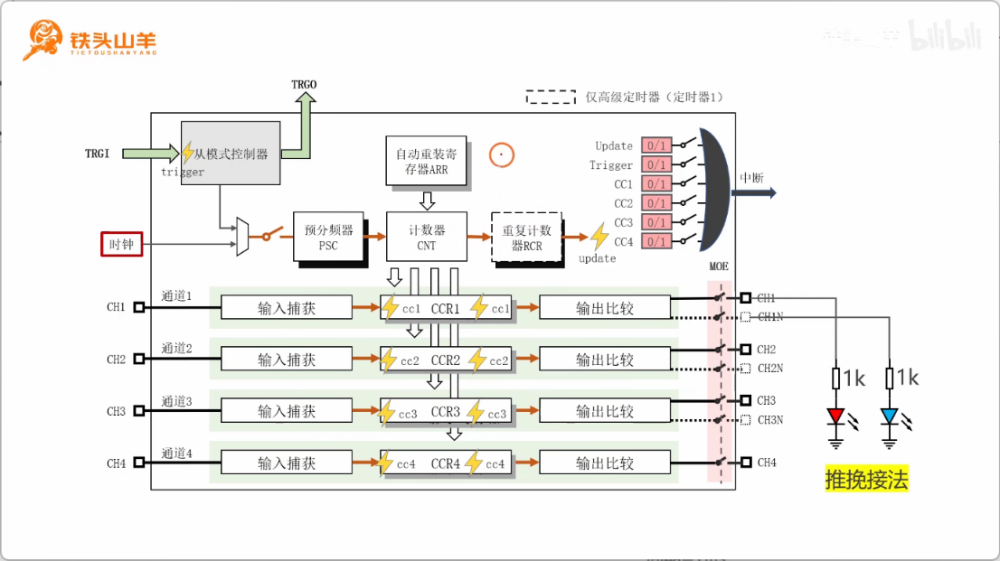
3. 接线图：                                  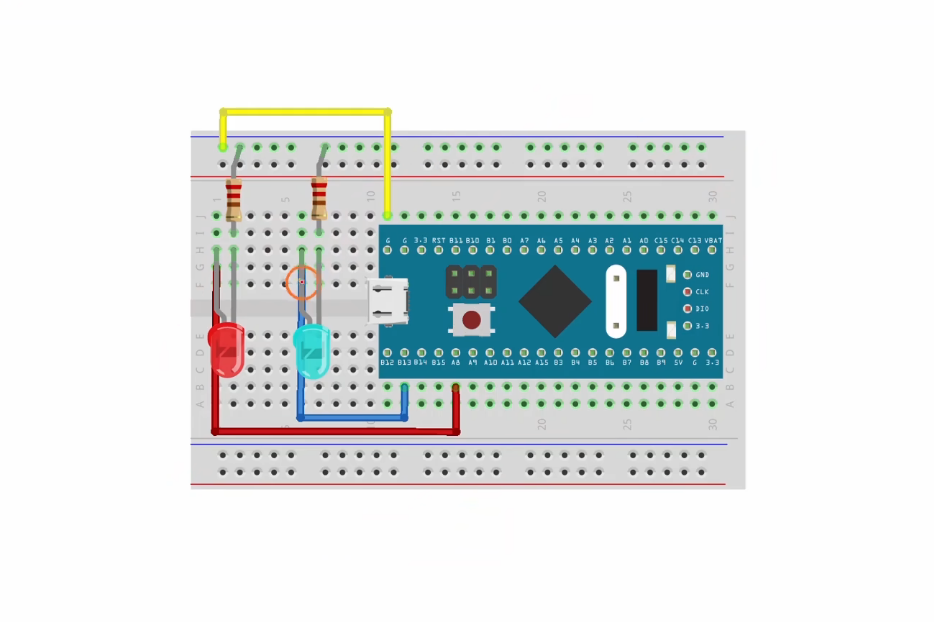
4. IO引脚配置：复用输出推挽模式  最大输出速度：1ms的周期→1kMHz   所以选择2kMHz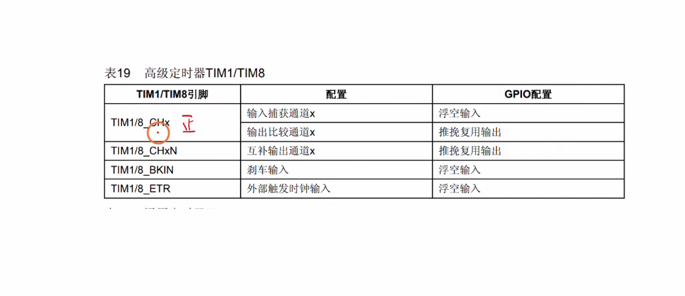
## 1.4.3 配置时基单元
## 1.4.4 配置输出比较的参数
## 1.4.5 改变PWM占空比
# 1.5 输入捕获
# 1.6 超声波测距实验
# 1.7 从模式控制器
# 1.8 PWM参数测量原理
# 1.9 PWM参数测量实验
  

