# 1.1 时钟树
## 1.1.1 时钟和时钟树的概念
1. 时钟：**抽象的节拍和信号** ，周期性交替的高低电平信号（方波），作为全局同步基准，控制触发器在特定边沿动作，确保数据有序传输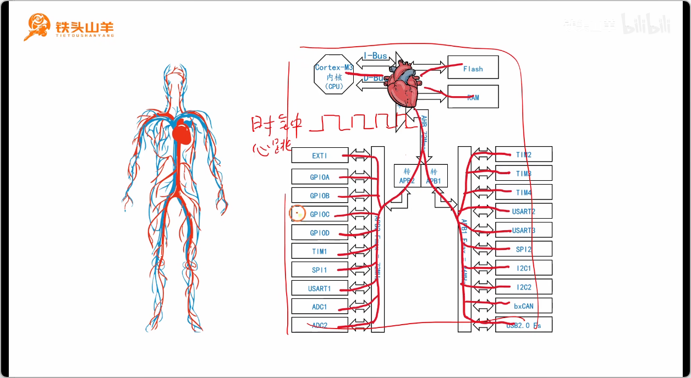
2. 时钟树：芯片物理设计中用于分发时钟信号的树状网络结构，由于时钟源到各触发器的物理距离不同，直接布线会导致延迟差异（时钟偏斜）和信号衰减，因此需要通过多级缓冲器逐级分支构建该网络，其核心目的是将时钟信号准确送达全芯片所有触发器，尽量减小各终端接收信号的时间差，保证信号完整性并控制动态功耗。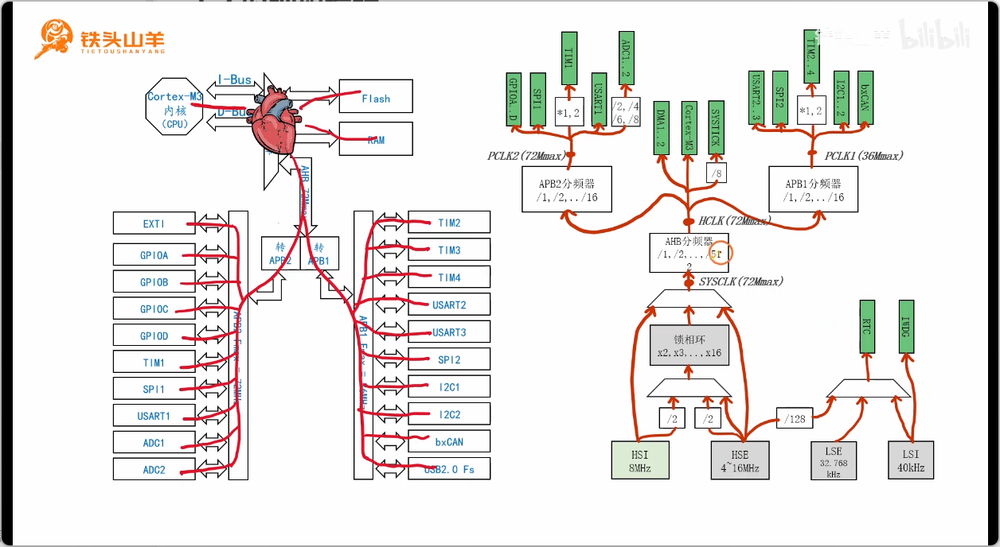
## 1.1.2 分频器、锁相环和复用器
1. 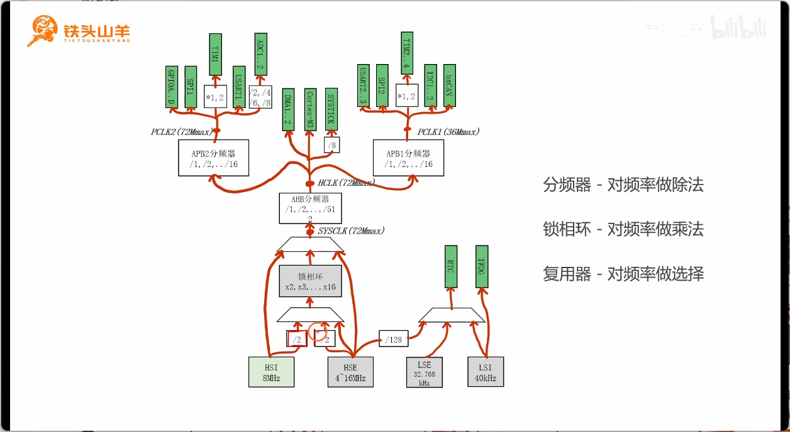
	1. 分频器：对频率做除法
	2. 锁相环：对频率做乘法
	3. 复用器：对频率做选择
## 1.1.3 树根
1. 单片机有两个时钟树，每一个时钟树都有两个时钟源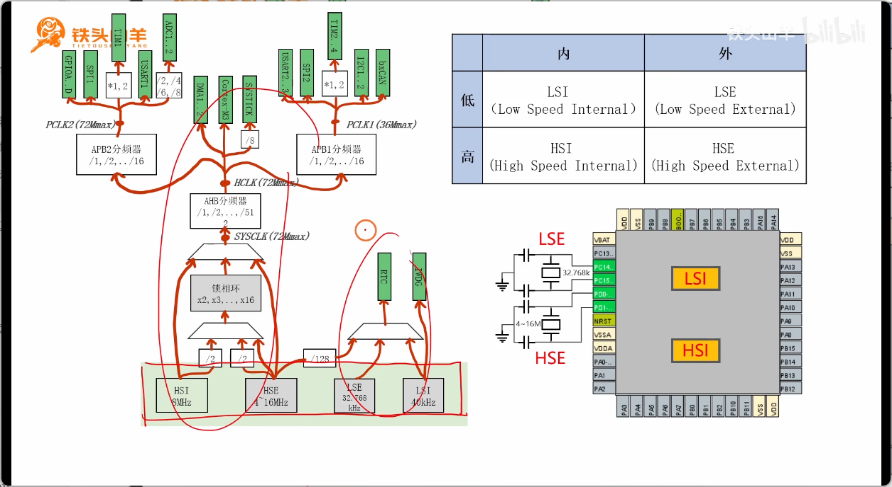
	- HS（高速）：
		- HSI：高速内部时钟
		- HSE：高速外部时钟
	- LS（低速）：
		- LSI：低速内部时钟
		- LSE：低速外部时钟
	- 外部高速时钟和外部低速时钟作用：内部时钟源精度不高，所以要加入外部时钟
## 1.1.4 树干
1. 产生系统时钟SYSCLK（系统是时钟）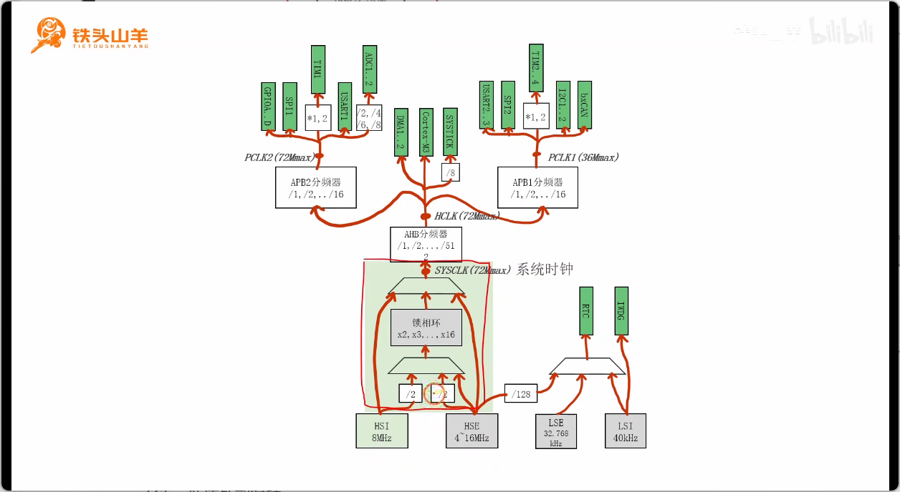
	- 系统时钟来源：HSI，HSE，锁相环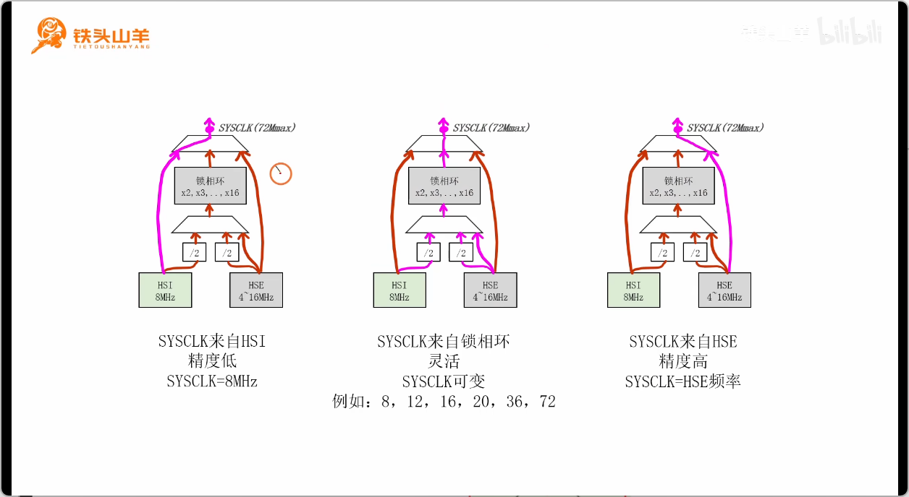
		- SYSCLK来自HSI，精度低，SYSCLK=8MHz
		- SYSCLK来自锁相环，灵活，SYSCLK可变
		- SYSCLK来自HSI，精度高，SYSCLK=HSE频率
## 1.1.5 树枝
1. 三条总线就是三个树枝，每一个树枝都有一个分频器, AHB分频器分频产生的就是HCLK,HCLK会被APB2分频器和APB1分频器继续分频得到PCLK2和PCLK1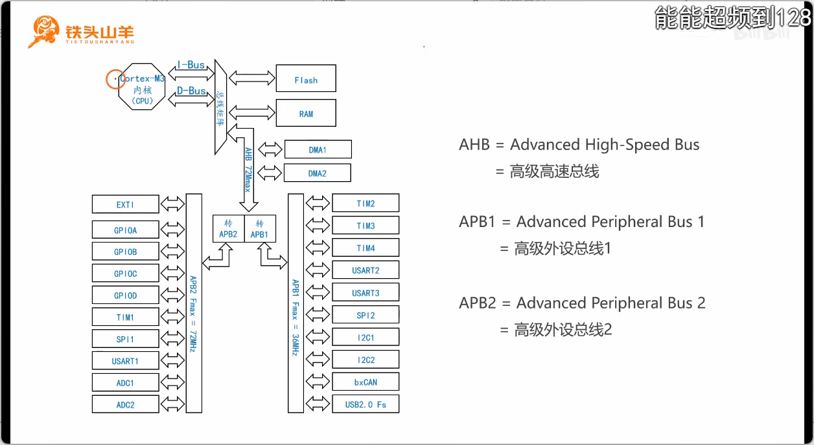
	- AHB(高级高速总线)：DMA1,DMA2
	- APB1（高级外设总线1）：GPIOA~D,EXTI,TIM1,SPI1,USART1,ADC1,ADC2
	- APB2（高级外设总线2）：TIM2,TIM3,TIM4,USART2,USART3,SPI2,I2C1,I2C2,bxCAN,USB2.0Fs
	- HCLK最高频率是：72MHz，PCLK1的最高频率是36MHz,PCLK2的最高频率是72MHz
2. 通过三个分频系数分频可得到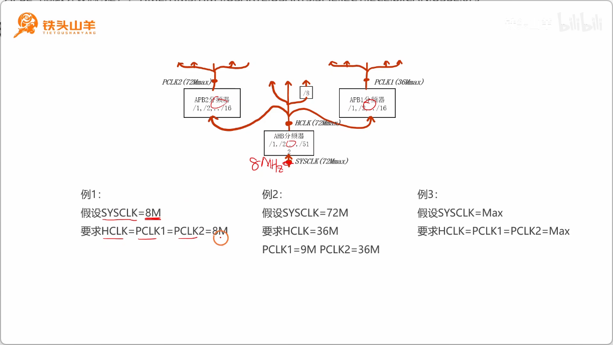
# 1.2 时钟树编程
## 1.2.1 时钟树的初始状态
1. 时钟树的初始状态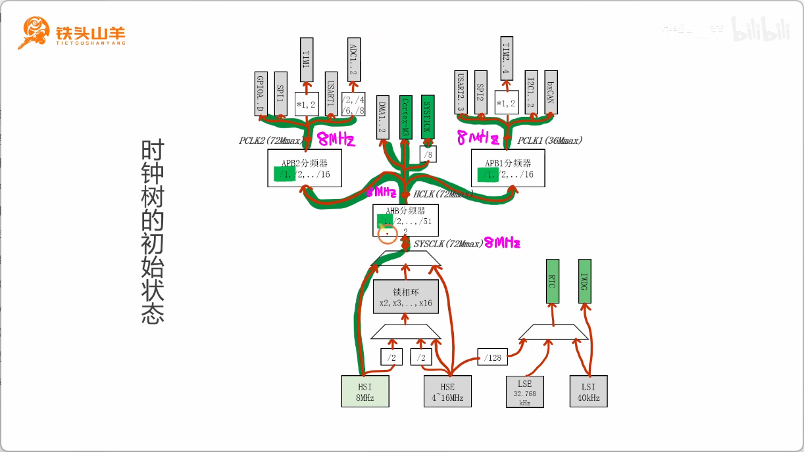
	- 初始状态下：SYSCLK的时钟来源于HSI(8MHz)，三个分频器系数都是1
2. 验证时钟树的初始化状态：内核时执行代码的，同时内核时钟的来源时HCLK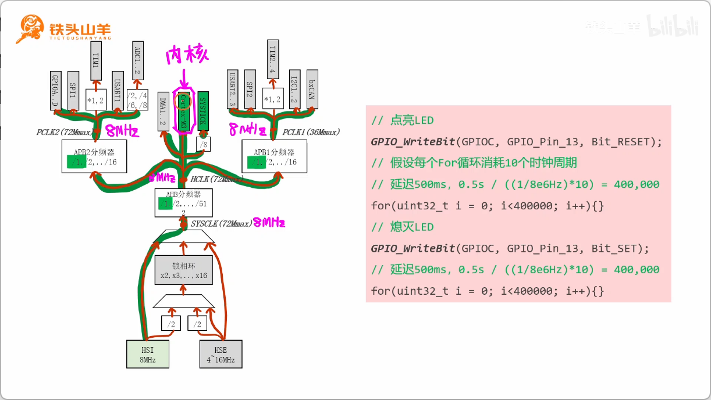
## 1.2.2 标准库的启动代码
1. 单片机复位后从ResetHandler开始执行，SystemInit(帮助用户选择最高频率（72MHz）,以发挥芯片性能)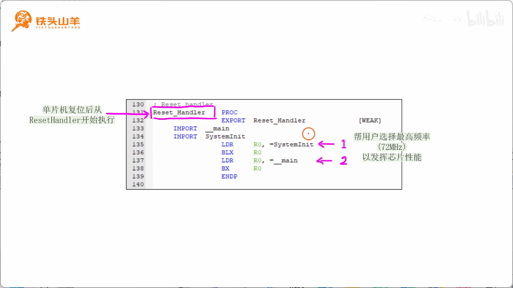
2. SystemInit会帮助用户选择最高频率，为了消除这个问题，需要加注释，这个代码时汇编语言写的，注释为`;`    这样就是初始状态了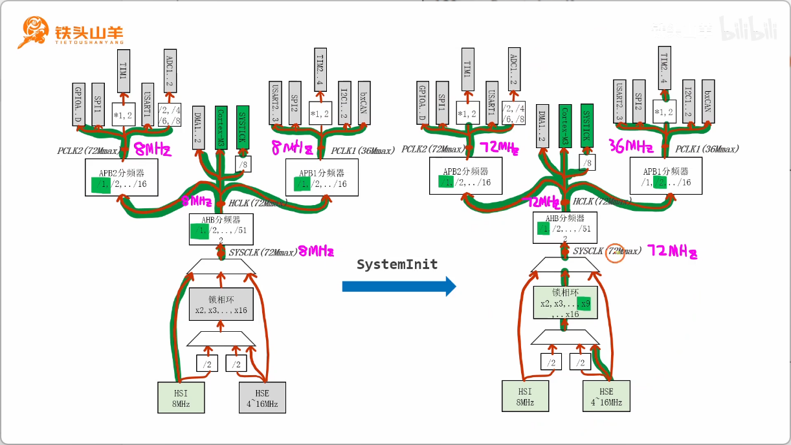
## 1.2.3 时钟树的编程接口
1. 时钟树的编程接口：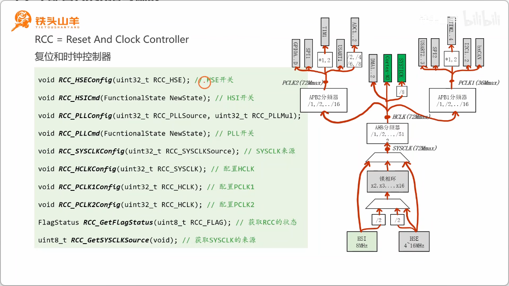
	- RCC：**复位**和**时钟**控制器
	- `RCC_HSEConfig`:HSE的开关
	- `RCC_HSICmd`：HSI开关
	- `RCC_PLLConfig`：锁相环配置（锁相环输入信号，锁相环倍频系数）
	- `RCC_PLLCmd`：PLL（锁相环）开关
	- `RCC_SYSCLKConfig`：选择系统时钟的来源（HSI，HSE，PLL(锁相环)）
	- `RCC_HCLKConfig`：配置HCLK(设置AHB的分频系数)
	- `RCC_PCLK1Config`：配置PCLK1 （设置APB1的分频系数）
	- `RCC_PCLK2Config`：配置PCLK2（设置APB2的分频系数）
	- `RCC_GetFlagStatus`：获取RCC的状态（查询标志位，了解开关是否开启）
	- `RCC_GetSYSCLKSource`：获取SYSCLK的来源（SYSCLK可以切换，判断是否切换成功，就需要这个函数接口）
## 1.2.4 配置时钟树
1. HSE时钟开启→ 锁相环配置和启动→三个分频器配置→切换SYSCLK的来源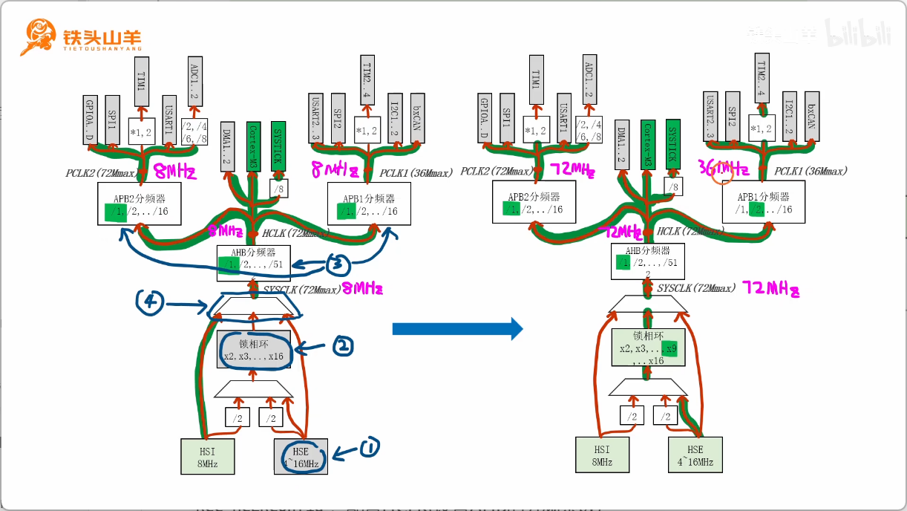
2. 开启HSE（等待就绪）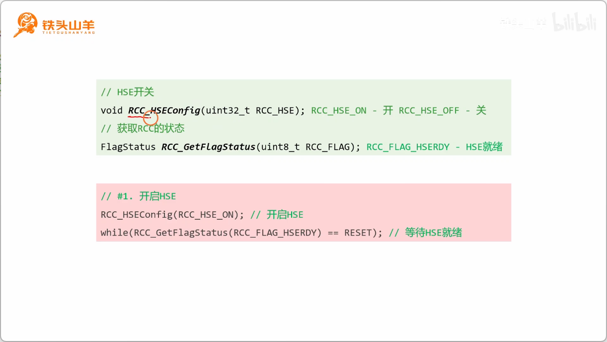
3. 配置锁相环（锁相环输入，倍频系数）开启PLL（等待就绪）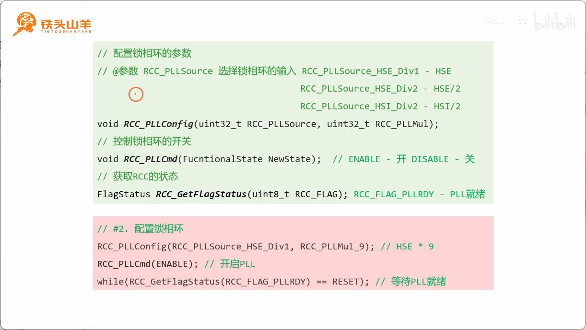
4. 配置分频器的分频系数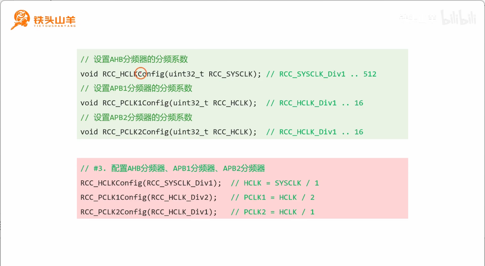
5. 切换系统时钟来源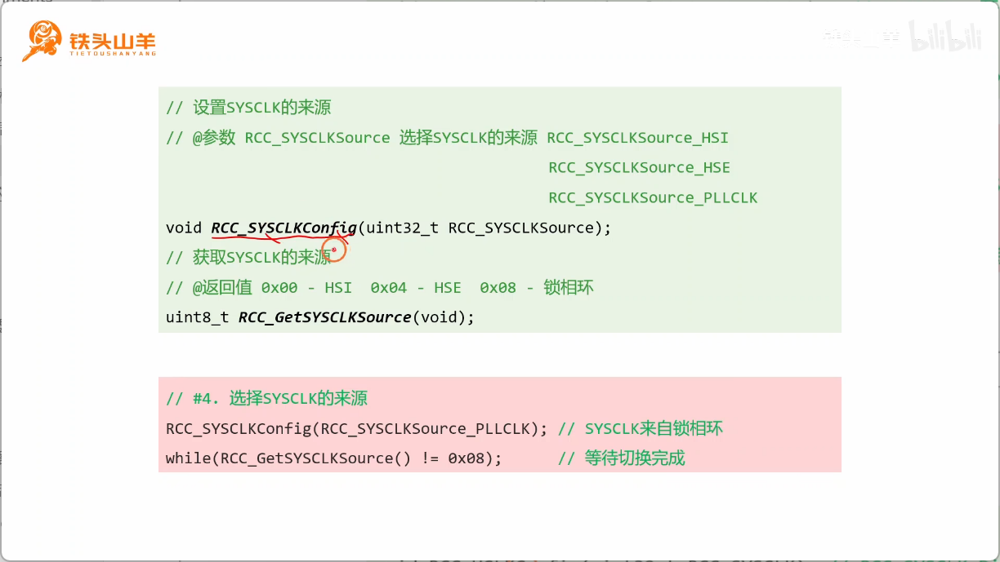
## 1.2.5 配置Flash指令预取
1. 指令预取：Cortex-M3内核在读取Flash时候，会拖后腿，所以要用缓冲区，指令预取(SYSCLK<=8MHz时候才能运行)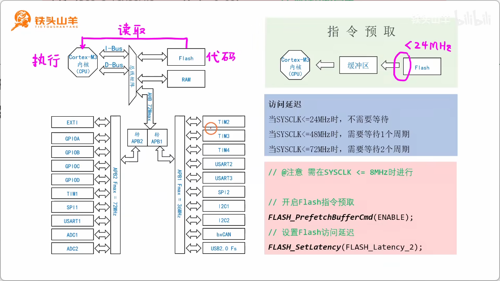
## 1.2.6 片上外设开关和复位
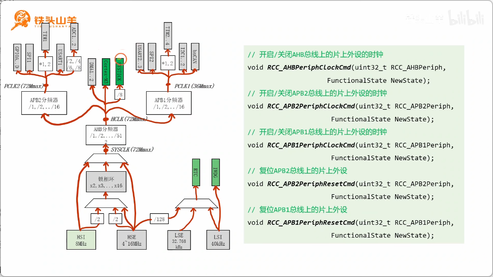

 