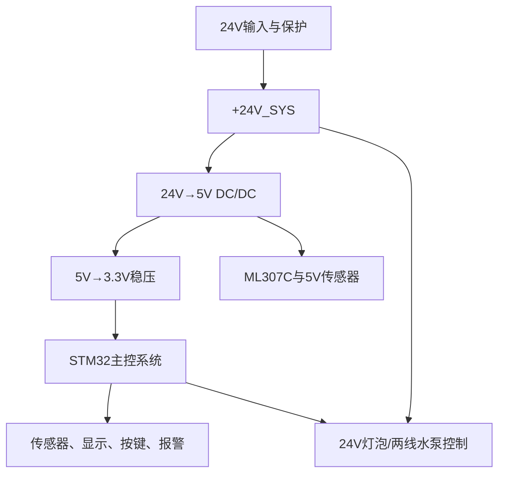

你这个智能水箱控制器，建议把整张原理图划分为 **8个大模块**。每个模块解决一个明确问题，这样以后检查、画PCB和维修都比较清楚。

## 一、总体模块关系



当前电源关系：

```text
外部24V
├── 24V灯泡/未来24V两线水泵
└── LM2576HV降压到5V
      ├── ML307C开发板
      ├── 5V传感器
      └── AP2112降压到3.3V
            ├── STM32
            ├── OLED
            └── 3.3V数字电路
```

---

# 模块一：24V输入与保护

这是整块主板的电源入口。

包含：

1. 24V接线端子；
    
2. 保险丝；
    
3. 反接保护；
    
4. TVS浪涌保护；
    
5. 输入滤波电容；
    
6. 24V测试点。
    

连接关系：

```text
J1外部24V
→ F1保险丝
→ Q1反接保护
→ TVS保护
→ 输入滤波
→ +24V_SYS
```

主要器件：

|编号|器件|作用|
|---|---|---|
|J1|24V输入端子|接入外部电源|
|F1|带引脚慢断保险丝|严重过流时断开|
|Q1|P沟道MOSFET|防止正负极接反|
|D1|SMBJ33A|抑制瞬态过压|
|ZD1|12V稳压管|保护MOS栅源极|
|C1|220µF/63V|储能和低频滤波|
|C2|100nF/100V|高频滤波|

本模块输出：

```text
+24V_SYS
GND
```

---

# 模块二：电源转换系统

这一板块再分成两个小模块。

## 2.1 24V转5V

采用：

```text
LM2576HVS-5.0
```

包含：

- LM2576HV；
    
- 100µH功率电感；
    
- MBR560肖特基二极管；
    
- 输入电容；
    
- 输出电容；
    
- 5V测试点。
    

输出：

```text
+5V_SYS
```

主要供给：

- ML307C开发板；
    
- 5V传感器；
    
- 5V继电器线圈（如果保留）；
    
- 5V转3.3V稳压器。
    

## 2.2 5V转3.3V

可以采用：

```text
AP2112K-3.3
```

连接关系：

```text
+5V_SYS
→ AP2112K-3.3
→ +3V3
```

包含：

- 输入电容；
    
- AP2112；
    
- 输出电容；
    
- 3.3V测试点。
    

输出的 `+3V3` 主要供给：

- STM32F103CBT6；
    
- OLED；
    
- 按键和LED电路；
    
- 其他3.3V数字逻辑。
    

★ ML307C不能从AP2112的3.3V输出取电，应从满足其要求的5V支路供电。

---

# 模块三：STM32最小系统

## 3.1 STM32主体

主控：

```text
STM32F103CBT6
LQFP48
```

需要连接：

- 三组VDD/VSS；
    
- VDDA/VSSA；
    
- VBAT；
    
- NRST；
    
- BOOT0；
    
- 晶振；
    
- SWD；
    
- 所有功能接口。
    

## 3.2 MCU电源去耦

每个VDD附近放置一颗：

```text
100nF
```

另外放置一颗总储能电容：

```text
4.7µF～10µF
```

大致结构：

```text
+3V3
├── 100nF → GND（靠近VDD1）
├── 100nF → GND（靠近VDD2）
├── 100nF → GND（靠近VDD3）
└── 4.7µF或10µF → GND
```

## 3.3 模拟电源VDDA

建议：

```text
+3V3
→ 磁珠或0Ω电阻
→ VDDA
```

VDDA附近放：

```text
100nF + 1µF
```

它主要给ADC和内部模拟电路供电。

## 3.4 VBAT

如果不使用外部RTC电池：

```text
VBAT → +3V3
```

不要悬空。

## 3.5 BOOT0

推荐：

```text
BOOT0
→ 10kΩ
→ GND
```

这样默认从内部Flash启动。

也可以预留跳帽：

```text
BOOT0
├── 10kΩ → GND
└── 跳帽 → +3V3
```

---

# 模块四：时钟、复位与下载调试

## 4.1 8MHz晶振

目前已经确定：

```text
PD0/OSC_IN  ──┐
              X1 8MHz
PD1/OSC_OUT ──┘
```

晶振两端分别通过33pF接GND：

|器件|参数|
|---|---|
|X1|8MHz、HC-49SMD|
|C8|33pF、C0G/NP0|
|C9|33pF、C0G/NP0|

## 4.2 复位按键

已经确定：

```text
+3V3
  │
 R11 10kΩ
  │
  ├── NRST → STM32第7脚
  ├── C10 100nF → GND
  └── SW6常开按键 → GND
```

## 4.3 SWD下载接口

建议至少包含：

|SWD接口|STM32引脚|
|---|---|
|`SWDIO`|PA13|
|`SWCLK`|PA14|
|`NRST`|NRST|
|`+3V3`|目标板电压参考|
|`GND`|公共地|

建议使用5Pin或6Pin接口。

## 4.4 调试串口

当前分配：

| 功能            | 引脚   |
| ------------- | ---- |
| `DBG_UART_TX` | PB10 |
| `DBG_UART_RX` | PB11 |

接口建议再引出：

```text
PB10
PB11
GND
+3V3（可选）
```

---

# 模块五：传感器采集系统

## 5.1 压力检测

当前分配：

```text
PA0 / ADC1_IN0
网络名：TANK_PRESS_SENSE
```

不能直接把任意压力传感器输出接入PA0，需要根据传感器输出决定是否加入：

- 分压；
    
- RC滤波；
    
- 运放调理；
    
- 输入限流；
    
- 钳位保护。
    

STM32 ADC允许的信号范围不能超过：

```text
0～VDDA，通常约0～3.3V
```

## 5.2 24V负载电压检测

当前分配：

```text
PA1 / ADC1_IN1
网络名：PUMP_V_SENSE
```

24V绝对不能直接接STM32 ADC，必须经过：

```text
24V
→ 电阻分压
→ RC滤波
→ ADC保护
→ PA1
```

这部分用于判断：

- 电源欠压；
    
- 电源过压；
    
- 负载供电是否存在；
    
- 开关是否正常工作。
    

## 5.3 负载电流检测

当前分配：

```text
PA4 / ADC1_IN4
网络名：PUMP_I_SENSE
```

需要增加专用检测器件，例如：

```text
采样电阻
+ 电流检测放大器
```

或者使用霍尔电流传感器。

不能只从电源线直接拉一根线接ADC。

## 5.4 硬件过流故障

当前预留：

```text
PB0
网络名：PUMP_OC_FAULT_N
```

可能由比较器或电流检测芯片输出：

```text
电流异常
→ 比较器输出低电平
→ PB0检测到故障
→ STM32立即关闭负载
```

后缀 `_N` 表示低电平有效。

## 5.5 超声波液位接口

需要根据最终超声波型号确定。

如果是UART型：

|功能|引脚|
|---|---|
|`US_UART_TX`|PA2|
|`US_UART_RX`|PA3|

如果是TRIG/ECHO型，则改成：

```text
US_TRIG
US_ECHO
```

其中5V的ECHO输出必须降到3.3V后才能进入STM32。

★ 购买超声波传感器前，必须先确定它是UART型、TRIG/ECHO型、RS485型还是模拟量型。

---

# 模块六：24V灯泡/水泵控制与保护

这是功率控制模块。

当前决定：

```text
第一版：24V直流灯泡
以后：24V两线直流水泵
不使用PWM
不使用FG反馈
```

STM32控制引脚：

```text
PB12
网络名：PUMP_EN
```

## 6.1 如果直接控制24V灯泡或两线水泵

基本结构：

```text
STM32 PB12
→ 栅极电阻
→ 功率NMOS
→ 控制24V负载通断
```

完整模块一般包含：

- 60V逻辑电平NMOS；
    
- 栅极串联电阻；
    
- 栅极下拉电阻；
    
- 负载接口；
    
- 水泵续流二极管或TVS；
    
- 电压检测；
    
- 电流检测；
    
- 功率测试点。
    

★ 如果未来直接驱动24V水泵，不能使用耐压只有30V左右、体积较小的AO3400A作为主功率管。建议评估耐压至少60V、低导通电阻的逻辑电平功率MOSFET。

## 6.2 如果使用继电器控制负载

则分成两部分：

```text
PB12
→ AO3400A
→ 继电器线圈
```

继电器触点再负责控制24V灯泡或水泵。

这时AO3400A只是驱动继电器线圈，不直接承受水泵工作电流。

所以后面必须明确二选一：

- 方案A：功率MOSFET直接控制24V负载；
    
- 方案B：小MOSFET控制继电器，继电器控制负载。
    

对于24V直流灯泡、未来两线直流水泵，优先建议评估 **60V功率MOSFET直接控制方案**。

---

# 模块七：通信、显示与本地交互

## 7.1 ML307C通信

当前精简为四线接口：

|接口|连接|
|---|---|
|`+5V_SYS`|ML307C电源|
|`GND`|公共地|
|`4G_UART_TX`|PA9 / USART1_TX|
|`4G_UART_RX`|PA10 / USART1_RX|

这里暂时不占用：

- CTS；
    
- RTS；
    
- STATUS；
    
- RI；
    
- PWRKEY；
    
- RESET。
    

但应先确认开发板是否已经自动开机，以及UART逻辑电平是否为3.3V。

## 7.2 OLED接口

当前分配：

|功能|引脚|
|---|---|
|`OLED_SCL`|PB6 / I2C1_SCL|
|`OLED_SDA`|PB7 / I2C1_SDA|
|电源|+3V3|
|地|GND|

外围电路：

- SCL上拉4.7kΩ；
    
- SDA上拉4.7kΩ；
    
- OLED接口附近100nF；
    
- 可增加10µF局部储能电容。
    

## 7.3 本地按键

当前分配：

|按键|STM32引脚|网络名|
|---|---|---|
|模式|PA15|`KEY_MODE_N`|
|启动|PB3|`KEY_START_N`|
|停止|PB4|`KEY_STOP_N`|
|消音|PB5|`KEY_MUTE_N`|

采用低电平按下：

```text
GPIO
├── 上拉到+3V3
└── 按键接GND
```

PA15、PB3、PB4属于原JTAG相关引脚，软件中需要保留SWD、关闭完整JTAG后才能作为普通GPIO使用。

## 7.4 运行灯和故障灯

当前分配：

|功能|引脚|
|---|---|
|`LED_RUN`|PB14|
|`LED_FAULT`|PB15|

每个LED必须串联限流电阻：

```text
STM32 GPIO
→ 限流电阻
→ LED
→ GND
```

限流电阻建议先选：

```text
1kΩ～2.2kΩ
```

之前的10kΩ也能亮，但可能比较暗。

## 7.5 蜂鸣器

当前分配：

```text
PB13
网络名：BUZZER_EN
```

连接：

```text
PB13
→ 100Ω栅极电阻
→ AO3400A
→ 有源蜂鸣器
```

并加入：

- 栅极10kΩ下拉；
    
- 蜂鸣器如果是电磁型，增加续流二极管；
    
- 默认上电关闭。
    

---

# 模块八：接口、测试点和工程预留

这个模块经常被忽略，但调试时非常重要。

## 8.1 外部接口

建议包括：

- 24V电源输入；
    
- 24V灯泡/水泵输出；
    
- ML307C四线接口；
    
- OLED四线接口；
    
- 超声波接口；
    
- 压力传感器接口；
    
- SWD接口；
    
- 调试串口；
    
- 按键；
    
- 蜂鸣器和LED。
    

## 8.2 测试点

至少预留：

| 测试点             | 网络      |
| --------------- | ------- |
| `TP_24V_IN`     | 原始24V输入 |
| `TP_24V_SYS`    | 保护后的24V |
| `TP_5V_SYS`     | 5V      |
| `TP_3V3`        | 3.3V    |
| `TP_GND`        | GND     |
| `TP_NRST`       | 复位信号    |
| `TP_PUMP_EN`    | 负载控制    |
| `TP_PUMP_V`     | 电压采样    |
| `TP_PUMP_I`     | 电流采样    |
| `TP_UART_TX/RX` | 调试串口    |

---

# 推荐的原理图分页方式

如果使用多页原理图，建议分成以下7页：

|页码|原理图页面|包含内容|
|--:|---|---|
|1|`POWER_INPUT`|24V输入、保险丝、反接、TVS、滤波|
|2|`POWER_CONVERSION`|24V转5V、5V转3.3V|
|3|`MCU_CORE`|STM32、去耦、VDDA、BOOT0、晶振、复位|
|4|`DEBUG_INTERFACE`|SWD、调试UART、测试点|
|5|`SENSOR_INTERFACE`|压力、超声波、电压、电流、过流输入|
|6|`LOAD_CONTROL`|24V灯泡/两线水泵驱动与保护|
|7|`COMMUNICATION_UI`|ML307C、OLED、按键、LED、蜂鸣器|

---

# 推荐绘制顺序

不要按照“想到哪个画哪个”，建议严格按照这个顺序：

1. 24V输入与保护；
    
2. 24V转5V；
    
3. 5V转3.3V；
    
4. STM32电源和去耦；
    
5. 晶振、复位、BOOT0；
    
6. SWD与调试串口；
    
7. OLED；
    
8. ML307C；
    
9. 本地按键、LED和蜂鸣器；
    
10. 超声波和压力传感器；
    
11. 电压、电流检测；
    
12. 灯泡/水泵功率控制；
    
13. 接口与测试点；
    
14. ERC检查和引脚复核。
    

★ 当前最先应完成的是“STM32最小系统”：供电、去耦、VDDA、VBAT、BOOT0、晶振、复位和SWD。完成这部分后，主控才具备上电、下载、运行和复位的基本条件。

![[Pasted image 20260926184631.png]]