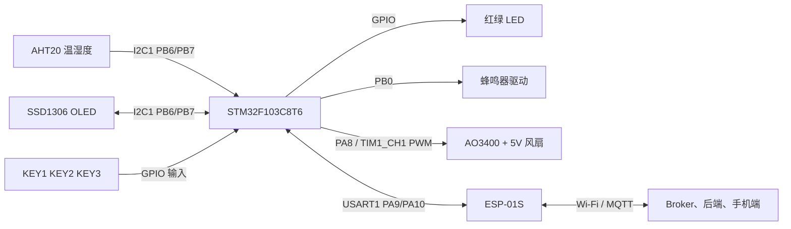
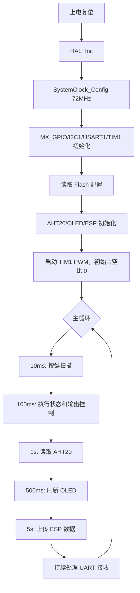
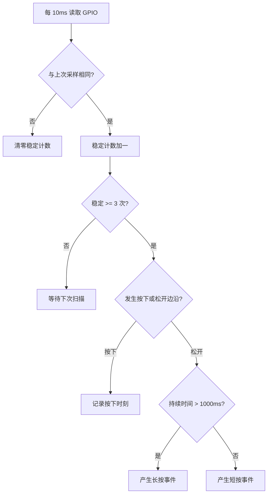
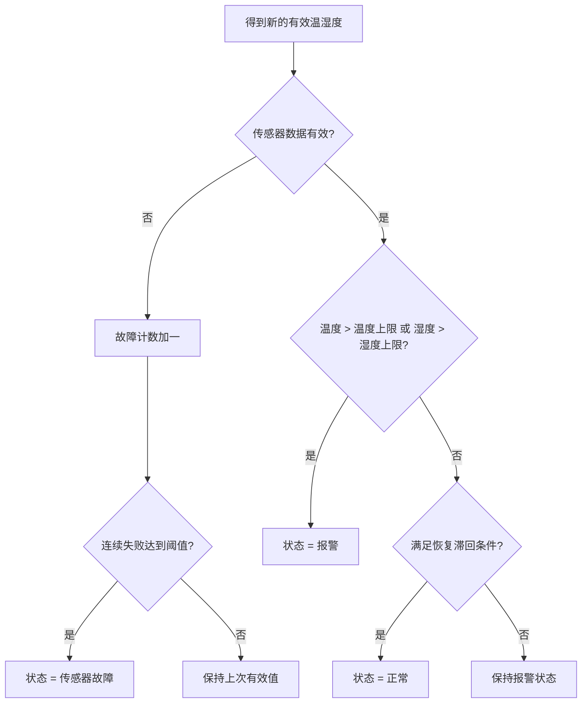
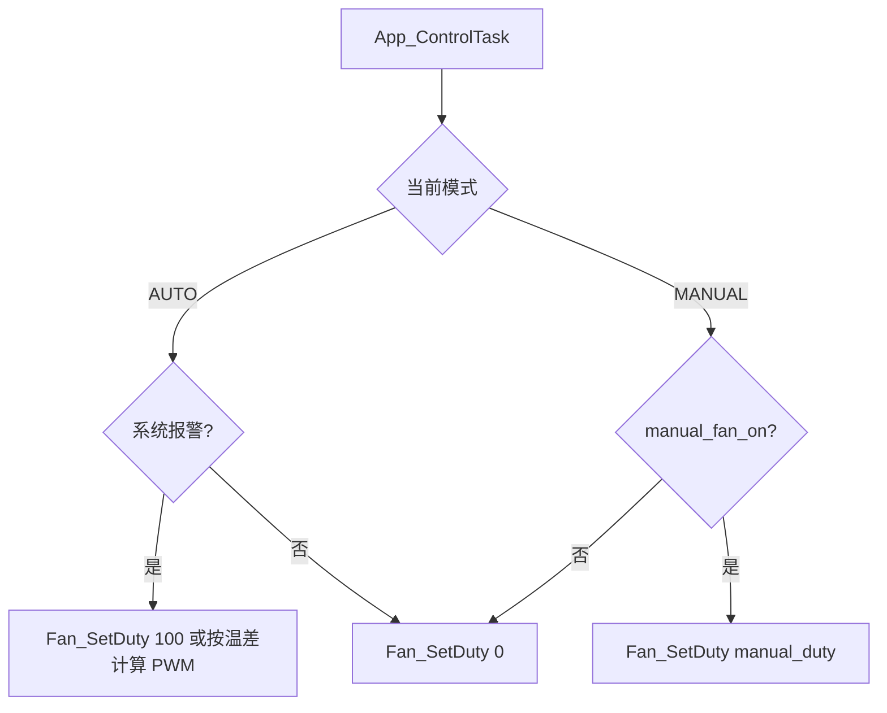
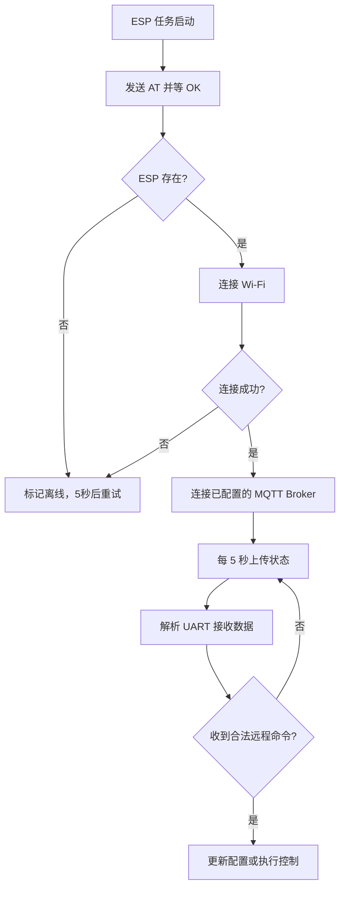
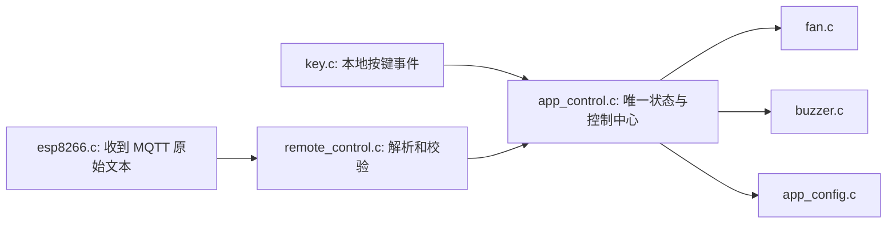

# 基于 STM32 的温湿度监测与智能控制系统
## HAL 软件需求与设计说明书

**版本：** V1.0  
**主控：** STM32F103C8T6  
**开发环境：** STM32CubeMX + Keil MDK + STM32 HAL 库 + C 语言  
**适用硬件：** 本项目自制两层 PCB  
**本文目的：** 在不直接给出完整工程代码的前提下，明确软件要做什么、CubeMX 如何配置、各模块如何拆分，以及每一步完成后如何测试。

---

## 0. 本项目软件方案最终确认

### 0.1 作用

这一节是后续写代码时的“定稿规则”。没有明确写在这里的功能，不应在第一版程序中临时增加，以免按键逻辑、状态机和 PCB 实际能力互相冲突。

### 0.2 已确认的决定

| 项目     | 最终决定                                 | 说明                                                       |
| ------ | ------------------------------------ | -------------------------------------------------------- |
| 报警按键控制 | KEY3 只能**静音蜂鸣器**，不能取消真实报警            | 温湿度仍超限时，红 LED、OLED 和网络报警必须保留                             |
| 阈值设置   | KEY1 进入/确认，KEY2 增加，KEY3 减少           | 设置状态下，KEY2/KEY3 临时不执行模式切换和静音                             |
| 自动/手动  | KEY2 短按切换；手动模式下 KEY2 长按循环风扇档位        | 档位为 `0% -> 40% -> 60% -> 80% -> 100% -> 0%`；自动模式由温湿度决定风扇 |
| 风扇 PWM | 第一版必须实现“0%/100% 开关”；PWM 调速作为同一驱动的第二步 | PA8 已有 PWM 硬件通路，但目前还没有编写程序，因此功能尚未实现                      |
| 配置保存   | 使用 STM32 内部 Flash 保存阈值、模式、手动风扇状态     | PCB 不需要 EEPROM；目前没有程序，所以保存功能尚未实现                         |
| 风扇测速   | V1 不实现闭环转速检测                         | 当前为两线风扇和 2Pin 接线端子，没有转速信号；空闲 GPIO 本身不能产生转速数据             |
| 网络     | V1 完成 MQTT 上报、手机修改阈值、手机远程控风扇         | 本地温湿度与报警不能依赖网络是否在线；具体 Broker 地址和账号在部署时配置                 |

### 0.3 按键最终定义

| 当前界面/状态 | KEY1（PB12）        | KEY2（PB13）                          | KEY3（PB14）   |
| ------- | ----------------- | ----------------------------------- | ------------ |
| 首页，自动模式 | 短按进入温度上限设置        | 短按切手动模式                             | 报警时静音；正常时无动作 |
| 首页，手动模式 | 短按进入温度上限设置        | 短按切自动模式；长按循环 `0/40/60/80/100%` 风扇档位 | 报警时静音；正常时无动作 |
| 温度上限设置  | 短按转入湿度上限设置        | 温度上限加 0.5 C                         | 温度上限减 0.5 C  |
| 湿度上限设置  | 短按保存、写入 Flash、回首页 | 湿度上限加 1 %RH                         | 湿度上限减 1 %RH  |

> 报警被静音后，只要本次报警尚未恢复正常，KEY3 不再改变状态；恢复正常时自动清除静音标志。下一次新报警发生时，蜂鸣器可以再次响。

---

## 1. 项目总体介绍

### 1.1 作用

本系统持续采集环境温度和湿度，在 OLED 上显示数据；当温度或湿度超过用户设置的上限时，系统进行声光报警，并在自动模式下驱动 5V 风扇。ESP-01S 负责把数据和状态发送到手机端或 MQTT 平台。

系统不是让 ESP8266 直接控制硬件。**STM32 是唯一的硬件控制中心**：它负责传感器、显示、按键、LED、蜂鸣器和风扇；ESP8266 只是网络通信模块。

### 1.2 本版功能边界

V1 必须完成：

1. AHT20 定时读取温湿度。
2. OLED 显示温度、湿度、模式、风扇和报警状态。
3. 三个按键完成阈值设置、模式切换和静音。
4. 自动模式下超限启动风扇、LED 和蜂鸣器报警。
5. 手动模式下由按键控制风扇，超限仍保留红灯报警，但不强制开风扇。
6. UART 与 ESP-01S 通信，通过 MQTT 上传状态。
7. 将阈值、模式等配置保存到 STM32 内部 Flash。
8. 手机端可以修改温湿度阈值、切换自动/手动模式、控制手动风扇。

V1 不强制完成、但接口要预留：

1. 用户注册、设备绑定、多设备管理。
2. 历史曲线、数据库长期存储。
3. 手机推送通知。
4. 风扇闭环转速检测。当前风扇只有两线，不具备转速反馈。

### 1.3 V1 联网功能限制

V1 要完成远程功能，但要把范围控制住，避免第一次就陷入 App、数据库和账号系统的大工程。

| V1 要做 | V1 不做 |
|---|---|
| 一个固定设备编号 | 多设备管理 |
| 一组测试账号/设备密码 | 用户注册、登录、找回密码 |
| 上报实时温湿度和状态 | 长期历史曲线、报表、数据库分析 |
| 远程改两个阈值 | 任意复杂配置菜单 |
| 远程切自动/手动 | 远程强制覆盖自动报警逻辑 |
| 手动模式远程设风扇 `0~100%` | OTA 升级、远程烧录 |
| 命令成功/失败回复 | 手机推送通知、设备分享 |

这不是删掉联网，而是先做一个能完整演示“手机看数据、手机控设备”的最小版本。后续用户系统、历史数据和推送属于第二阶段的后端开发。

---

## 2. 功能需求

### 2.1 温湿度采集

**作用：** 获得后续显示、报警和网络上传所需的温湿度数据。

**实现方式：** 每 1 秒触发一次 AHT20 测量。AHT20 使用 I2C1，7 位地址通常为 `0x38`。软件应先判断传感器是否存在、是否校准成功，再读取测量结果并换算为浮点温湿度。

### 2.2 OLED 显示

**作用：** 提供脱离手机也能确认系统状态的本地界面。

**实现方式：** OLED 与 AHT20 共用 I2C1 总线。建议使用 SSD1306 兼容驱动；多数 0.96 英寸 OLED 的地址是 `0x3C`，但第一次上电必须用 I2C 扫描程序确认。

推荐首页显示：

```text
T: 26.4 C    H: 52.1 %
Mode: AUTO   Fan: OFF
Alarm: NORMAL
Tmax: 30.0   Hmax: 75.0
```

### 2.3 阈值设置

**作用：** 让用户不改代码也能调整报警温度上限和湿度上限。

**实现方式：** 配置模式中使用三个按键完成“进入/确认、增加、减少”。设置完成后写入 STM32 内部 Flash。

由于硬件只有三个按键，推荐统一按键语义如下：

| 场景 | KEY1 / PB12 | KEY2 / PB13 | KEY3 / PB14 |
|---|---|---|---|
| 正常界面 | 短按：进入设置 | 短按：切自动/手动；手动模式长按：循环 `0/40/60/80/100%` | 短按：报警静音 |
| 设置温度上限 | 短按：转到湿度设置/保存 | 短按：加 0.5 C | 短按：减 0.5 C |
| 设置湿度上限 | 短按：保存并退出 | 短按：加 1 %RH | 短按：减 1 %RH |

> `短按` 建议为 30 ms 至 800 ms；`长按` 建议大于 1000 ms。数值步进可在后续代码中统一修改。

### 2.4 超限报警

**作用：** 在环境异常时提示用户并自动散热。

**实现方式：** 每次得到新的有效温湿度数据后，比较温度上限和湿度上限。只要任一超限即进入报警状态。

报警动作：

| 功能 | 自动模式 | 手动模式 |
|---|---|---|
| 红色 LED | 点亮 | 点亮 |
| 绿色 LED | 熄灭 | 熄灭 |
| 蜂鸣器 | 报警，静音后关闭 | 报警，静音后关闭 |
| 风扇 | 自动开启/PWM 调速 | 保持用户手动决定 |

恢复正常后，红色 LED 和蜂鸣器关闭，绿色 LED 点亮；自动模式下关闭风扇。

### 2.5 自动与手动模式

**作用：** 自动模式强调无人值守；手动模式让用户在调试或特殊场景下自行决定风扇开关。

**实现方式：** KEY2 短按切换 `AUTO` / `MANUAL`，模式写入 Flash。手动模式下 KEY2 长按循环风扇目标占空比：`0% -> 40% -> 60% -> 80% -> 100% -> 0%`；报警仍然显示并允许静音，但风扇不被报警逻辑强制改变。

### 2.6 风扇 PWM 调速的可行性

**结论：可以实现，但当前是“硬件已经预留、软件尚未实现”。**

PCB 上 PA8 通过 `R16 100R` 连接 AO3400A MOS 的 Gate，MOS 控制两线 5V 风扇的负极。这正是 MCU 输出 PWM 的硬件条件。CubeMX 将 PA8 配为 `TIM1_CH1 PWM` 后，改变占空比就能改变风扇获得的平均功率。

实现分两步进行：

1. **第一步：开关验证。** `Fan_SetDuty(0)` 必须让风扇停止，`Fan_SetDuty(100)` 必须让风扇稳定启动。
2. **第二步：调速验证。** 测试 40%、60%、80%、100%。建议风扇每次启动先 100% 持续约 500 ms，再切到目标占空比，避免低占空比无法起转。

两线无刷风扇不是标准四线 PWM 风扇，因此不同型号对 PWM 的响应会不同：某些低占空比会异响或不转。这不是 PA8 或 HAL 的错误。第一版可以稳定使用 0% 和 100%，在风扇实测正常后再开启分级调速。

### 2.7 风扇闭环测速的可行性

**结论：当前 PCB 和两线风扇不能实现真正的闭环测速。**

“闭环测速”是指 MCU 接收到真实转速脉冲，计算 RPM，再按目标 RPM 调整 PWM。仅仅多出一个 GPIO 并不能测到任何东西，必须同时有转速信号来源。

后续扩展有两种路线：

| 路线 | 需要增加什么 | 是否可在当前板上实现 |
|---|---|---|
| 三线/四线风扇测速 | 使用带 `TACH` 转速输出线的风扇；把第三根线通过杜邦线接到备用 GPIO 排针 | 可以。建议用 `PA0 / TIM2_CH1` 做输入捕获，但需要额外飞线，现有 2Pin 风扇端子仍只接电源两线 |
| 外置霍尔传感器 | 在风扇旁增加霍尔传感器、磁铁、电源和信号线 | 可以，但属于新增硬件模块，复杂度更高 |

V1 只做“PWM 占空比控制”，不把“占空比 60%”误称为“风扇转速 60%”。

### 2.8 ESP8266 上传与远程扩展

**作用：** 把当前温湿度、模式、风扇、报警状态发送到手机端；未来支持远程控制。

**实现方式：** STM32 通过 USART1 与 ESP-01S 的 AT 固件通信。ESP 负责 Wi-Fi 和 MQTT/TCP；STM32 只传递设备数据和执行收到的合法命令。

V1 的通信方案确定为：**ESP-01S + ESP-AT 固件 + MQTT Broker + 手机 Web 页面（H5）**。开发调试时，先用 MQTTX 在电脑上模拟手机；随后再做手机页面。Broker 可使用 EMQX Cloud 或自行部署 EMQX/Mosquitto，部署地址、账号和密码均属于配置，不写死在 STM32 业务代码里。

---

## 2.9 手机端、服务器与 MQTT 的工作方式

### 作用

让手机不只是“看见数据”，还可以安全地下发“改阈值、改模式、控制风扇”等命令。

### 三个角色的简单解释

| 名称 | 可以把它理解成 | 本项目中的职责 |
|---|---|---|
| MQTT Broker（服务器） | 网络上的邮局 | 接收消息，并按 Topic 转发给订阅者 |
| 设备端 | 寄信和收信的设备 | ESP-01S 通过 UART 与 STM32 配合，上报数据、接收命令 |
| 手机网页 H5 | 用户操作面板 | 显示温湿度、报警和风扇状态；请求修改参数或控制风扇 |
| 后端服务 | 管理员/翻译层 | 验证用户身份、保存数据、将手机命令发布到 MQTT Topic |


### 为什么不让手机直接连 STM32

手机通常不在同一个局域网；家用路由器也不会把 STM32 暴露到互联网。即使强行开放端口，也会带来安全风险。正确路径是：设备主动连接 Broker，手机通过服务器或 WebSocket 访问同一个 Broker 的消息。

### V1 的两阶段实现

1. **设备验证阶段：** STM32 + ESP-01S 连接 MQTT Broker；电脑 MQTTX 订阅数据 Topic、发送控制 Topic。这一步先证明硬件、AT 指令、Topic 和数据格式正确。
2. **手机网页阶段：** 后端提供 HTTPS 接口给 H5 页面；后端校验命令后发布 MQTT。手机不直接保存设备 MQTT 密码。

> 课堂演示可以让手机 MQTT 客户端直接连接 Broker，但这只适合临时测试。要称为可推广的产品，手机端必须经过用户登录、设备绑定和后端权限校验。

### V1 MQTT Topic 约定

假设设备编号为 `stm32-temp-001`：

| Topic | 方向 | 内容 |
|---|---|---|
| `device/stm32-temp-001/telemetry` | 设备 -> 云端 | 温湿度、模式、风扇、报警、故障 |
| `device/stm32-temp-001/status` | 设备 -> 云端 | 上线、离线、固件版本、心跳 |
| `device/stm32-temp-001/cmd` | 云端 -> 设备 | 改阈值、改模式、控风扇 |
| `device/stm32-temp-001/reply` | 设备 -> 云端 | 命令成功/失败及当前参数 |

### V1 必须支持的远程命令

```json
{"cmd":"set_threshold","temp_high":30.0,"hum_high":75.0}
{"cmd":"set_mode","mode":"auto"}
{"cmd":"set_manual_fan","duty":80}
{"cmd":"get_status"}
```

命令处理规则：

1. 先检查 JSON 格式和字段是否存在。
2. 检查范围：温度 `-20~80 C`，湿度 `1~100 %RH`，PWM `0~100`。
3. 合法命令更新内存配置，必要时写 Flash。
4. 发布 `reply`，携带成功/失败原因和当前参数。
5. 在自动模式下，`set_manual_fan` 不直接接管风扇；必须先切换为手动模式，防止远程命令破坏自动安全逻辑。

---

## 3. 硬件模块和通信关系

### 3.1 作用

明确谁与谁通信，避免把显示、传感器、网络逻辑全部堆进 `main.c`。

### 3.2 系统关系图



### 3.3 硬件清单和软件责任

| 模块 | 硬件接口 | 软件责任 |
|---|---|---|
| AHT20 | I2C1 | 初始化、触发测量、读取、CRC/状态检查、转换数据 |
| OLED | I2C1 | 初始化、清屏、显示文本/图标、刷新 |
| ESP-01S | USART1 | AT 命令、接收解析、联网状态、数据上传、命令接收 |
| 三个按键 | GPIO 输入 | 10 ms 扫描、消抖、短按/长按事件 |
| 红绿 LED | GPIO 输出 | 正常/报警状态指示 |
| 蜂鸣器 | PB0，已确认 | 开关、静音控制、可选鸣叫节奏 |
| 风扇 | PA8 / TIM1_CH1，已确认 | 开关、PWM 占空比调节 |
| Flash | 芯片内部 Flash | 保存阈值、模式、手动风扇状态 |

---

## 4. STM32 引脚分配表

### 4.1 作用

CubeMX 配置必须与 PCB 原理图一一对应。任何改引脚，都要同时改原理图网络标签、CubeMX 和软件宏定义。

### 4.2 已确认的引脚

| STM32 引脚 | CubeMX 功能 | 网络/模块 | 说明 |
|---|---|---|---|
| PB6 | I2C1_SCL | AHT20、OLED | I2C 时钟 |
| PB7 | I2C1_SDA | AHT20、OLED | I2C 数据 |
| PA9 | USART1_TX | ESP-01S RXD | STM32 发给 ESP |
| PA10 | USART1_RX | ESP-01S TXD | ESP 发给 STM32 |
| PB12 | GPIO_Input | KEY1 | 设置/确认 |
| PB13 | GPIO_Input | KEY2 | 模式切换、手动风扇 |
| PB14 | GPIO_Input | KEY3 | 蜂鸣器静音/设置减 |
| PA4 | GPIO_Output | 红色 LED | 报警指示 |
| PA5 | GPIO_Output | 绿色 LED | 正常指示 |
| PB0 | GPIO_Output | BUZZER_CTRL | 已由原理图确认 |
| PA8 | TIM1_CH1 PWM | FAN_PWM | 已由原理图确认，AO3400 MOS 驱动 |
| PA13 | SYS_SWDIO | SWD 调试口 | 不能当普通 GPIO 使用 |
| PA14 | SYS_SWCLK | SWD 调试口 | 不能当普通 GPIO 使用 |
| PD0 | RCC_OSC_IN | 8 MHz 晶振 | 外部高速晶振输入 |
| PD1 | RCC_OSC_OUT | 8 MHz 晶振 | 外部高速晶振输出 |
| NRST | Reset | 复位按键/SWD | 硬件复位 |
| BOOT0 | Boot | 启动跳帽 | 正常运行时保持低电平 |

### 4.3 备用引脚

`PA0、PA1、PA2、PA3` 已引到备用 GPIO 排针。V1 不使用；未来可接模拟传感器、继电器输入等。不要在 V1 主逻辑中随意占用，保留扩展价值。

---

## 5. 系统状态设计

### 5.1 作用

状态枚举让程序不再靠一堆零散的 `if` 判断，而是能清楚回答“系统现在是否报警、是否静音、风扇由谁控制”。

### 5.2 建议状态

```c
typedef enum {
    SYS_NORMAL = 0,      // 温湿度均未超限
    SYS_PREWARNING,      // 接近阈值，仅显示提醒，可在 V1 关闭
    SYS_ALARM,           // 温度或湿度至少一项超限
    SYS_SENSOR_FAULT     // AHT20 连续读取失败
} SystemState_t;

typedef enum {
    MODE_AUTO = 0,
    MODE_MANUAL
} WorkMode_t;

typedef enum {
    FAN_OFF = 0,
    FAN_ON
} FanState_t;
```

### 5.3 状态定义和动作

| 状态 | 条件 | 红灯 | 绿灯 | 蜂鸣器 | 自动模式风扇 |
|---|---|---|---|---|---|
| 正常 | 温度和湿度均未超限 | 关 | 开 | 关 | 关 |
| 预警 | 接近阈值但未超限 | 关 | 开 | 关 | 关 |
| 报警 | 温度或湿度超限 | 开 | 关 | 开或静音 | 开 |
| 传感器故障 | 连续多次读取失败 | 可用红灯闪烁 | 关 | 可选间歇鸣叫 | 建议关 |

建议预警阈值：温度距离上限 2.0 C、湿度距离上限 5 %RH。若 V1 不需要预警，只保留枚举即可，不触发该状态。

### 5.4 滞回（防止风扇频繁开关）

**作用：** 温度正好在阈值附近时，不让风扇一秒开、一秒关。

**实现方式：** 例如温度高于 `temp_high` 时报警；恢复必须低于 `temp_high - 1.0 C`。湿度恢复可使用 `hum_high - 3 %RH`。这些值作为可修改配置，而不是写死在判断语句中。

---

## 6. 自动模式与手动模式逻辑

### 6.1 自动模式

1. 每获得一组有效温湿度，就进行报警判断。
2. 报警时：红灯开、绿灯关、蜂鸣器开；风扇由软件打开。
3. 恢复到正常状态后：红灯关、绿灯开、蜂鸣器关、风扇关。
4. KEY3 静音只影响蜂鸣器，不影响红灯、OLED、手机状态和风扇。

### 6.2 手动模式

1. 报警判断仍然执行，红绿 LED 和蜂鸣器逻辑不变。
2. 风扇不受报警逻辑强制改变。
3. 用户通过 KEY2 长按切换风扇开/关。
4. 当从手动模式切回自动模式，立即根据当前报警状态重新计算风扇状态。

---

## 7. 程序整体执行流程

### 7.1 作用

把程序拆成短周期任务。初学阶段不需要 FreeRTOS；用 `HAL_GetTick()` 建立软定时任务更直观、容易调试。

### 7.2 主函数流程图



### 7.3 主循环伪代码

```c
while (1)
{
    Key_Task_10ms();                 // 到时才实际执行
    AHT20_Task();                    // 非阻塞或短阻塞读取
    App_ControlTask_100ms();         // 状态、报警、风扇、LED、蜂鸣器
    OLED_Task_500ms();
    ESP8266_Task();                  // UART 接收解析、重连、上传
    Config_SaveTask();               // 配置变更后延迟写 Flash
}
```

不要在 `while(1)` 内使用多秒的 `HAL_Delay()`。长延时会让按键不灵、ESP 丢数据、显示刷新卡顿。

---

## 8. 按键处理设计

### 8.1 作用

机械按键按下和松开时会抖动，几毫秒内可能出现很多次高低电平变化。若直接读取，会被当成多次按键。

### 8.2 接线电平

按当前 PCB 原理图，按键一端接 GND，推荐 CubeMX 设置为 `GPIO_Input + Pull-up`：

```text
未按下：GPIO = 1
按下：  GPIO = 0
```

上电后必须用万用表或简单串口打印确认；若实物按下为高电平，只需改 `KEY_PRESSED_LEVEL` 宏，不要反复改业务逻辑。

### 8.3 10 ms 消抖方案

1. 每 10 ms 读取三次按键电平中的一次。
2. 某按键连续 3 次（30 ms）读到按下，确认 `PRESS` 事件。
3. 记录按下时间。
4. 确认松开后，根据持续时间产生 `SHORT_PRESS` 或 `LONG_PRESS` 事件。
5. 业务层只接收“事件”，不直接读 GPIO。

建议数据结构：

```c
typedef enum {
    KEY_NONE = 0,
    KEY1_SHORT, KEY1_LONG,
    KEY2_SHORT, KEY2_LONG,
    KEY3_SHORT, KEY3_LONG
} KeyEvent_t;

typedef struct {
    GPIO_TypeDef *port;
    uint16_t pin;
    uint8_t stable_level;
    uint8_t sample_count;
    uint32_t press_tick;
    uint8_t pressed;
} Key_t;
```

### 8.4 按键处理流程



---

## 9. 温湿度读取与报警判断

### 9.1 AHT20 读取流程

**作用：** 把 AHT20 原始字节转换为摄氏温度和相对湿度。

**实现方式：**

1. 上电后等待至少 40 ms。
2. 读取状态字节并确认校准位正常。
3. 写入触发命令 `0xAC 0x33 0x00`。
4. 等待测量完成，建议约 80 ms；更规范的写法是轮询忙位，不要固定长时间阻塞。
5. 读取 7 字节数据，检查状态和 CRC（若使用的驱动实现 CRC）。
6. 换算湿度和温度。

```text
Humidity = raw_humidity / 2^20 * 100
Temperature = raw_temperature / 2^20 * 200 - 50
```

### 9.2 报警判断流程



### 9.3 建议函数

```c
bool AHT20_Init(void);
bool AHT20_Read(float *temperature, float *humidity);
bool AHT20_IsOnline(void);
void Alarm_Evaluate(float temperature, float humidity);
```

---

## 10. 风扇和蜂鸣器控制设计

### 10.1 风扇控制

**作用：** 通过 PA8 输出控制 AO3400 MOS，使 5V 两线风扇工作。

**实现方式：** PA8 配置为 `TIM1_CH1 PWM`。V1 可以仅用 `0%` 和 `100%`；后续不改 PCB 也能改变占空比实现 PWM 调速。

```c
void Fan_Init(void);
void Fan_SetDuty(uint8_t duty_percent);  // 0 到 100
void Fan_SetState(FanState_t state);     // 内部调用 SetDuty(0/100)
FanState_t Fan_GetState(void);
```

建议先使用 20 kHz PWM：在 72 MHz 定时器时钟下，`PSC = 0`、`ARR = 3599`，频率约为 20 kHz。若某个两线风扇低占空比不转或异响，先固定 100% 验证硬件，再调整频率或最小占空比。推荐启动策略是：先 `100%` 持续 500 ms，再设为目标占空比；第一次调试先只实现 `0%` 和 `100%`。

### 10.2 风扇流程



### 10.3 蜂鸣器控制

**作用：** 声音报警，并允许 KEY3 静音。

**实现方式：** 当前原理图已确认 PB0 连接蜂鸣器驱动三极管，蜂鸣器为有源蜂鸣器，输出高/低电平即可开关。

```c
void Buzzer_Init(void);
void Buzzer_On(void);
void Buzzer_Off(void);
void Buzzer_SetMuted(bool muted);
```

静音规则：

1. KEY3 在报警状态下把 `alarm_muted = true`。
2. 静音不改变 `SystemState_t`，红灯和手机报警标志保持。
3. 当前报警恢复正常后自动清除 `alarm_muted`。
4. 下次重新发生报警，蜂鸣器应再次允许响。

---

## 11. OLED 显示设计

### 11.1 作用

显示必须与实际状态结构体一致，不要在显示函数中重新做报警判断。

### 11.2 页面建议

| 页面 | 内容 | 进入方式 |
|---|---|---|
| 首页 | 温度、湿度、模式、风扇、报警 | 默认 |
| 设置温度 | 当前温度上限 | KEY1 进入 |
| 设置湿度 | 当前湿度上限 | KEY1 再按 |
| 故障页 | AHT20 或 ESP 错误代码 | 自动显示或轮询显示 |

### 11.3 接口

```c
bool OLED_Init(void);
void OLED_Clear(void);
void OLED_ShowMainPage(const SystemData_t *data);
void OLED_ShowSettingPage(const DeviceConfig_t *cfg, uint8_t item);
void OLED_ShowFaultPage(uint32_t fault_flags);
void OLED_Refresh(void);
```

---

## 12. ESP8266 通信设计

### 12.1 作用

保证 STM32 不因网络慢或 ESP 掉线而停住。所有 AT 命令必须有超时和结果判断。

### 12.2 通信参数

| 项目 | 推荐值 |
|---|---|
| 外设 | USART1 |
| 波特率 | 115200，首次上电可按 ESP 固件实际波特率确认 |
| 数据位 | 8 |
| 校验 | 无 |
| 停止位 | 1 |
| 接收方式 | 推荐 UART 中断或 DMA + 空闲中断 |

### 12.3 ESP 初始化阶段

```text
1. 发送 AT，等待 OK
2. 读取 AT+GMR，记录 ESP AT 固件版本
3. 关闭回显：ATE0
4. 设置 STA 模式：AT+CWMODE=1
5. 连接路由器：AT+CWJAP="SSID","PASSWORD"
6. 确认获得 IP：AT+CIFSR
7. 连接已部署的 MQTT Broker，并订阅命令 Topic
```

> 不是每个 ESP-01S 自带的 AT 固件都支持 `AT+MQTT...` 指令。先用串口助手确认 `AT+GMR` 和 `AT+MQTTUSERCFG=?`。不支持 MQTT 的固件需要升级 ESP-AT，或改用 TCP/HTTP 方案；这一步不能等到 STM32 代码全部写完才检查。

### 12.4 建议上报数据格式

在 STM32 内部先生成简单 JSON，Topic 使用本说明书第 2.9 节约定：

```json
{
  "temperature": 26.4,
  "humidity": 52.1,
  "mode": "auto",
  "fan": 1,
  "alarm": 0,
  "mute": 0
}
```

### 12.5 接收远程命令的预留格式

```json
{"cmd":"fan","value":1}
{"cmd":"mode","value":"auto"}
{"cmd":"temp_high","value":30.0}
{"cmd":"hum_high","value":75.0}
```

STM32 必须校验字段和值域。例如湿度上限必须在 `1~100`，温度上限建议限制为 `-20~80 C`，错误命令不得改写 Flash。

### 12.6 ESP 通信流程



### 12.7 接口

```c
void ESP8266_Init(void);
void ESP8266_Task(void);
bool ESP8266_SendCommand(const char *cmd, const char *expect, uint32_t timeout_ms);
bool ESP8266_PublishStatus(const SystemData_t *data);
bool ESP8266_IsOnline(void);
void ESP8266_RxByteCallback(uint8_t byte);
```

---

## 13. STM32CubeMX 配置清单

### 13.1 作用

CubeMX 负责生成 HAL 初始化代码。应用逻辑写在 `USER CODE BEGIN` / `USER CODE END` 区域或自建 `.c/.h` 文件中，避免重新生成代码时丢失。

### 13.2 新建工程

1. 选择 MCU：`STM32F103C8Tx`。
2. Project Manager：Toolchain / IDE 选择 `MDK-ARM`。
3. Code Generator：勾选“每个外设生成独立 .c/.h 文件”可读性更好。
4. SYS Debug 选择 `Serial Wire`，保留 PA13/PA14 给 ST-Link。

### 13.3 RCC 与时钟

| 项目 | CubeMX 设置 |
|---|---|
| HSE | Crystal/Ceramic Resonator |
| LSE | Disable |
| PLL Source | HSE |
| PLL MUL | x9 |
| SYSCLK | 72 MHz |
| AHB | 72 MHz |
| APB1 | 36 MHz |
| APB2 | 72 MHz |

此配置对应 PCB 的 8 MHz 外部晶振。若晶振未焊或不起振，程序可能不能正常启动，因此首次点亮阶段可准备一个 HSI 调试方案，但正式版本使用 HSE 72 MHz。

### 13.4 GPIO

| 引脚 | Mode | Pull | 初始电平/说明 |
|---|---|---|---|
| PA4 | GPIO Output Push-Pull | No Pull | 红灯，初始关 |
| PA5 | GPIO Output Push-Pull | No Pull | 绿灯，初始按实际状态设置 |
| PB0 | GPIO Output Push-Pull | No Pull | 蜂鸣器，初始关 |
| PB12 | GPIO Input | Pull-up | KEY1，按下为低 |
| PB13 | GPIO Input | Pull-up | KEY2，按下为低 |
| PB14 | GPIO Input | Pull-up | KEY3，按下为低 |

按键无需使用 EXTI；本项目用 10 ms 轮询消抖更简单。后续熟悉中断后可再改。

### 13.5 I2C1

| 参数 | 配置 |
|---|---|
| 外设 | I2C1 |
| 引脚 | PB6 / PB7 |
| Speed Mode | Standard Mode，100 kHz 起步 |
| Addressing | 7-bit |
| Own Address | 0 |
| Dual Address | Disable |

板上已有 4.7k 上拉，GPIO 不要再额外软件上拉。若线短、AHT20 与 OLED 都稳定，再考虑升到 400 kHz。

### 13.6 USART1

| 参数 | 配置 |
|---|---|
| 引脚 | PA9 TX、PA10 RX |
| Baud Rate | 115200（按 ESP 实际固件调整） |
| Word Length | 8 Bits |
| Parity | None |
| Stop Bits | 1 |
| Mode | TX/RX |
| NVIC | 开启 USART1 global interrupt |

第一版可用 `HAL_UART_Receive_IT()` 按字节接收。数据量较大或发生丢包后，再升级到 DMA + 空闲中断。

### 13.7 TIM1 PWM

| 参数 | 配置 |
|---|---|
| Channel | CH1 |
| 引脚 | PA8 |
| Mode | PWM Generation CH1 |
| Prescaler | 0 |
| Counter Period | 3599 |
| PWM Frequency | 20 kHz（72MHz / 3600） |
| Pulse | 0，初始关闭 |
| Polarity | High |

### 13.8 其他

| 项目 | 建议 |
|---|---|
| NVIC 优先级 | USART1 中断优先级高于普通任务；初学阶段可全部默认，避免复杂抢占 |
| SysTick | HAL 默认 1 ms，不要关闭 |
| CRC 外设 | 非必须；Flash 配置 CRC 可先用软件简单校验 |
| Watchdog | V1 调通后再启用 IWDG，避免调试阶段反复复位 |

---

## 14. 程序文件结构

### 14.1 作用

模块化能避免 `main.c` 变成几千行，也便于单独测试每个外设。

```text
Core/
  Inc/main.h
  Src/main.c
  Src/stm32f1xx_it.c

App/
  app_control.c / app_control.h    系统状态、模式、报警总决策
  app_config.c / app_config.h      Flash 配置读写、默认值、参数校验

BSP/
  aht20.c / aht20.h                AHT20 驱动
  oled.c / oled.h                  SSD1306 OLED 驱动
  key.c / key.h                    按键扫描、消抖、事件
  fan.c / fan.h                    风扇开关、PWM
  buzzer.c / buzzer.h              蜂鸣器开关、静音
  led.c / led.h                    红绿 LED
  esp8266.c / esp8266.h            AT 命令、UART 缓冲、联网状态
  remote_control.c / remote_control.h MQTT 命令解析、参数校验、命令回复
```

`main.c` 只做四件事：硬件初始化、模块初始化、定时调用任务、处理严重错误。它不应直接写 AHT20 命令或 ESP AT 字符串。

### 14.2 本地按键与远程控制如何不冲突

**原则：ESP8266 模块和远程控制模块不能直接调用 `Fan_SetDuty()`，也不能自己写 Flash。** 所有控制最终必须交给 `app_control.c`。



控制优先级固定如下：

1. 传感器故障和自动报警逻辑优先于普通风扇请求。
2. 自动模式下，远程只能修改阈值和模式，不能直接指定风扇 PWM。
3. 手动模式下，本地 KEY2 长按和远程 `set_manual_fan` 都可以修改手动占空比；**最后一个合法命令生效**，OLED 立刻显示新档位。
4. 本地 KEY3 静音只影响蜂鸣器，不接受远程静音，防止手机误操作掩盖现场报警。

### 14.3 远程控制模块接口

```c
typedef enum {
    REMOTE_CMD_NONE = 0,
    REMOTE_CMD_SET_THRESHOLD,
    REMOTE_CMD_SET_MODE,
    REMOTE_CMD_SET_MANUAL_FAN,
    REMOTE_CMD_GET_STATUS
} RemoteCommandType_t;

typedef struct {
    RemoteCommandType_t type;
    float temp_high_c;
    float hum_high_rh;
    WorkMode_t mode;
    uint8_t fan_duty;
} RemoteCommand_t;

bool RemoteControl_Parse(const char *payload, RemoteCommand_t *cmd);
bool RemoteControl_Validate(const RemoteCommand_t *cmd);
void RemoteControl_Handle(const RemoteCommand_t *cmd);
```

`RemoteControl_Handle()` 不直接改寄存器；它调用 `app_control.c` 提供的请求接口，例如 `App_RequestMode()`、`App_RequestThreshold()`、`App_RequestManualFanDuty()`。执行结果再由 ESP8266 模块发布到 `reply` Topic。

---

## 15. 主要结构体、枚举和变量

### 15.1 配置结构体

```c
typedef struct {
    uint32_t magic;             // 固定标识，判断 Flash 是否有效
    uint16_t version;           // 配置结构版本
    float temp_high_c;
    float hum_high_rh;
    float temp_hysteresis_c;
    float hum_hysteresis_rh;
    WorkMode_t mode;
    uint8_t manual_fan_duty;
    uint16_t crc;               // 简单校验，防止读到脏数据
} DeviceConfig_t;
```

建议默认配置：温度上限 30.0 C、湿度上限 75 %RH、温度滞回 1.0 C、湿度滞回 3 %RH、自动模式、手动风扇占空比 100%。默认值不是硬件限制，后续可在设置界面修改。

### 15.2 运行数据结构体

```c
typedef struct {
    float temperature_c;
    float humidity_rh;
    SystemState_t system_state;
    WorkMode_t work_mode;
    FanState_t fan_state;
    uint8_t fan_duty;
    bool alarm_muted;
    bool aht20_online;
    bool esp_online;
    uint32_t fault_flags;
} SystemData_t;
```

### 15.3 故障位

```c
#define FAULT_AHT20_OFFLINE   (1U << 0)
#define FAULT_OLED_OFFLINE    (1U << 1)
#define FAULT_ESP_OFFLINE     (1U << 2)
#define FAULT_FLASH_INVALID   (1U << 3)
```

---

## 16. 定时任务安排

### 16.1 作用

任务有固定节奏，系统反应可预测，也避免 OLED 和 ESP 发送过于频繁。

| 周期 | 任务 | 内容 |
|---:|---|---|
| 1 ms | HAL SysTick | HAL 默认计时，不写复杂业务 |
| 10 ms | `Key_Task_10ms()` | 按键扫描、消抖、长短按判断 |
| 50 ms | `Buzzer_Task()` | 可选的间歇鸣叫节奏 |
| 100 ms | `App_ControlTask_100ms()` | 状态机、LED、蜂鸣器、风扇输出 |
| 500 ms | `OLED_Task_500ms()` | 刷新显示，避免闪烁 |
| 1000 ms | `AHT20_Task()` | 读取温湿度并更新有效值 |
| 5000 ms | `ESP8266_PublishStatus()` | 上报一次设备状态 |
| 5000 ms | `ESP8266_ReconnectTask()` | 离线时尝试重连 |
| 延迟 2~5 s | `Config_SaveTask()` | 设置完成后再写 Flash，降低擦写次数 |

---

## 17. Flash 配置保存

### 17.1 作用

断电后保留温湿度上限、模式和手动风扇配置。

**当前状态：** PCB 已具备使用内部 Flash 的全部条件，但项目尚未编写 Flash 配置代码，因此此功能目前还没有实现。它是纯软件功能，不需要重画 PCB，也不需要增加外置 EEPROM。

### 17.2 实现原则

1. 不要每秒写 Flash。Flash 擦写次数有限。
2. 只在用户确认设置后，延迟 2~5 秒写一次。
3. 保存 `magic + version + 数据 + CRC`。
4. 开机读出后必须检查 `magic`、版本和 CRC；无效时加载默认配置。
5. Flash 地址必须选择未被程序代码占用的最后一页，实际地址要按 Keil map 文件和 STM32F103C8 Flash 容量最终确认。

---

## 18. 故障处理方案

### 18.1 AHT20 无响应

| 现象 | 软件处理 |
|---|---|
| 单次 I2C 读失败 | 保留上次有效数据，失败计数加一 |
| 连续 3 次失败 | 标记 `FAULT_AHT20_OFFLINE`，进入传感器故障状态 |
| 故障状态 | OLED 显示 `AHT20 ERR`；红灯可闪烁；不使用错误数据控制风扇 |
| 后续读成功 | 清除失败计数和故障位，恢复正常判断 |

### 18.2 OLED 无响应

OLED 故障不应影响风扇、报警和网络。记录 `FAULT_OLED_OFFLINE`，每 5 秒重试初始化。

### 18.3 ESP8266 掉线

1. UART 超时、收到 `ERROR` / `WIFI DISCONNECT` 或多次无应答，标记 ESP 离线。
2. 不阻塞主控制逻辑。
3. 每 5 秒依次重试 `AT`、Wi-Fi 连接、MQTT/平台连接。
4. OLED 可显示 `WiFi: OFF`，但本地报警继续工作。

### 18.4 I2C 总线卡死

若 I2C 返回 `HAL_BUSY` 或超时，可执行：停止当前通信 -> `HAL_I2C_DeInit()` -> 软件释放 SCL/SDA（进阶）或 `HAL_I2C_Init()` -> 重新初始化 AHT20/OLED。V1 先实现“重新初始化 I2C1 和两模块”，不要在主循环无限等待。

---

## 19. 开发顺序

### 19.1 作用

按依赖关系开发，出现问题时能知道是硬件、CubeMX 还是自己的业务代码。

### 19.2 推荐步骤

1. CubeMX 配置系统时钟、SWD，下载空工程，确认不复位。
2. 编写 `led.c`，分别点亮红绿 LED，确认 PA4/PA5 极性。
3. 编写 `key.c`，串口或 LED 输出三个按键事件。
4. 配置 I2C1，先做 I2C 扫描，确认 AHT20 和 OLED 地址。
5. 完成 AHT20 单独读取，串口输出温湿度。
6. 完成 OLED 单独显示固定文本，再显示温湿度。
7. 编写 `fan.c`，先 100% 开关，再测试 PWM。
8. 编写 `buzzer.c`，验证 PB0 和硬件静音跳帽。
9. 编写 `app_control.c`，实现自动/手动、报警、静音和阈值。
10. 编写 Flash 配置保存和上电恢复。
11. 完成 ESP AT 通信、Wi-Fi、上报。
12. 最后接入 MQTT/手机平台下发命令。

每完成一步就提交一份可运行工程备份。不要等所有模块都写完再上电。

---

## 20. 完整测试步骤和测试用例

### 20.1 上电前检查

1. 万用表确认 5V 和 3.3V 之间没有短路。
2. 给板子上电，测量 3.3V 是否在正常范围。
3. 不插 ESP 和外设时，确认 STM32 可以被 ST-Link 识别和下载。
4. 确认 BOOT0 处于正常启动位置。

### 20.2 软件测试用例

| 编号 | 测试项 | 操作 | 预期结果 |
|---|---|---|---|
| T01 | 时钟/SWD | 下载空工程 | 可下载、程序连续运行 |
| T02 | 红 LED | 调用 `Led_RedOn()` | 红灯亮 |
| T03 | 绿 LED | 调用 `Led_GreenOn()` | 绿灯亮 |
| T04 | 三个按键 | 分别短按、长按 | 仅产生一次正确事件 |
| T05 | I2C 扫描 | 输出扫描结果 | 找到 AHT20 和 OLED 地址 |
| T06 | AHT20 | 每秒读一次 | 温湿度稳定、数值合理 |
| T07 | OLED | 显示固定文本/数据 | 无乱码、刷新不闪烁 |
| T08 | 风扇开关 | 设 0%、100% PWM | 0% 停，100% 转 |
| T09 | PWM | 30/60/100% | 风扇状态随占空比变化；若低占空比不转，记录最小可用值 |
| T10 | 蜂鸣器 | 触发开/关/静音 | 报警响，KEY3 后静音，红灯保持 |
| T11 | 自动报警 | 临时把阈值设低于当前温度 | 自动模式红灯、蜂鸣器、风扇均动作 |
| T12 | 自动恢复 | 将阈值调高或等待数据恢复 | 自动模式解除报警、风扇关闭 |
| T13 | 手动模式 | 切到手动，长按 KEY2 | 风扇由用户控制，报警不强制改变风扇 |
| T14 | Flash | 修改阈值和模式后断电重启 | 配置正确恢复 |
| T15 | AHT20 故障 | 拔掉传感器模块 | OLED 显示故障，本地程序不死机 |
| T16 | ESP AT | 发送 `AT` | 返回 `OK` |
| T17 | ESP 断网 | 关闭路由器 | 本地控制正常，ESP 定时重连 |
| T18 | 数据上传 | 联网后检查平台 | 温湿度和状态按周期更新 |

### 20.3 最终验收标准

1. 连续运行 30 分钟，系统无卡死、无异常复位。
2. 温湿度正常显示，误差是否合理以 AHT20 模块规格为准。
3. 阈值、自动/手动、静音行为与本文状态表一致。
4. 风扇启动时 STM32 不复位，OLED 不花屏。
5. 断电重启后配置保留。
6. ESP 掉线不影响本地温湿度监控与报警。

---

## 21. 开工前最终确认清单

在开始写正式 HAL 代码前，确认以下项目：

- [ ] AHT20 模块的实际 I2C 地址。
- [ ] OLED 实际地址、分辨率、控制器是否为 SSD1306。
- [ ] KEY1/2/3 实物按下电平是否为低。
- [ ] PA4/PA5 控制 LED 时高电平是否点亮。
- [ ] PB0 控制蜂鸣器时高电平是否响。
- [ ] PA8 的 PWM `0%`、`100%` 与风扇实际状态一致。
- [ ] ESP-01S 已经焊接/插接方向正确，天线区域不被遮挡。
- [ ] ESP-01S 的 AT 固件版本、默认波特率、是否支持 MQTT 指令。
- [ ] 已创建 MQTT Broker 部署，并获得服务器地址、端口、设备账号和密码。
- [ ] 已确定手机网页 H5 的后端地址和设备编号。

完成这份清单后，程序开发就可以从“LED + 按键 + I2C 扫描”开始，一步一步把整机带起来。
