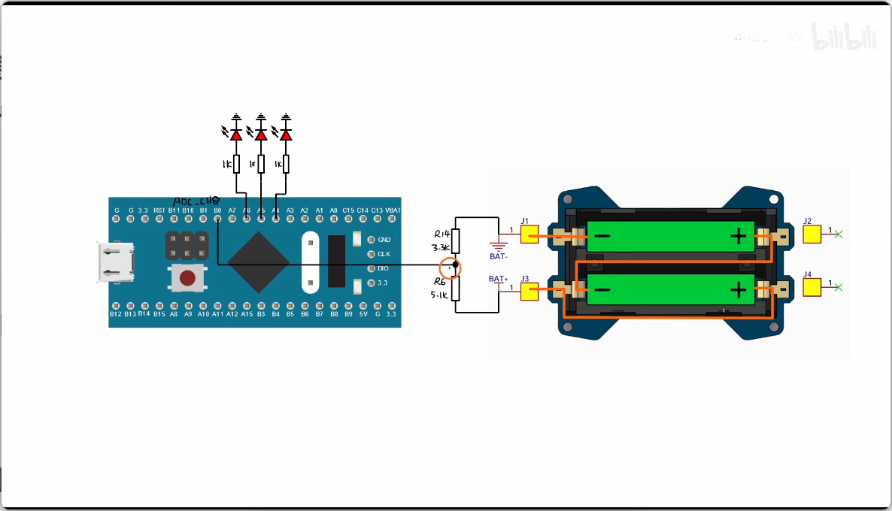
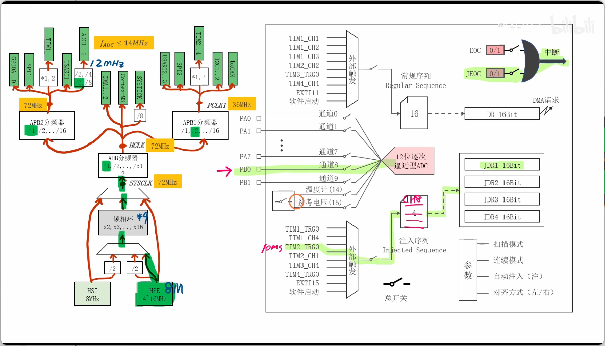
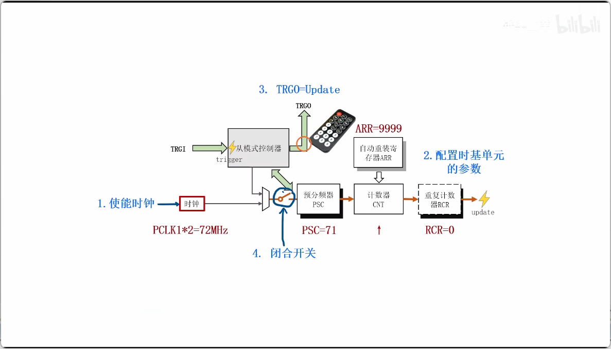

# 1. 平衡车开箱

# 2. 电池
## 2.1 使用ADC采集电池电压
1. 供电流程
2. ADC时钟树&内部结构框图
3. 配置TIM2_TRGO→ 配置ADC的注入序列→ 中断响应函数
4. 代码编写习惯：
	- user: 每一个模块的代码
	- test：测试代码  
5. 定时器从模式控制器
	- 定时器时基单元
	- 定时器从模式控制器（TRGO外部输入时为从机模式，通过从模式计数器产生TRGO发送是主机模式）
	- 
## 2.2 裸机多任务模型和电源指示灯
# 3. 电机
## 3.1 电机调速原理
## 3.2 电机调速代码
# 4. 编码器
## 4.1 位置测量（1）
## 4.2 位置测量（2）
## 4.3 计算减速比
## 4.4 M法测速
## 4.5 T法测速
## 4.6 改进T法测速

