# 1. 平衡车开箱
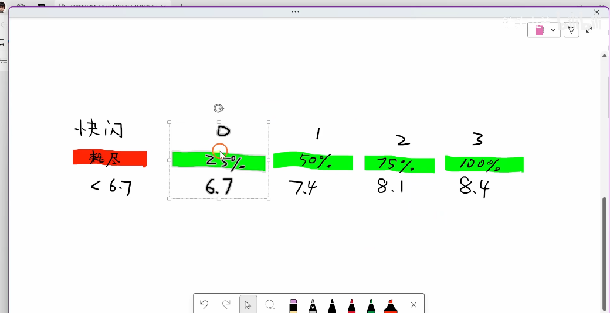
# 2. 电池
## 2.1 使用ADC采集电池电压
1. 供电流程
2. ADC时钟树&内部结构框图
3. 配置TIM2_TRGO→ 配置ADC的注入序列→ 中断响应函数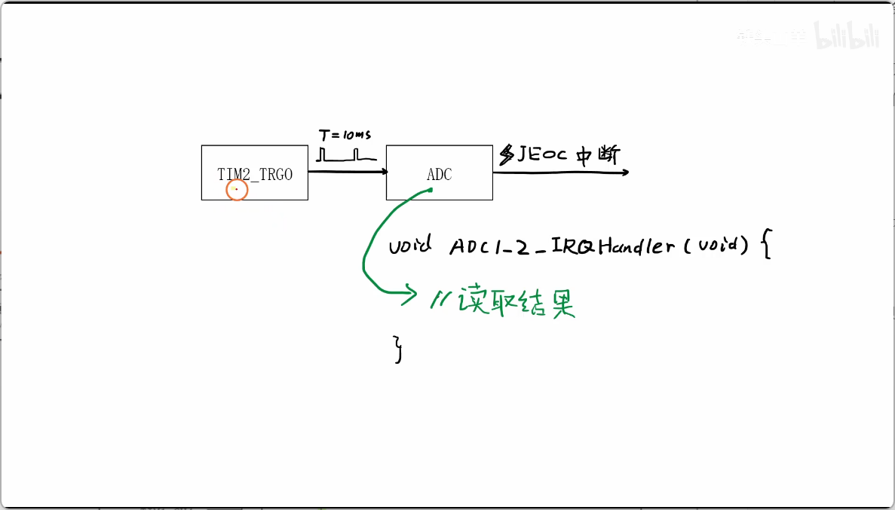
4. 代码编写习惯：
	- user: 每一个模块的代码
	- test：测试代码  
5. 定时器从模式控制器
	- 定时器时基单元
	- 定时器从模式控制器（TRGO外部输入时为从机模式，通过从模式计数器产生TRGO发送是主机模式）
	- 
6. 采样时间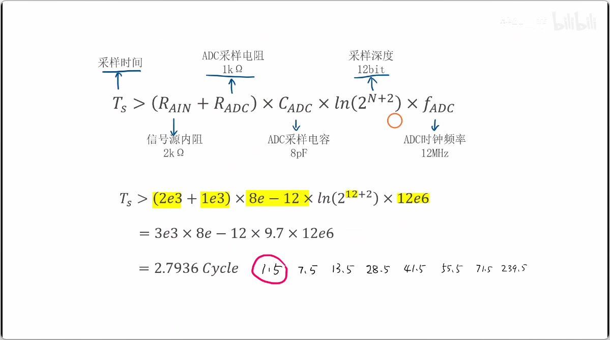
7. 戴维南等效电阻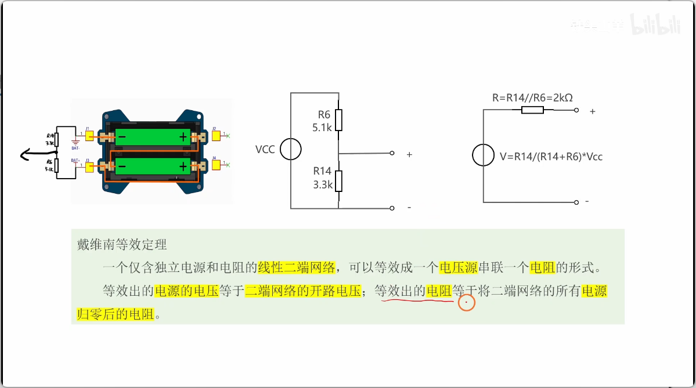
8. 代码编写流程
	- TIM定时器配置
	- ADC时钟和GPIO模拟输入配置
	- ADC1初始化
	- ADC注入序列配置
	- NVIC中断配置
## 2.2 裸机多任务模型和电源指示灯
1. 放电曲线：蓝色（当前电压）  红色（电池放电的电流）                                                                                      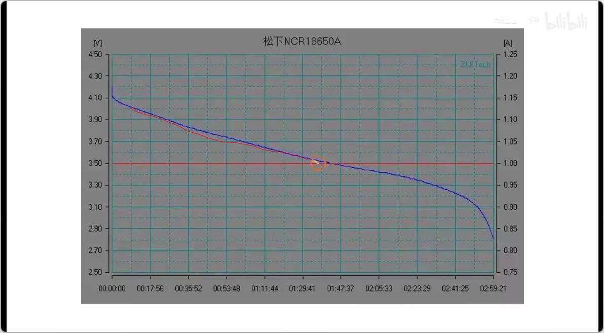
2. 通过判断当前电压所在的电压范围，然后通过3个LED状态实现显示                                                                             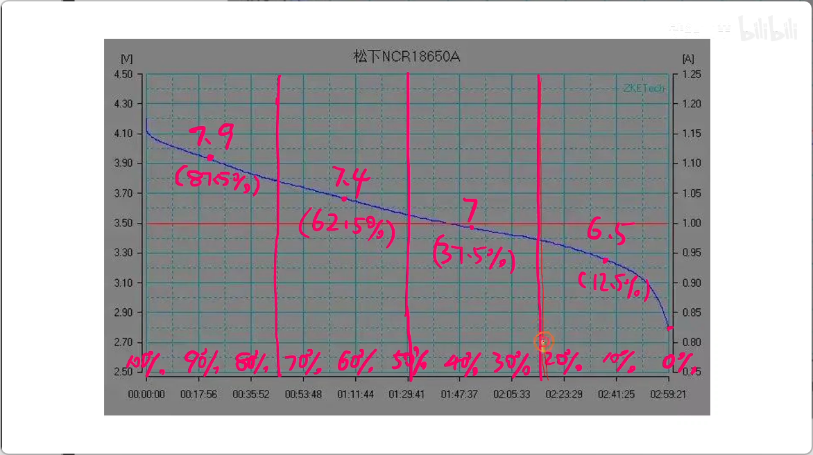
### 2.2.1 裸机多任务编程模型
1. 三个任务切，三个任务切片组合，当切片足够细（执行时间足够短，不允许使用），可以等效为三个任务同时执行 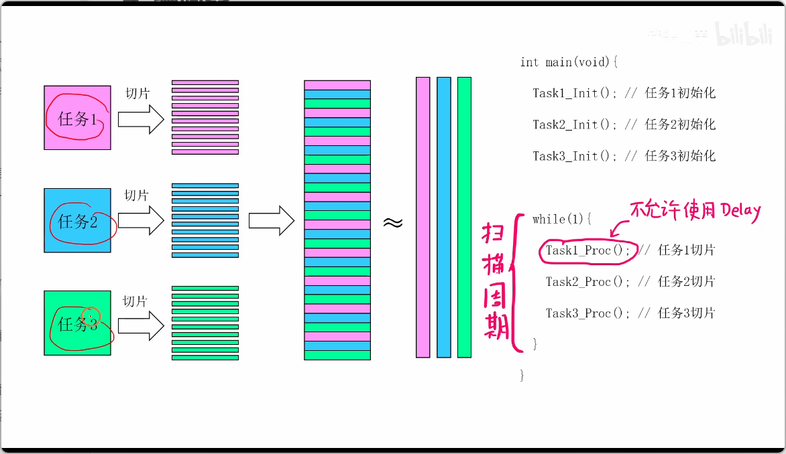
2. 例子：
	- 非裸机多任务模型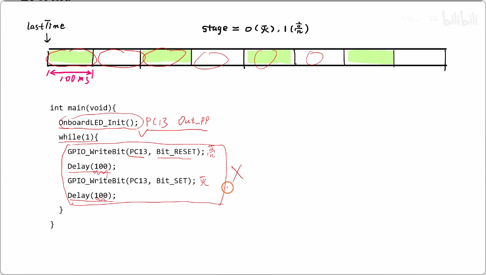
	- 声明两个变量，lastTime(上次切换时间)，stage(记录灯当前状态)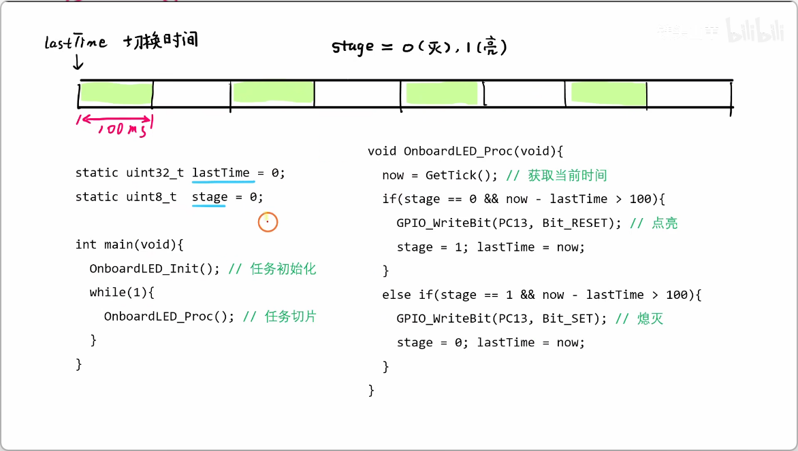
3. 实验现象：拔掉一个电池看看是否闪灯
# 3. 电机
## 3.1 电机调速原理（电机基本原理，H桥调速的基本原理）
直流有刷电机（GA25-370） 
1. 直流有刷电机（GA25-370）有刷（改变电流流动方向）无刷（没有电刷，通过 硬件电路改变电流方向）
	- 电压越高，空载转速越大
	- 电流越大，输出扭矩越大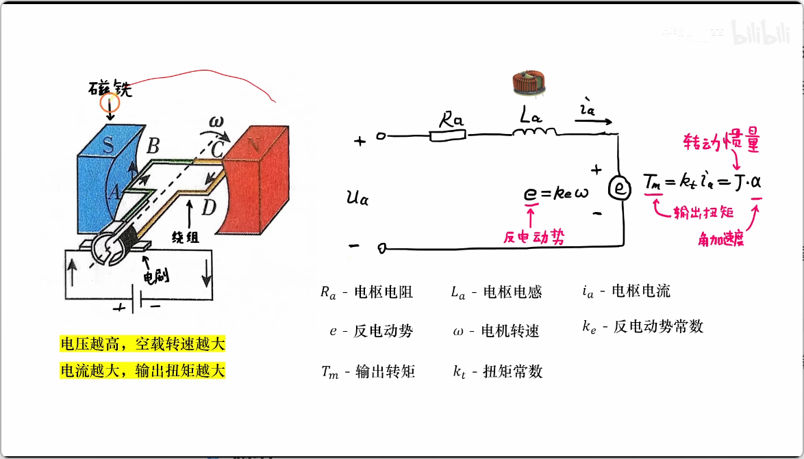
2. 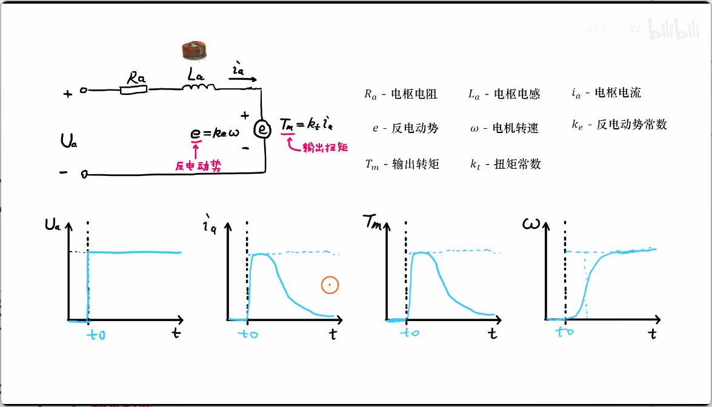
3. H桥，四个MOS管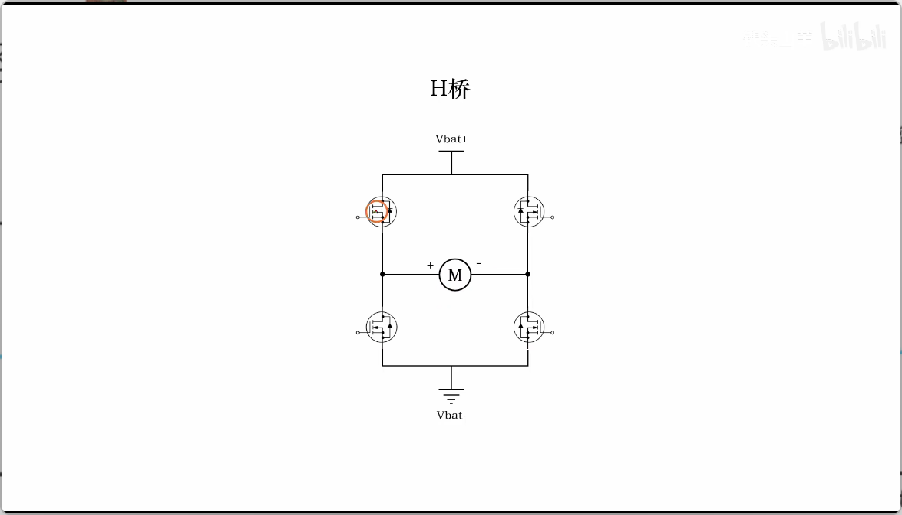
	- 正转：闭合左上角和右下角MOS管，所加电压是正向电压，电机正转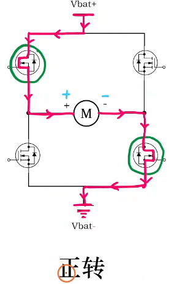
	- 反转：闭合右上角和左下角MOS管，所加电压是反向电压，电机反转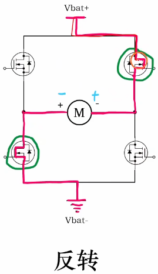
4. 电机调速（正转）：调节$U_a$大小，产生PWM信号，通过调节紫色的PWM信号，从而调节$U_a$的等效电压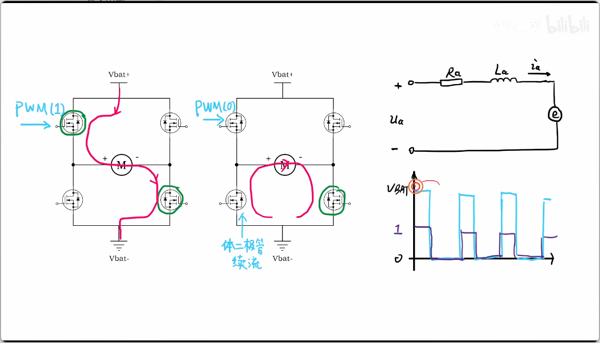
5. TB6612FNG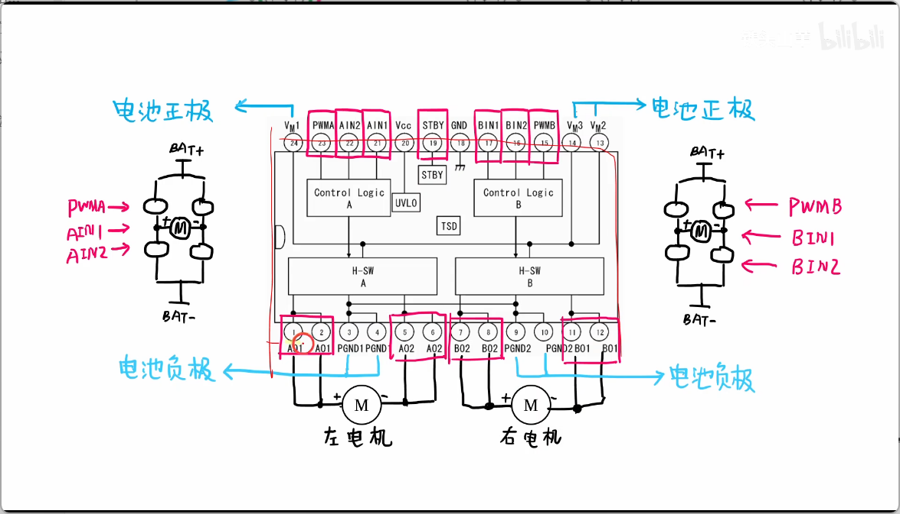
## 3.2 电机调速代码
1. TB6612FNG引脚介绍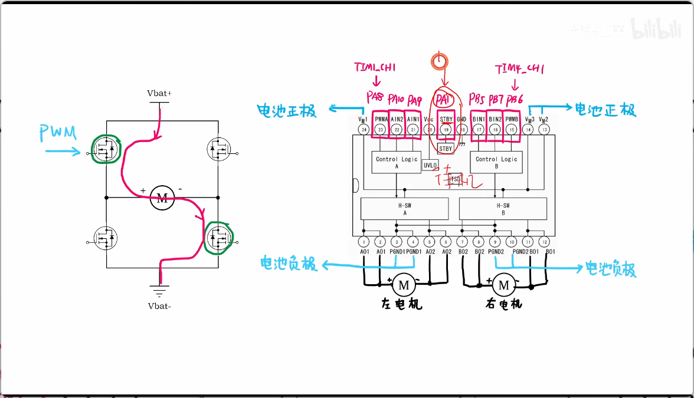
	- STBY-PA1：控制芯片是否进入待机状态
	- 控制信号：AIN1 AIN2（AIN1高电压，AIN2低电压，电机正转，反之则反转）  调节单片机电机速度需要PWMA引脚产生PWM信号
2. 
# 4. 编码器
## 4.1 位置测量（1）
## 4.2 位置测量（2）
## 4.3 计算减速比
## 4.4 M法测速
## 4.5 T法测速
## 4.6 改进T法测速

